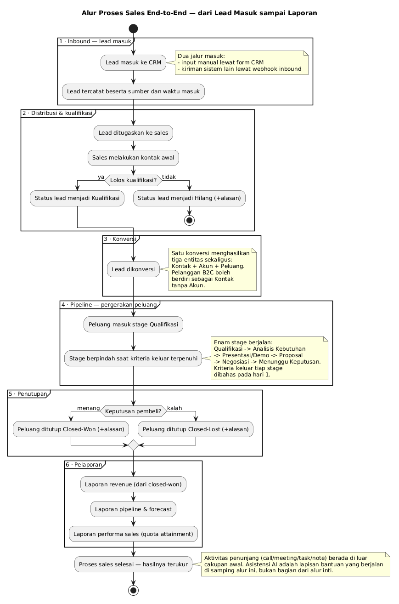
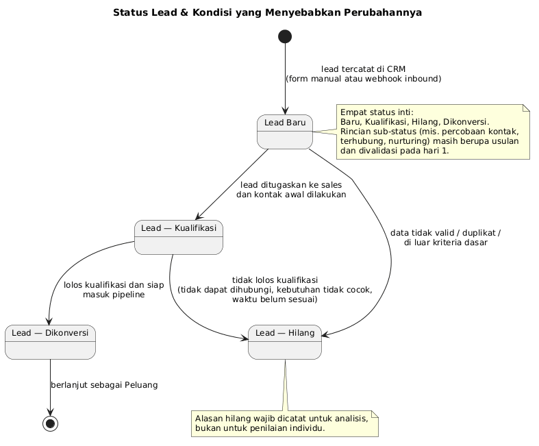

# Spesifikasi Proses Sales — CRM Multi-Tenant TLab

**Disusun Oleh:** Yudha Pratama — PM, berperan sebagai Product Owner
**Pendamping:** BRD CRM Multi-Tenant (`bootcamp-crm-brd-v1.md` v4.0)

> **Versi bersih untuk tim tersedia** —
> `bootcamp-crm-sales-process-specification-v1-clean.md`: isi yang sama tanpa
> sitasi keputusan dan kolom Sumber, untuk dibagikan/dipresentasikan.

> **Kedudukan dokumen ini.** BRD menjawab pertanyaan *"apa yang harus dibangun"*.
> Dokumen ini menjawab pertanyaan yang muncul lebih dulu: *"proses sales yang
> mana yang sedang kita bangun sistemnya"*. Tidak semua anggota tim memiliki
> latar belakang sales, sehingga spesifikasi teknis saja tidak cukup — perlu
> ada satu dokumen yang menjelaskan **kapan proses ini dimulai, apa yang
> terjadi di tengah, dan bagaimana proses ini dinyatakan selesai**.
>
> **Batas lingkup.** Dokumen ini memakai **kasus umum (general case) sales
> B2B/B2C** — bukan proses sales satu industri tertentu. Ia melayani modul
> mandatory M3 (Lead), M4 (Pipeline/Peluang), M2 (Kontak & Akun), dan M7
> (Reporting).

---

## 0. Cara Membaca Dokumen Ini

Setiap butir diberi **status** agar tidak tercampur antara yang sudah
diputuskan dan yang masih usulan:

| Label | Arti |
|---|---|
| **[Ditetapkan]** | Sudah diputuskan PO. Merujuk ke ID di BRD, requirement, atau decision log. Tidak boleh diubah peserta tanpa change request |
| **[Usulan]** | Praktik umum industri atau rancangan PM. **Belum** diputuskan — divalidasi/disempurnakan peserta pada hari 1 |
| **[Belum ada data]** | Dibutuhkan, tetapi datanya belum tersedia. **Tidak diisi dengan angka karangan** |

Singkatan yang dipakai: **BR-nnn** = business requirement di BRD ·
**REQ-nnn** = requirement di requirement-backlog · **DEC-nnn** = keputusan di
decision log.

---

## 1. Proses Sales dalam Satu Paragraf

Proses sales berjalan dalam enam langkah berurutan, dan **berhenti** ketika
hasilnya terukur:

```
1. INBOUND     → lead masuk dan tercatat
2. DISTRIBUSI  → lead ditugaskan ke sales, lalu dikualifikasi
3. KONVERSI    → lead yang lolos menjadi Kontak + Akun + Peluang
4. PIPELINE    → peluang bergerak antar-stage
5. PENUTUPAN   → peluang ditutup menang atau kalah
6. PELAPORAN   → hasilnya diukur: revenue, pipeline, performa sales
```

Dua hal yang harus disepakati lebih dulu, karena keduanya adalah pintu masuk
dan pintu keluar seluruh sistem:

* **Di mana proses ini dimulai?** Saat ada orang yang menunjukkan minat dan
  identitasnya tercatat — bukan saat proposal dikirim.
* **Di mana proses ini selesai?** Saat keputusan pembeli tercatat (menang atau
  kalah **beserta alasannya**), bukan saat uang diterima. Revenue berhenti di
  *deal closed-won* **[Ditetapkan — BR-011, DEC-016]**; modul tagihan/invoice
  di luar lingkup **[BRD §2.2]**.

```
INBOUND ──► DISTRIBUSI ──► KONVERSI ──► PIPELINE ──► PENUTUPAN ──► PELAPORAN
            + kualifikasi  K+A+P        6 stage      won/lost      terukur
```

Diagram alur lengkap tersedia pada **§9 Diagram**.

---

## 2. Aktor & Tanggung Jawab

| Aktor | Peran dalam proses sales | Sumber |
|---|---|---|
| **Sales Rep** | Menangkap lead, melakukan kontak awal, mengualifikasi, mengelola peluang, menutup deal | SH001 [BRD §3] |
| **Sales Manager** | Menugaskan lead, menetapkan kuota bulanan, melihat pipeline tim, membaca laporan performa | SH002 [BRD §3] |
| **Sistem Klien** (di luar CRM) | Mengirim lead ke CRM melalui webhook inbound, tanpa input manual | SH008 [BRD §3] |
| **Manajemen / Head of Sales** | Membaca laporan revenue & pipeline untuk keputusan | SH009 [BRD §3] |
| **Tenant Admin** | Kendali user/role/permission; konfigurasi integrasi webhook | SH005 [BRD §3] |

**Pembatas peran [Ditetapkan — BRD §6.7]:** hanya Sales Manager yang menetapkan
kuota; hanya Tenant Admin yang menyentuh tenancy dan konfigurasi webhook. Sales
Rep tidak dapat menetapkan kuotanya sendiri.

---

## 3. Inbound — Bagaimana Lead Masuk?

### 3.1 Kanal Lead Masuk

| # | Kanal | Deskripsi | Status | Sumber |
|---|---|---|---|---|
| INB-01 | **Input manual lewat form CRM** | Sales mencatat lead yang diperolehnya sendiri (referensi, kartu nama, pameran). | **[Ditetapkan]** | REQ-020, BR-008 |
| INB-02 | **Webhook inbound dari sistem klien** | Sistem lain (landing page, chatbot, form situs, sistem internal) mengirim data lead langsung ke CRM — tanpa input manual. | **[Ditetapkan — prioritas *Should*, bukan *Must*]** | BR-009, BR-025, REQ-016 |
| INB-03 | **Kontak masuk yang sudah punya akun** | Orang dari organisasi yang sudah tercatat menghubungi kembali. Tidak membuat lead baru; langsung menjadi aktivitas pada akun/peluang yang ada. | **[Usulan]** | — |

> **Catatan penting untuk INB-02.** Webhook inbound berstatus *Should*
> **[Ditetapkan — BR-009]**. Artinya bila waktu pengembangan kurang, kanal ini
> boleh tidak selesai tanpa menahan kelulusan. Namun **rancangan titik
> masuknya tetap harus ada sejak M1** agar tidak perlu membongkar core.

### 3.2 Langkah Penanganan Lead Masuk

| # | Langkah | Aktor | Keluaran | Status |
|---|---|---|---|---|
| L-1 | Lead masuk melalui salah satu kanal §3.1 | Sales Rep / Sistem Klien | Record lead mentah | **[Ditetapkan]** |
| L-2 | **Pemeriksaan data minimum** (§3.4) — data tidak lengkap ditolak/ditandai | Sistem | Lead valid, atau ditandai "perlu dilengkapi" | **[Usulan]** |
| L-3 | **Pemeriksaan duplikat** — email/telepon/nama perusahaan sudah ada? | Sistem | Lead digabung atau ditandai duplikat | **[Usulan]** |
| L-4 | Lead ditugaskan ke sales (**routing**, §3.3) | Sales Manager / Sistem | Lead punya pemilik | **[Ditetapkan]** — aktornya Sales Manager (REQ-020, US-003) |
| L-5 | Sales melakukan **kontak awal** (§3.5) | Sales Rep | Percobaan kontak tercatat | **[Usulan]** — aktivitas M5 *nice to have* |
| L-6 | **Kualifikasi** — kebutuhan, wewenang, anggaran, waktu | Sales Rep | Status lead: Kualifikasi atau Hilang | **[Ditetapkan]** — REQ-020 |

Rantai L-1 sampai L-6 inilah arti praktis dari **"lead tercatat dan
terkualifikasi"**. Selama L-4 belum terjadi, lead belum dapat dikatakan
"berjalan"; ia masih milik bersama.

### 3.3 Aturan Distribusi Lead — **[Usulan, perlu validasi hari 1]**

BRD menetapkan **bahwa** lead harus ditugaskan **[BR-008]**, tetapi **belum
menetapkan mekanisme penugasannya**. Tiga pola yang lazim dipakai:

| Pola | Cara kerja | Cocok bila |
|---|---|---|
| *Round-robin* | Lead dibagi merata bergiliran ke sales | Jumlah lead banyak, wilayah tidak berbeda |
| *Territory-based* | Dibagi berdasarkan wilayah/segmen akun | Pasar terbagi jelas (mis. per provinsi, per industri) |
| *Named-account* | Akun tertentu ditangani sales tertentu | Pelanggan enterprise dengan hubungan personal |

> **Belum ada data:** TLab belum memutuskan pola mana yang dipakai CRM.
> **[Belum ada data]** — dibahas di hari 1. Untuk MVP, penugasan manual oleh
> Sales Manager sudah cukup untuk membuktikan alurnya berjalan.

### 3.4 Data Minimum agar Lead Dapat Diterima — **[Usulan, perlu validasi hari 1]**

| Tingkat | Field | Alasan |
|---|---|---|
| **Wajib** (lead ditolak bila kosong) | Nama, **satu kanal kontak yang dapat dihubungi** (email **atau** telepon), **sumber lead** | Tanpa ini lead tidak dapat ditindaklanjuti maupun diukur asalnya |
| **Sangat dianjurkan** | Nama organisasi, kebutuhan awal, pemilik | Menentukan cara tindak lanjut |
| **Opsional** | Jabatan, industri, ukuran organisasi, catatan | Memperkaya data, tidak menahan proses |

> **Perbedaan B2B dan B2C [Ditetapkan — DEC-020]:** pelanggan B2C boleh berdiri
> sebagai **Kontak tanpa Akun** untuk organisasi **[BR-007]**. Karena itu *nama
> organisasi* tidak boleh dijadikan field wajib.

### 3.5 Kecepatan Respons — **[Usulan, didukung rujukan industri]**

Riset *Lead Response Management* (Dr. James Oldroyd, MIT — dipublikasikan
InsideSales/XANT) menemukan bahwa peluang **mengontak** lead turun ~100× bila
dihubungi dalam 30 menit dibanding 5 menit, dan peluang **mengualifikasi** lead
turun ~21×. Studi yang sama juga mencatat rata-rata sales hanya melakukan ~1,3
percobaan kontak sebelum menyerah, sementara 6–9 percobaan dapat menaikkan
tingkat kontak hingga 90%+ (InsideSales).

**Konsekuensi untuk produk kita:** "kecepatan respons lead" adalah kandidat
metrik utama — tetapi **tidak dapat dihitung** pada MVP karena pengukuran lapis
aktivitas memerlukan M5 **[BR-016: Won't di MVP]**. Untuk MVP, kompromi yang
paling murah adalah mencatat **waktu masuk lead** dan **waktu kontak pertama
tercatat** sebagai field, sehingga metriknya dapat dihitung kemudian tanpa
migrasi data.

> **[Belum ada data]:** target waktu respons yang mengikat untuk TLab belum
> ditetapkan. Angka 5 menit di atas adalah **tolok ukur industri dari rujukan**,
> bukan keputusan produk.

---

## 4. Field — Data Apa yang Dibutuhkan?

Field disusun per entitas. Kolom **Wajib?** memakai: **W** = wajib, **A** =
anjuran, **O** = opsional.

### 4.1 Lead (M3) — **[Ditetapkan: BR-008, BR-009, REQ-020]**

| Kode | Field | Wajib? | Keterangan | Sumber |
|---|---|---|---|---|
| FLD-L01 | Nama lead (orang) | W | Identitas calon pelanggan | BR-008 |
| FLD-L02 | Nama organisasi | A | Kosong diperbolehkan untuk B2C | BR-007, DEC-020 |
| FLD-L03 | Jabatan | O | Berguna untuk menilai wewenang | §4.1 usulan |
| FLD-L04 | Email | W* | *Salah satu dari email/telepon wajib ada | §3.4 |
| FLD-L05 | Telepon | W* | *Salah satu dari email/telepon wajib ada | §3.4 |
| FLD-L06 | **Status lead** | W | Baru / Kualifikasi / Hilang / Dikonversi (§5) | REQ-020 |
| FLD-L07 | **Pemilik (sales)** | W | Hasil penugasan §3.3 | BR-008 |
| FLD-L08 | **Sumber lead** | W | Kanal asal lead — dasar analisis kanal | §3.4, INB-01/02 |
| FLD-L09 | Detail sumber | O | Mis. nama kampanye, nama acara | — |
| FLD-L10 | **Waktu masuk** | W | Dasar metrik kecepatan respons §3.5 | §3.5 usulan |
| FLD-L11 | Waktu kontak pertama | A | Diisi saat kontak pertama tercatat | §3.5 usulan |
| FLD-L12 | Kebutuhan awal | A | Ringkasan kebutuhan yang terucap | §4.1 usulan |
| FLD-L13 | Anggaran (kualifikasi) | O | Bila disebutkan calon pelanggan | §4.1 usulan |
| FLD-L14 | Wewenang / pengambil keputusan | O | Siapa yang memutuskan | §4.1 usulan |
| FLD-L15 | Waktu rencana pembelian | O | Kualifikasi waktu | §4.1 usulan |
| FLD-L16 | Rating (hot / warm / cold) | O | Penilaian kasar sales; lihat catatan di bawah | §4.1 usulan |
| FLD-L17 | **Alasan hilang** | W (saat status = Hilang) | Wajib diisi saat lead ditandai hilang | §5.2 usulan |
| FLD-L18 | Catatan bebas | O | Konteks yang tidak masuk field lain | — |
| FLD-L19 | Riwayat perubahan status | W | Jejak: siapa, kapan, dari status apa ke apa | §5.2 usulan |

> **Catatan FLD-L16 (Rating).** Rating berbeda dari *lead scoring*. *Scoring*
> prediktif berbasis data historis **tidak masuk MVP** — masuk fase roadmap
> **[BRD §2.2, EP-016, REQ-049]**. Rating di sini hanya penilaian manual sales.
>
> **Catatan FLD-L19.** Riwayat perubahan status adalah **syarat agar proses
> dapat diaudit dan angka laporan dapat dipertanggungjawabkan**. Tanpa riwayat,
> laporan hanya menampilkan keadaan akhir dan tidak dapat menjawab "sejak kapan
> lead ini menggantung".

### 4.2 Kontak & Akun (M2) — **[Ditetapkan: BR-006, BR-007]**

| Kode | Field | Entitas | Wajib? | Keterangan |
|---|---|---|---|---|
| FLD-K01 | Nama lengkap | Kontak | W | Individu |
| FLD-K02 | Email | Kontak | A | Kanal utama |
| FLD-K03 | Telepon | Kontak | A | Kanal kedua |
| FLD-K04 | Jabatan | Kontak | O | Peran dalam keputusan pembelian |
| FLD-K05 | Akun terkait | Kontak | O | **Kosong diperbolehkan untuk B2C [BR-007]** |
| FLD-A01 | Nama organisasi | Akun | W (bila Akun ada) | Organisasi/perusahaan |
| FLD-A02 | Industri | Akun | O | Segmentasi |
| FLD-A03 | Ukuran organisasi | Akun | O | Indikasi potensi nilai deal |
| FLD-A04 | Alamat / wilayah | Akun | O | Dasar penugasan territori §3.3 |
| FLD-A05 | Situs web | Akun | O | Riset pra-kontak |

### 4.3 Peluang (M4) — **[Ditetapkan: BR-010, BR-010a, BR-011]**

| Kode | Field | Wajib? | Keterangan | Sumber |
|---|---|---|---|---|
| FLD-P01 | Nama peluang | W | Identitas deal | BR-010 |
| FLD-P02 | Akun / Kontak terkait | W | Hasil konversi lead (§5.3) | BR-010 |
| FLD-P03 | **Nilai deal** | W | Sumber hitungan revenue bila menang | BR-010, BR-011 |
| FLD-P04 | **Stage pipeline** | W | Salah satu dari 6 stage (§6) | BR-010a |
| FLD-P05 | **Tanggal tutup (perkiraan)** | W | Dasar laporan pipeline & forecast | BR-010 |
| FLD-P06 | Pemilik (sales) | W | Dasar quota attainment | BR-013 |
| FLD-P07 | **Status akhir** | W (saat ditutup) | Closed-Won / Closed-Lost | BR-010 |
| FLD-P08 | **Alasan menang/kalah** | W (saat ditutup) | Wajib disertai alasan | BR-010 |
| FLD-P09 | Tanggal penutupan aktual | A | Pembanding terhadap perkiraan | §4.3 usulan |
| FLD-P10 | Probabilitas per stage | O | Lihat catatan di bawah | §4.3 usulan |
| FLD-P11 | Sumber peluang | O | Asal kanal, diturunkan dari lead | §4.3 usulan |
| FLD-P12 | Riwayat pergerakan stage | W | Siapa, kapan, dari stage apa ke apa | §6.2 usulan |

> **Catatan FLD-P10 (Probabilitas).** HubSpot memberi *probability* bawaan per
> stage pada pipeline default-nya (mis. *Appointment scheduled* 20%, *Qualified
> to buy* 40%) **[rujukan: HubSpot — default deal stages]**. Ini berguna untuk
> *weighted pipeline*, **tetapi belum diputuskan** untuk produk kita. Bila
> dipakai, angkanya harus ditetapkan per tenant — bukan disalin dari HubSpot.
>
> **Catatan FLD-P08.** Alasan menang/kalah bukan formalitas. Inilah satu-satunya
> data yang menjawab **mengapa** kita kalah, dan tanpanya perbaikan proses hanya
> bisa menebak.

### 4.4 Kuota & Performa (M7) — **[Ditetapkan: BR-012 … BR-015, DEC-035, DEC-039]**

| Kode | Field | Wajib? | Keterangan | Sumber |
|---|---|---|---|---|
| FLD-Q01 | Sales (pemilik kuota) | W | Kuota per individu | BR-012 |
| FLD-Q02 | **Periode kuota** | W | **Bulanan** | DEC-035 |
| FLD-Q03 | Nilai target | W | Target *won* (nilai), bukan jumlah deal | BR-012 |
| FLD-Q04 | Kuota attainment | W (terhitung) | Nilai closed-won ÷ kuota × 100% | BR-013 |
| FLD-Q05 | Status performa | W (terhitung) | Mencapai / tidak mencapai target | BR-014 |
| FLD-Q06 | Ambang batas | W (terhitung) | **Configurable per tenant; default 80%** | BR-014, BR-015, DEC-039 |

### 4.5 Aturan Pengisian Field

| Aturan | Isi | Alasan |
|---|---|---|
| R-1 | Field **W** tidak boleh kosong; sistem menolak simpan | Menjaga data dapat dilaporkan |
| R-2 | Field **A/O** boleh kosong dan **tidak menahan** perpindahan stage | Sales tidak boleh tertahan administrasi |
| R-3 | Alasan wajib diisi **hanya** pada dua titik: status lead → Hilang, dan peluang → ditutup | Dua titik inilah yang diminta analisis |
| R-4 | Field yang menyesuaikan per tenant (mis. ambang 80%) **tidak boleh di-hardcode** | BR-014/DEC-023 |
| R-5 | Setiap field bertipe *configurable per tenant* dicatat pada rancangan M1 sejak awal | Menghindari rework (C-10) |

---

## 5. Status Lead & Kondisi yang Menyebabkan Perubahannya

Bagian ini menjawab pertanyaan *"kapan lead berubah status, dan apa yang
menyebabkannya"*. **Aturan status dibuat satu state machine untuk semua lead** —
tidak dibedakan per jalur masuk (INB-01 vs INB-02) **[Usulan]**. Alasannya: jalur
masuk menentukan *cara memperoleh* lead, bukan *cara mengelolanya*.

### 5.1 Empat Status Inti — **[Ditetapkan: REQ-020 / 01.03.01]**

| # | Status | Arti | Lead masih "hidup"? |
|---|---|---|---|
| LDS-01 | **Baru** | Lead tercatat, belum ada kontak bermakna | Ya |
| LDS-02 | **Kualifikasi** | Sedang/ sudah dinilai: layak lanjut atau tidak | Ya |
| LDS-03 | **Hilang** | Tidak lolos kualifikasi atau tidak layak | Tidak — berhenti di sini |
| LDS-04 | **Dikonversi** | Lolos kualifikasi dan menjadi Peluang | Tidak — berpindah ke siklus peluang |

### 5.2 Transisi & Penyebabnya

| # | Dari | Ke | Kondisi pemicu (yang harus teramati) | Status |
|---|---|---|---|---|
| T-1 | (mulai) | **Baru** | Lead tercatat di CRM — melalui form manual atau webhook inbound | **[Ditetapkan]** |
| T-2 | Baru | **Kualifikasi** | Lead ditugaskan ke sales **dan** kontak awal dilakukan | **[Ditetapkan]** |
| T-3 | Baru | **Hilang** | Data tidak dapat dihubungi **sama sekali**; duplikat dari lead yang sudah ada; di luar cakupan produk sama sekali | **[Usulan]** |
| T-4 | Kualifikasi | **Hilang** | Tidak dapat dihubungi setelah beberapa percobaan; kebutuhan tidak cocok dengan produk; **waktu belum sesuai** | **[Usulan]** |
| T-5 | Kualifikasi | **Dikonversi** | Lolos kualifikasi dan layak masuk pipeline | **[Ditetapkan]** |

**Aturan pengisian alasan (T-3/T-4):** alasan hilang **wajib dicatat** dan
dipakai untuk analisis kanal serta perbaikan pesan — **bukan untuk penilaian
individu** (BRD Diagram 4, catatan pada state Hilang).

> **Penting — "Hilang" bukan "Gagal".** Lead berstatus *Hilang* berarti **belum
> cocok sekarang**. Kategori "waktu belum sesuai" sengaja dipisahkan dari
> "kebutuhan tidak cocok", karena yang pertama berpotensi dihubungi kembali di
> lain waktu, sedangkan yang kedua tidak. Tanpa pemisahan ini, proses *nurturing*
> di masa depan tidak punya data untuk bekerja.

### 5.3 Konversi — Satu Aksi, Tiga Entitas — **[Ditetapkan: BR-008]**

Konversi lead menghasilkan **tiga entitas sekaligus**:

```
Lead (Dikonversi)
      ├──► Kontak   (orangnya)
      ├──► Akun     (organisasinya — OPSIONAL untuk B2C)
      └──► Peluang  (deal-nya) ── masuk stage Qualifikasi
```

* **Kontak tidak dihapus saat Akun tidak ada** — pelanggan B2C sah berdiri
  sebagai Kontak tanpa Akun **[BR-007, DEC-024]**.
* Lead yang sudah dikonversi **berhenti menjadi lead**; ia tidak lagi muncul di
  daftar lead aktif, tetapi datanya tetap tersedia untuk pelaporan.

### 5.4 Sub-Status — **[Usulan, perlu validasi hari 1]**

Empat status inti di atas **cukup untuk menjalankan MVP**, tetapi sering
dianggap terlalu kasar dalam praktik. Praktik industri memecahnya lebih detail —
mis. HubSpot memakai *Lead Status* sebagai sub-status di dalam tahap *Sales
Qualified Lead*, dengan pilihan bawaan: *New, Open, In Progress, Open Deal,
Unqualified, Attempted to Contact, Connected, Bad Timing*
**[rujukan: HubSpot — lifecycle stages & lead status]**.

| Usulan sub-status | Induk | Gunanya |
|---|---|---|
| Percobaan kontak | Baru | Menandai sudah dihubungi namun belum tersambung |
| Terhubung | Kualifikasi | Percakapan sudah terjadi, kualifikasi berjalan |
| Nurturing | Hilang | Tidak cocok sekarang, layak dihubungi kembali |
| Waktu belum sesuai | Hilang | Alasan spesifik, memisahkan dari "kebutuhan tidak cocok" |

> **Keputusan yang diminta di hari 1:** apakah MVP memakai **4 status inti saja**
> (lebih sederhana, lebih cepat dibangun) atau **4 status + sub-status**
> (lebih informatif, menambah beban rancangan). Rekomendasi PM: **mulai dari 4
> status inti**, dan pastikan strukturnya memungkinkan penambahan sub-status
> tanpa migrasi data.

---

## 6. Workflow & Pipeline

### 6.1 Enam Stage Berjalan + Dua Outcome — **[Ditetapkan: BR-010a, DEC-047]**

| # | Stage | Yang dinilai pada tahap ini | Status |
|---|---|---|---|
| STG-1 | **Qualifikasi** | Apakah peluang ini layak dikerjakan sama sekali | **[Ditetapkan]** |
| STG-2 | **Analisis Kebutuhan** | Kebutuhan dan cakupan solusi digali bersama calon pelanggan | **[Ditetapkan]** |
| STG-3 | **Presentasi / Demo** | Solusi diperlihatkan dan diuji | **[Ditetapkan]** |
| STG-4 | **Proposal** | Penawaran/estimasi disampaikan | **[Ditetapkan]** |
| STG-5 | **Negosiasi** | Harga dan syarat dibahas | **[Ditetapkan]** |
| STG-6 | **Menunggu Keputusan** | Menunggu keputusan akhir pembeli | **[Ditetapkan]** |
| OUT-1 | **Closed-Won** | Menang — **wajib disertai alasan** | **[Ditetapkan]** |
| OUT-2 | **Closed-Lost** | Kalah — **wajib disertai alasan** | **[Ditetapkan]** |

**Mengapa 6, bukan 7 [Ditetapkan — BRD §4.4]:** tahap *prospecting* pada rujukan
industri sudah dilayani **M3 Lead Management**. Menambahkannya sebagai stage
peluang akan menduplikasi M3. Karena itu pipeline peluang dimulai dari
**Qualifikasi** — yaitu saat peluang terbentuk dari konversi lead.

**Configurable per tenant**; pelanggan B2C boleh memakai alur lebih pendek
**[BR-010a]**.

### 6.2 Kriteria Keluar per Stage — **[Usulan, WAJIB divalidasi hari 1]**

> **Peringatan yang harus dibaca peserta.** BRD mencatat bahwa **exit criteria
> per stage masih terbuka** dan divalidasi pada hari 1 **[BRD §4.4, §9.1 butir 1]**.
> Tabel di bawah adalah **titik awal**, bukan keputusan.

Peringatan praktik industri yang perlu dipegang **[BRD §4.4]:** stage yang
mendeskripsikan **tindakan sales** kurang bermakna sebagai indikator. Contoh
yang sering dikritik adalah *"Proposal Sent"* — mengirim proposal adalah
tindakan **kita**, bukan tanda bahwa **pembeli** sudah bergerak. Setiap kriteria
keluar sebaiknya menjawab: *"apa yang sudah **dilakukan atau disetujui pembeli**?"*

| Stage | Kriteria masuk | Kriteria keluar — yang sudah dilakukan **pembeli** | Sumber kriteria |
|---|---|---|---|
| STG-1 Qualifikasi | Peluang terbentuk dari konversi lead | Pembeli mengonfirmasi ada kebutuhan nyata, ada anggaran, dan ada pihak yang berwenang memutuskan | **[Usulan]** |
| STG-2 Analisis Kebutuhan | — | Pembeli menyetujui ringkasan kebutuhan/cakupan solusi yang kita tuliskan | **[Usulan]** |
| STG-3 Presentasi / Demo | — | Solusi sudah diperlihatkan dan **diuji**; pembeli menyatakan cocok untuk kebutuhannya | **[Usulan]** |
| STG-4 Proposal | — | Penawaran sudah **diterima dan dibahas** — bukan sekadar terkirim | **[Usulan]** |
| STG-5 Negosiasi | — | Harga dan syarat sedang dibahas aktif; ada usulan balik dari pembeli | **[Usulan]** |
| STG-6 Menunggu Keputusan | — | Pembeli menyatakan keputusan tinggal menunggu proses internalnya | **[Usulan]** |

> **Batas tegas STG-4 dan STG-5 [BRD §4.4].** *Proposal* dan *Menunggu Keputusan*
> **harus dibedakan tegas** agar tidak tumpang tindih. Pembeda yang dipakai:
> *Proposal* = penawaran sedang **dipertimbangkan**; *Menunggu Keputusan* =
> penawaran sudah **disetujui isinya**, tinggal keputusan formal.

### 6.3 Kondisi yang Menyebabkan Peluang Berpindah Stage

| # | Pergerakan | Kondisi | Status |
|---|---|---|---|
| M-1 | **Maju** satu stage | Kriteria keluar stage saat ini terpenuhi | **[Usulan]** |
| M-2 | **Mundur** satu stage | Terjadi temuan baru yang membatalkan asumsi stage sebelumnya (mis. anggaran ternyata belum ada) | **[Usulan]** |
| M-3 | **Mundur lebih dari satu stage** | Perubahan lingkup besar atau pergantian pihak yang berwenang | **[Usulan]** |
| M-4 | **Ditutup menang** | Pembeli menyatakan setuju | **[Ditetapkan]** |
| M-5 | **Ditutup kalah** | Pembeli menyatakan tidak lanjut, atau tidak ada respons dalam waktu lama | **[Ditetapkan]** |
| M-6 | **Pindah pemilik** | Sales pengampu berganti (mutasi/keluar) | **[Usulan]** |

> **Pergerakan mundur (M-2/M-3) harus diizinkan, bukan disembunyikan.** Pipeline
> yang hanya bisa maju memaksa sales membiarkan deal mati di stage tinggi agar
> tidak terlihat mundur — ini merusak akurasi forecast. Setiap pergerakan mundur
> dicatat di riwayat (FLD-P12) beserta alasannya.

### 6.4 Aturan Disiplin Pipeline — **[Usulan]**

Aturan berikut **belum ditetapkan** dan perlu keputusan hari 1:

| Kode | Aturan yang diusulkan | Pertanyaan yang menyertainya |
|---|---|---|
| D-1 | Peluang tanpa perubahan stage selama **N hari** ditandai *stale* dan muncul di daftar perhatian Sales Manager | Berapa nilai **N**? **[Belum ada data]** |
| D-2 | Peluang yang melewati **tanggal tutup** (FLD-P05) ditandai terlambat dan wajib diperbarui tanggalnya | Perbarui otomatis atau manual? |
| D-3 | Peluang tidak boleh ditutup menang tanpa akun/kontak terkait | — |
| D-4 | Perpindahan stage dicatat di riwayat; pergerakan mundur wajib beralasan | — |

---

## 7. Report — Laporan Apa yang Dibutuhkan?

### 7.1 Laporan Wajib — **[Ditetapkan: BR-029, BR-030, BR-031]**

| # | Laporan | Isi | Pemakai | Prioritas | Sumber |
|---|---|---|---|---|---|
| RPT-01 | **Laporan Revenue** | Rekap nilai *closed-won* per periode | Manajemen / Head of Sales | **Must** | BR-029, REQ-026 |
| RPT-02 | **Laporan Pipeline & Forecast** | Rekap pipeline berjalan dan proyeksi | Sales Manager | *Should* | BR-030, REQ-027 |
| RPT-03 | **Laporan Performa Sales** | *Quota attainment* per sales | Sales Manager | **Must** | BR-031, REQ-028 |
| RPT-04 | **Laporan Ambang Performa** | Status mencapai/tidak mencapai target per sales, ambang configurable (default 80%) | Sales Manager | **Must** | BR-014, BR-015, DEC-039 |
| RPT-05 | **Laporan Kuota** | Kuota bulanan per sales beserta realisasinya | Sales Manager | **Must** | BR-012, BR-013 |

> **Laporan tiket dan laporan SLA tidak ada di sini [Ditetapkan — DEC-043].**
> Ticketing adalah domain *service*, bukan domain sales; ia berada di luar
> lingkup produk ini.

### 7.2 Metrik Tambahan — **[Usulan, hasil riset; sebagian sudah diusulkan PM]**

Riset PM (lihat `requirement-analysis.md` §5.4) sudah mengusulkan beberapa
metrik yang **murah dihitung dari data yang sudah ada** dan **belum masuk
keputusan**:

| # | Metrik | Rumus | Status |
|---|---|---|---|
| RPT-06 | **Win rate per sales** | Won ÷ (won + lost) | **[Usulan]** |
| RPT-07 | **Average deal size** | Total nilai won ÷ jumlah won | **[Usulan]** |
| RPT-08 | **Leaderboard sales** | Peringkat sales menurut attainment | **[Usulan]** |
| RPT-09 | **Revenue per kanal** | Rekap closed-won per sumber lead (FLD-L08) | **[Usulan]** — memerlukan FLD-L08 diisi konsisten |
| RPT-10 | **Alasan kalah teratas** | Distribusi alasan pada Closed-Lost (FLD-P08) | **[Usulan]** — paling murah, paling informatif |
| RPT-11 | **Pipeline coverage ratio** | Total nilai pipeline ÷ target periode; tolok ukur lazim 3×–4× **[rujukan industri]** | **[Belum ada data]** — menunggu M5 & data historis |
| RPT-12 | **Sales cycle length** | Rata-rata hari dari peluang dibuat hingga ditutup | **[Belum ada data]** — menunggu data historis |
| RPT-13 | **Conversion rate antar-stage** | Peluang yang maju ÷ peluang yang masuk stage | **[Belum ada data]** — menunggu data historis |

> **Tiga metrik terakhir (RPT-11 s/d RPT-13) sengaja ditandai belum ada data.**
> Ketiganya memerlukan **riwayat** yang belum dimiliki tenant baru — alasan yang
> sama dengan penundaan AI prediktif ke fase roadmap **[BRD §2.2, EP-016]**.
> Mencantumkan angkanya sekarang berarti menciptakan target fiktif.

### 7.3 Irama Review — **[Usulan berbasis praktik industri]**

| Lapis | Yang dilihat | Irama | Tersedia di MVP? |
|---|---|---|---|
| **Aktivitas** (leading) | Kontak, percobaan, pertemuan | Harian | **Tidak** — memerlukan M5 [BR-016] |
| **Pipeline** (leading) | Pergerakan deal, coverage, usia deal | Mingguan | Sebagian — RPT-02 & §6.4 |
| **Outcome** (lagging) | Win rate, deal size, quota attainment | Bulanan | **Ya** — RPT-01, RPT-03, RPT-04 |

> **Implikasi yang perlu disadari tim:** MVP kita **hanya kuat pada lapis
> outcome**. Artinya, di minggu-minggu awal, sistem dapat memberi tahu *apakah
> target tercapai*, tetapi belum dapat memberi tahu *mengapa* — karena
> indikator penyebabnya (aktivitas) berada di M5. Ini konsekuensi sadar dari
> pemotongan lingkup **[BR-016: Won't di MVP]**, bukan kelalaian.

---

## 8. Yang Belum Diputuskan — Bahan Hari 1

Seluruh butir di bawah ini **tidak boleh diisi dengan asumsi**. Daftar ini
adalah bahan validasi pada hari 1 — **tidak diberi nomor Q baru**; pencatatannya
di `requirement-analysis.md` §7 hanya dilakukan bila PO memutuskan salah satu
butir perlu ditelusuri terpisah.

| # | Pertanyaan | Konteks | Pemilik | Dampak bila tidak dijawab hari 1 |
|---|---|---|---|---|
| BUKA-01 | Pola distribusi lead mana yang dipakai (round-robin / territory / named-account)? | §3.3 | PO + peserta | Penugasan lead tidak konsisten antar tim |
| BUKA-02 | Apa daftar data minimum yang **tegas** untuk sebuah lead (mana yang menolak simpan)? | §3.4 | PO + peserta | Kualitas data laporan tidak seragam |
| BUKA-03 | Apakah MVP memakai **4 status inti** atau **4 status + sub-status**? | §5.4 | PO + peserta | Rework pada rancangan status |
| BUKA-04 | **Exit criteria** untuk masing-masing 6 stage | §6.2 | PO + peserta | Pergerakan peluang tidak konsisten — **sudah tercatat sebagai item hari 1 di BRD §9.1** |
| BUKA-05 | Berapa ambang hari sebuah deal disebut *stale*? Apakah tanggal tutup lewat diperbarui otomatis? | §6.4 | PO + peserta | Pipeline menumpuk tanpa deteksi |
| BUKA-06 | Apakah pergerakan stage **mundur** diizinkan, dan apakah wajib beralasan? | §6.3 | PO + peserta | Akurasi forecast tidak dapat dijaga |
| BUKA-07 | Apakah **probabilitas per stage** dipakai, dan berapa nilainya per tenant? | §4.3 catatan | PO + peserta | *Weighted pipeline* tidak dapat dihitung |
| BUKA-08 | Target waktu respons lead — apakah ditetapkan sebagai angka, atau cukup diukur? | §3.5 | PO + peserta | Metrik kecepatan respons tidak punya kriteria |
| BUKA-09 | Apakah sub-status "Nurturing" diperlukan sejak MVP? | §5.2/§5.4 | PO + peserta | Lead "belum cocok" hilang tanpa jalur tindak lanjut |

**Butir yang sudah tertutup dan tidak perlu dibahas ulang:** nama & jumlah stage
(BR-010a/DEC-047), periode kuota (DEC-035), ambang default 80% (DEC-039),
tujuan revenue = closed-won (DEC-016), dukungan B2B + B2C (DEC-020), aktivitas &
pipeline di luar MVP (BR-016).

---

## 9. Diagram

| Diagram | Isi | Berkas |
|---|---|---|
| **Proses Sales End-to-End** | Alur dari lead masuk sampai laporan, dalam 6 partisi | `diagrams/11-alur-proses-sales-end-to-end.png` |
| **Status Lead & Pemicu Perubahannya** | State machine 4 status beserta kondisi transisinya | `diagrams/12-status-lead.png` |
| Siklus Hidup Lead → Peluang | Hubungan lead, konversi, dan pipeline (dari BRD) | `diagrams/04-siklus-lead-peluang.png` |

### 9.1 Diagram — Alur Proses Sales End-to-End



*Poin kunci:* proses **dimulai** saat lead tercatat dan **berakhir** saat
laporan sales dapat ditampilkan. Aktivitas penunjang dan asistensi AI berjalan
**di samping** alur ini, bukan di dalamnya.

### 9.2 Diagram — Status Lead & Kondisi Perubahannya



*Poin kunci:* empat status, lima transisi, dan satu aturan yang mengikat —
**perubahan ke status Hilang selalu wajib disertai alasan.**

---

## 10. Rujukan

**Dokumen internal project `bootcamp-crm`:**

* BRD CRM Multi-Tenant — `requirements/brd/bootcamp-crm-brd-v1.md` (v4.0)
* Requirement Analysis — `requirements/requirement-analysis.md` (§5.4 metrik, §5.7 stage)
* Requirement Backlog — `requirements/requirement-backlog.md`
* Decision Log — `decisions/decision-log.md`
* Riwayat BRD — `requirements/brd/brd-changelog.md`

**Rujukan praktik industri (untuk bagian berlabel [Usulan]):**

* HubSpot — default lifecycle stages, lead status, dan deal stages
  (`knowledge.hubspot.com`).
* Salesforce — pemisahan domain Sales Cloud vs Service Cloud **[dipakai DEC-043]**.
* Oldroyd, J. — *Lead Response Management Study*, MIT / InsideSales-XANT
  (kecepatan respons lead) (§3.5).
* BANT vs MEDDIC/GPCT — kerangka kualifikasi lead (§3.2 L-6).
* Referensi metrik pipeline (win rate, average deal size, sales cycle length,
  pipeline coverage ratio) — tolok ukur industri (§7.2).

**Catatan metodologis:** seluruh angka industri di atas dipakai sebagai
**tolok ukur pembanding**, bukan sebagai target atau keputusan produk. Angka
yang belum ditetapkan untuk produk kita tetap ditandai **[Belum ada data]**.

**Berkas pendamping:**

* `bootcamp-crm-sales-process-specification-v1-clean.md` — versi bersih untuk
  dibagikan/dipresentasikan ke tim (tanpa sitasi keputusan, kolom Sumber, dan
  wikilink).
* `sales-process-spec-changelog.md` — riwayat perubahan dokumen ini, dipisah
  agar badan dokumen tetap bersih.

---

## Related

- [[bootcamp-crm-brd-v1]]
- [[requirement-analysis]]
- [[requirement-backlog]]
- [[decision-log]]
- [[brd-changelog]]
