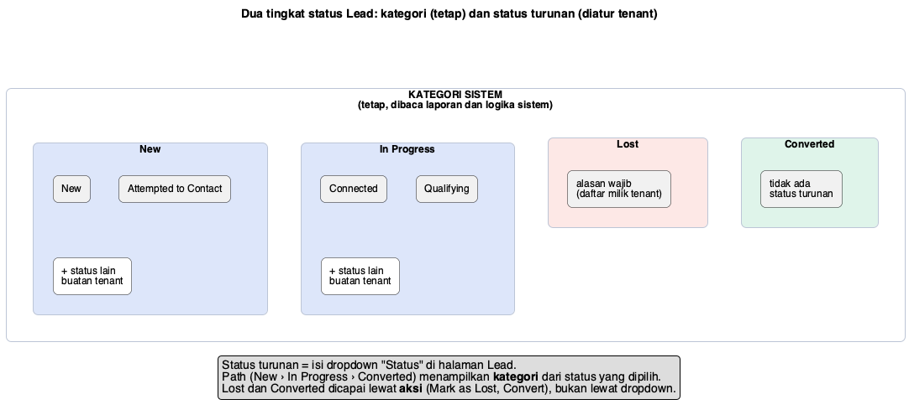
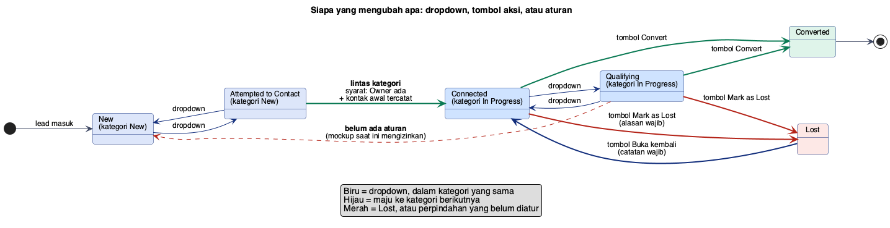
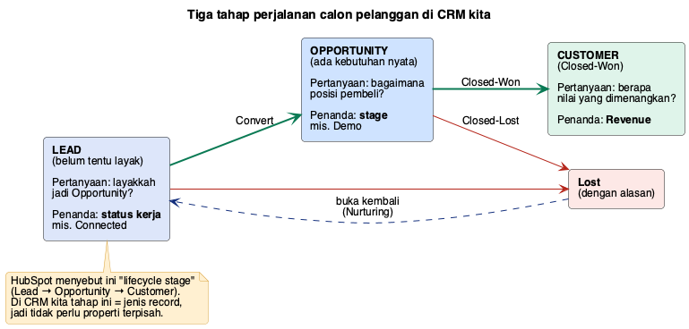
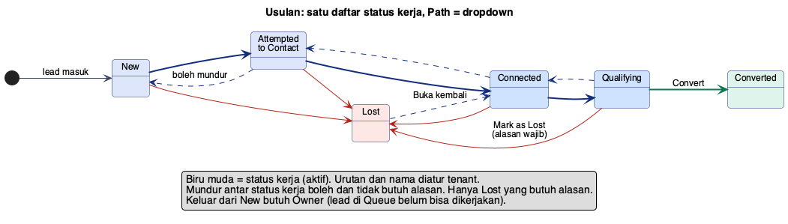

# Status Lead: kategori dan status turunan

## Dua tingkat

| Tingkat | Siapa yang mengatur | Dipakai untuk |
|---|---|---|
| **Kategori** (New, In Progress, Lost, Converted) | Sistem, tetap | Path di halaman Lead, laporan, logika (mis. "lead aktif") |
| **Status turunan** (mis. Connected) | Tenant | Dropdown "Status", detail kerja Sales |

Setiap status turunan **milik tepat satu kategori**. Memilih status di dropdown berarti memilih
kategorinya juga, sehingga Path berubah mengikuti dropdown.

## Cara berpindah

| Cara | Contoh | Catatan |
|---|---|---|
| **Dropdown** | Connected → Qualifying | Bebas dalam kategori yang sama |
| **Dropdown lintas kategori** | Attempted to Contact → Connected | Perlu Owner dan kontak awal tercatat |
| **Tombol aksi** | Mark as Lost, Convert, Buka kembali | Satu-satunya jalan ke Lost dan Converted |
| **Otomatis** | Lead masuk → New | Sistem |

## Perilaku mockup saat ini dibanding spesifikasi

| Hal | Mockup saat ini | Spesifikasi |
|---|---|---|
| Dropdown berisi | 4 status (New dan In Progress) | Sama; Lost dan Converted hanya lewat tombol |
| In Progress → New lewat dropdown | **Diizinkan** | **Tidak ada aturan** |
| New → In Progress lewat dropdown | Diizinkan tanpa syarat | Syarat: Owner ada + kontak awal tercatat (T-2) |
| Lead tanpa Owner | Dropdown nonaktif | Sesuai |

Dua baris tengah adalah celah yang perlu diputuskan.

---

# Usulan penyederhanaan (berdasarkan praktik platform lain)

## Apa yang dilakukan platform lain

| Platform | Cara memodelkan | Catatan |
|---|---|---|
| **HubSpot** | **Dua properti terpisah**: *Lifecycle stage* (posisi di funnel: Subscriber, Lead, MQL, SQL, Opportunity, Customer; **tidak pernah mundur**) dan *Lead status* (kerja Sales: New, Open, In Progress, Open Deal, Unqualified, Attempted to Contact, Connected, Bad Timing; **boleh bolak-balik**) | Lead status dipakai untuk "mendaur ulang" lead tanpa mengubah lifecycle |
| **Salesforce** | **Satu** daftar Lead Status, ditambah penanda sistem *converted* | Nilai bawaan yang beredar: Open – Not Contacted, Working – Contacted, Closed – Converted, Closed – Not Converted (sumber tidak seragam) |
| **Zoho** | **Satu** daftar status (Not Contacted, Attempted to Contact, Contacted, Qualified, Not Qualified, Junk Lead, dst.) | Semua status dianggap "terbuka"; status Lost buatan sendiri tidak bisa difilter sebagai tertutup |
| **Pipedrive** | Tidak ada status; Leads Inbox terpisah dari Deals | Lead tidak bergerak antar stage |

**Pola yang konsisten:** status lead adalah **status kerja** ("apa yang sedang dilakukan Sales pada lead ini?"), satu daftar, boleh
bolak-balik, dan ada penanda sistem untuk "sudah menjadi opportunity" dan "tertutup". Dua tingkat seperti HubSpot ada karena HubSpot
punya fungsi marketing (MQL/SQL) yang tidak kita punya.

## Mengapa model kita terasa membingungkan

1. **Kategori dan status turunan menampilkan hal yang sama dua kali** (Path dan dropdown).
2. **"New / In Progress" terlalu umum**, seperti status tugas. Tidak menjawab "apa yang harus dilakukan Sales selanjutnya?".
3. **Path 3 langkah menyiratkan jalur lurus**, padahal lead bisa Lost kapan saja, dan "Converted" bukan langkah kerja melainkan hasil.
4. Dropdown bisa mengubah apa saja karena aturan antar-status belum ditegaskan.

## Usulan

| Hal | Usulan |
|---|---|
| **Satu daftar status kerja**, urutan dan nama diatur tenant | Bawaan: New → Attempted to Contact → Connected → Qualifying |
| **Path = dropdown** | Satu kontrol saja; klik langkah di Path atau pilih di dropdown (mobile) |
| **Converted dan Lost** | Hasil akhir, bukan langkah kerja. Lewat tombol Convert dan Mark as Lost |
| Penanda sistem | Setiap status punya jenis: **Aktif**, **Converted**, atau **Lost**. Laporan membaca jenis, bukan nama |
| Mundur antar status kerja | Boleh, tanpa alasan (taruhannya kecil, berbeda dengan stage Opportunity) |
| Keluar dari New | Perlu Owner (lead di Queue belum dikerjakan) |
| Waktu kontak pertama | Terisi otomatis dari Activity pertama yang tercatat |
| Lifecycle stage | **Tidak perlu properti terpisah**: Lead → Opportunity → Customer sudah berupa jenis record |
