# Dokumen Spesifikasi Fungsional — Integrasi BP Tapera (BSB Sumsel Babel)

## FSD FINAL — Penyesuaian CR Konsolidasi API H2H Tapera v0.8.8

**No. Dokumen:** 20261013.TAPERA.FSD-CR-FINAL-01
**Versi:** 1.0 (FINAL)
**Tanggal:** 13 Oktober 2026
**Product:** Integrasi BP Tapera
**Stream:** Functional Specification Document (delta berbasis Change Request)
**Klien:** Bank Sumsel Babel (BSB)
**Vendor:** PT Teknologi Kode Indonesia (TLab)
**Dibuat oleh:** Yudha Pratama (Project Manager)
**Disetujui oleh:** Noverdian (IT Manager BSB) — *menunggu*

> **Sifat dokumen.** Ini adalah **FSD delta** — hanya mencakup perubahan atas FSD existing (`20241001.TAPERA.FSD-*.1.2`) yang timbul dari 3 Change Request aktif. Bagian yang tidak disebut di sini **tidak berubah** dan tetap mengacu ke FSD existing.
>
> **Sumber tunggal.** Lingkup, item pekerjaan, estimasi, dan urutan eksekusi mengacu ke **`CR-CONSOLIDATED-v2-TSD-v086-v088.md` v2.1** (source of truth internal) yang menaungi 3 CR aktif. Dokumen ini tidak menambah lingkup di luar ketiga CR tersebut.
>
> **Catatan mode dokumen.** Template FSD `system-analysis-tlab` mensyaratkan **split mode** bila use case > 5. Dokumen ini **sengaja monolitik** karena (a) ini FSD delta CR, bukan FSD green-field, dan (b) PM memutuskan satu master dokumen sebagai rujukan tunggal tim bisnis & tim teknis. Indeks use case disediakan di §3.0.
>
> **Status verifikasi.** Klaim teknis pada dokumen ini ditandai sumbernya: **[KODE]** = diverifikasi langsung ke `source-code/project-bsb-tapera/code-repo/`, **[CR]** = dari dokumen CR/TSD resmi, **[FSD]** = dari FSD existing, **[Perlu validasi]** = belum dapat diverifikasi dari dokumen/kode yang tersedia.

---

## 1. Pendahuluan

### 1.1 Tujuan Dokumen

Dokumen Spesifikasi Fungsional (FSD) ini menyediakan informasi detail tentang **perubahan perilaku sistem** yang diperlukan akibat rilis TSD Mitra Penyalur BP Tapera v0.8.6–v0.8.8, kebijakan KPR Sejahtera FLPP (Kepmen PKP 1721/1722 Tahun 2026), dan permintaan Divisi Bisnis BSB atas validasi form pengajuan. Dokumen ini menjadi dasar pelaksanaan development, penyusunan test case, dan kriteria penerimaan (BAST) untuk ketiga CR tersebut.

Dokumen ini melengkapi, bukan menggantikan, FSD existing:

| Dokumen Existing | Peran terhadap FSD ini |
|---|---|
| `20241216.TAPERA.FSD-Pengajuan_Pembiayaan.md` | Basis modul Pengajuan Pembiayaan (UC-1 s.d. UC-9) |
| `20241216.TAPERA.FSD-SP3K.md` | Basis modul SP3K (tenor, bunga, harga rumah, luasan) |
| `20241216.TAPERA.FSD-Amortisasi_Jadwal_Angsuran.md` | Basis modul Amortisasi/Jadwal Angsuran (UC-1, UC-2) |
| `20241009.TAPERA.FSD-SP3K.md` | Basis pengelolaan pengembang & data rumah |

### 1.2 Lingkup Proyek

Proyek Integrasi BP Tapera menghubungkan sistem internal BSB dengan API BP Tapera (Mitra Penyalur) dan Core Banking BSB untuk mengotomatisasi siklus hidup pembiayaan perumahan (Tapera & FLPP) — dari pengajuan, follow up, SP3K, verifikasi kelayakan, pre-loan, akad, amortisasi jadwal angsuran, hingga pencairan dana.

FSD ini mencakup **3 klaster perubahan**:

| Klaster | CR | Sumber Perubahan | Modul Terdampak |
|---|---|---|---|
| **K1 — Delta TSD v0.8.6–v0.8.8** | CR-20260729-001 | Rilis TSD Mitra Penyalur BP Tapera v0.8.8 (23 Juni 2026) | Jadwal Angsuran, DTO/Tabel DB (Pengajuan/SP3K/Akad), Stok Rumah, Detail Rumah, Dropdown Pekerjaan Pemohon |
| **K2 — Validasi Form Pengajuan** | CR-20260908-001 | Permintaan Divisi Bisnis BSB (WA, 8 Sep 2026) | Inbox Pengajuan, Form Pengajuan, Verifikasi Kelayakan |
| **K3 — Kebijakan KPR Sejahtera FLPP** | CR-20260908-002 | Kepmen PKP No. 1721 & 1722 Tahun 2026; Rapat Koordinasi 4 Sep 2026 | Pengajuan, SP3K, Amortisasi Jadwal Angsuran, Parameter Produk |

**Total estimasi effort: 60,5 MD (item-level) / 62 MD (surat penawaran No. 31/BD-TLab/SPH/IX/2026)** — lihat §9.1.

### 1.3 Lingkup Dokumen

Dokumen ini mencakup **14 use case** perubahan (§3.0). Tidak ada FSD turunan per-CR; seluruh item ketiga CR dipetakan ke satu dokumen ini (Lampiran A: matriks ketertelusuran CR → UC → FR → kode task).

**Di luar lingkup dokumen ini:**

| Item | Alasan | Sumber |
|---|---|---|
| Penyesuaian Core Banking BSB (dukungan tenor 480 bulan & skema bunga baru) | Tanggung jawab BSB; menjadi blocker K1 | [CR] CR-20260908-002 §"Di Luar Scope" |
| Perubahan porsi pendanaan 75:25 | Sudah didukung implementasi existing | [CR] CR-20260908-002 §"Di Luar Scope" |
| Fitur premi asuransi & pelunasan dipercepat | Kebijakan komersial bank; tidak ada fitur aplikasi terkait (asumsi) | [CR] CR-20260908-002 §"Di Luar Scope" |
| Perubahan TSD/API BP Tapera baru di luar v0.8.8 | Akan menjadi CR terpisah | [CR] CR-20260729-001, CR-20260908-002 |
| Penyesuaian constraint panjang field di sisi Core Banking BSB | Tanggung jawab BSB; menjadi blocker K8 | [CR] CR-20260729-001 §"Implikasi terhadap Kontrak" |
| Perbaikan bug di luar 3 CR aktif | Prosedur tersendiri (garansi/tiket) | — |

### 1.4 Dokumen Terkait

| Komponen | Nama (dengan tautan) | Deskripsi |
|---|---|---|
| **CR Master** | [`../../../decisions/CR/CR-CONSOLIDATED-v2-TSD-v086-v088.md`](../../../decisions/CR/CR-CONSOLIDATED-v2-TSD-v086-v088.md) | Source of truth internal — 3 CR aktif, dependensi, effort, timeline |
| CR Delta TSD | [`../../../decisions/CR/CR-20260729-001-penawaran-delta-tsd-v086-v088.md`](../../../decisions/CR/CR-20260729-001-penawaran-delta-tsd-v086-v088.md) | Penawaran CR Delta TSD v0.8.6–v0.8.8 (42 MD) |
| CR Validasi Form | [`../../../decisions/CR/CR-20260908-001-penyesuaian-validasi-gender-dan-pendapatan-applicant.md`](../../../decisions/CR/CR-20260908-001-penyesuaian-validasi-gender-dan-pendapatan-applicant.md) | Validasi Gender & Pendapatan (2,5 MD) |
| CR FLPP | [`../../../decisions/CR/CR-20260908-002-penyesuaian-tenor-dan-suku-bunga-flpp.md`](../../../decisions/CR/CR-20260908-002-penyesuaian-tenor-dan-suku-bunga-flpp.md) | Tenor maksimal & suku bunga KPR Sejahtera FLPP (16 MD) |
| Penawaran Klien | [`../../../decisions/surat-penawaran-change-request-consolidated.md`](../../../decisions/surat-penawaran-change-request-consolidated.md) | Surat No. 31/BD-TLab/SPH/IX/2026 (11 Sep 2026) |
| TSD BP Tapera | [`../../../decisions/CR/resources/TSD-Mitra_Penyalur-v0.8.8_-_15062026.pdf`](../../../decisions/CR/resources/TSD-Mitra_Penyalur-v0.8.8_-_15062026.pdf) | TSD Mitra Penyalur v0.8.8 (23 Juni 2026) — **sumber teknis primer K1** |
| Dokumen Rapat FLPP | [`../../../decisions/CR/resources/Rapat_Koordinasi_Konfirmasi_Progress_Sistem_IT_Kebijakan_Baru_Rusun.pdf`](../../../decisions/CR/resources/Rapat_Koordinasi_Konfirmasi_Progress_Sistem_IT_Kebijakan_Baru_Rusun.pdf) | Rapat Koordinasi Kesiapan Sistem IT Bank Penyalur FLPP (4 Sep 2026) |
| Matriks Validasi Baru | [`../../../decisions/CR/resources/Checklist Kesiapan Bank(Matrix Validasi Baru).csv`](../../../decisions/CR/resources/Checklist%20Kesiapan%20Bank(Matrix%20Validasi%20Baru).csv) | Kode error & batas validasi baru (FUP0000310/311, SPK0000017/31/32) |
| TSD Existing (referensi) | [`../../../architecture/tsd-tapera-v0.8.5.md`](../../../architecture/tsd-tapera-v0.8.5.md) | Versi acuan implementasi saat ini |
| ERD | [`../../../architecture/erd-v1.2.md`](../../../architecture/erd-v1.2.md) | ERD v1.2 (3NF) — perlu update delta |
| Decision Log | [`../../../decisions/decision-log.md`](../../../decisions/decision-log.md) | DEC-2026-011 (CR-20260908-002) |
| Risk Register | [`../../../risks/risk-register.md`](../../../risks/risk-register.md) | Risiko proyek — perlu sinkronisasi R1–R9 |
| Peta Taiga | [`../../../taiga/taiga-project-map.md`](../../../taiga/taiga-project-map.md) | Project `cr-integrasi-tapera-2026` (id 126) — 3 Epic / 18 US / 49 Task / 62 SP |
| FSD Existing — Pengajuan | [`../20241216.TAPERA.FSD-Pengajuan_Pembiayaan.md`](../20241216.TAPERA.FSD-Pengajuan_Pembiayaan.md) | Basis modul pengajuan |
| FSD Existing — SP3K | [`../20241216.TAPERA.FSD-SP3K.md`](../20241216.TAPERA.FSD-SP3K.md) | Basis modul SP3K |
| FSD Existing — Amortisasi | [`../20241216.TAPERA.FSD-Amortisasi_Jadwal_Angsuran.md`](../20241216.TAPERA.FSD-Amortisasi_Jadwal_Angsuran.md) | Basis modul jadwal angsuran |
| FSD Existing — Inbox | [`../20241009.TAPERA.FSD-Inbox_Pengajuan.md`](../20241009.TAPERA.FSD-Inbox_Pengajuan.md) | Basis inbox pengajuan |

### 1.5 Istilah/Akronim dan Definisi

| Istilah/Akronim | Definisi | Konteks dalam dokumen ini |
|---|---|---|
| **H2H** | Host-to-Host | Kanal integrasi langsung sistem BSB ke API BP Tapera |
| **TSD** | Technical Specification Document | Dokumen spesifikasi teknis API BP Tapera (versi acuan: v0.8.8) |
| **Mitra Penyalur** | Bank/perusahaan pembiayaan penyalur dana Tapera | Peran BSB pada API BP Tapera |
| **FLPP** | Fasilitas Likuiditas Pembiayaan Perumahan | Program pemerintah; skema porsi pendanaan 75:25 |
| **SP3K** | Surat Pernyataan Kesanggupan Pemberian Kredit | Tahap persetujuan pembiayaan setelah follow up |
| **SLF** | Sertifikat Laik Fungsi | Dokumen kelayakan bangunan; sumber field `nomor_slf`, `tanggal_slf` |
| **IMB/PBG** | Izin Mendirikan Bangunan / Persetujuan Bangunan Gedung | Field `nomor_imb_pbg` |
| **DTO** | Data Transfer Object | Struktur request/response pada backend & system integrator |
| **SI** | System Integrator (`tapera-integration-service`, NestJS) | Layer proxy BSB ↔ API BP Tapera / Core Banking |
| **Business Engine** | `pengajuan-pembiayaan` (Golang) | Mesin pemrosesan bisnis utama |
| **Web Interface** | `web-service` (React JS) | Portal operator cabang (konvensional & syariah) |
| **Core Banking (C-Hub)** | Sistem inti BSB | Sumber `Get Jadwal Angsur`, CIF, PK |
| **Enumeration (enum)** | Daftar nilai tertutup yang divalidasi API | Kasus `pekerjaan_pemohon` → 5 nilai |
| **Route alignment** | Penyesuaian path endpoint agar sama dengan TSD | 12 endpoint Jadwal Angsuran |
| **Isi Formulir** | Aksi navigasi pada stepper/inbox menuju form tahap berikutnya | Titik celah K2 (`views/create/4-eligibility-verification/List.tsx`, `components/stepper.tsx`) |
| **Blocker (K1–K11)** | Klarifikasi data yang wajib terjawab sebelum implementasi | Lihat Lampiran B |
| **Mandays (MD)** | Satuan effort per peran (dasar harga) | Berbeda dari timeline kalender |

### 1.6 Risiko dan Asumsi

**Asumsi** (dari CR; wajib dikonfirmasi → lihat Lampiran B):

| # | Asumsi | Sumber |
|---|---|---|
| A1 | Perhitungan jadwal angsuran tetap dilakukan di **Core Banking BSB**; Web Tapera meneruskan parameter dan menampilkan hasil | [CR] CR-20260908-002 §3.3 #1 |
| A2 | Porsi pendanaan 75:25 tidak berubah dari implementasi existing | [CR] CR-20260908-002 §3.3 #2 |
| A3 | Premi asuransi & pelunasan dipercepat tidak memerlukan perubahan fitur aplikasi | [CR] CR-20260908-002 §3.3 #3 |
| A4 | Seluruh item CR adalah pekerjaan Change Request baru, bukan perbaikan bug | [CR] CR-20260729-001 |
| A5 | Perubahan spesifikasi API BP Tapera di luar kendali vendor; penyesuaian bersifat konsekuensi langsung | [CR] CR-20260729-001 |
| A6 | Progres proyek 90,18% dan validitas User Guide 1–5 adalah asumsi (belum ada BA sign-off fisik) | [CR] DEC-2024-001 |

**Risiko** (konsolidasi dari ketiga CR; detail mitigasi di `risks/risk-register.md`):

| # | Risiko | Dampak | Kemungkinan | Mitigasi | Sumber |
|---|---|---|---|---|---|
| R1 | Core banking BSB belum mendukung tenor 480 bulan → jadwal angsuran tidak dapat diproses | Tinggi | Sedang | Klarifikasi tertulis ≤ H3; eskalasi BSB | [CR] K1 |
| R2 | BP Tapera merilis TSD baru di tengah pengerjaan → scope berubah | Tinggi | Sedang | Pemantauan rilis; CR terpisah | [CR] K2 |
| R3 | Konflik resource antara K3 (FLPP) & K1 (delta TSD) pada peran yang sama | Tinggi | Sedang | Prioritisasi P1; K1 dijadwalkan setelahnya | [CR] §2.3, R3 |
| R4 | Timeline ketat (target 25 Sep 2026, 12 hari kerja) | Sedang | Sedang | FE/BE paralel; gate H3; buffer H11–H12 | [CR] R4 |
| R5 | Nilai dropdown pekerjaan tidak match enum API (`KARYAWAN SWASTA` vs `SWASTA`) | Tinggi | Sedang | Pemetaan nilai sebelum submit | [CR] R5 |
| R6 | Simulasi angsuran tidak sesuai tabel resmi (5 zona × 4 tenor) | Sedang | Sedang | Uji silang sebelum UAT (item QA D.3) | [CR] R6 |
| R7 | Regresi pengajuan existing akibat perubahan parameter | Sedang | Rendah | Regression testing menyeluruh | [CR] R7 |
| R8 | Perbedaan panjang field Core Banking BSB (40–50x) vs TSD (100x) | Tinggi | Sedang | Konfirmasi BSB; koordinasi core banking | [CR] K8, R8 |
| R9 | URL environment development Tapera tidak dapat diakses (`You cannot consume this service`) | Tinggi | Tinggi | Koordinasi akses environment ke BP Tapera | [CR] K9, R9 |
| R10 | Perubahan 12 endpoint Jadwal Angsuran simultan berpotensi menyebabkan regression | Tinggi | Sedang | Uji manual 12 endpoint + regression sebelum production | [CR] CR-20260729-001 risiko 3.1 |

---

## 2. Tinjauan Sistem/Solusi

### 2.1 Arsitektur & Konteks Sistem

Sistem berinteraksi dengan entitas eksternal berikut. Diagram konteks lengkap untuk API Mitra Penyalur tersedia di [`../../../analysis/02_dfd_level0.md`](../../../analysis/02_dfd_level0.md) (rev. 0.8.5) — **diagram tersebut belum diperbarui untuk delta v0.8.8** dan menjadi salah satu keluaran pendamping FSD ini. [Perlu validasi]

#### 2.1.1 Peta Arsitektur Ringkas (terverifikasi dari kode)

| Lapisan | Artefak | Teknologi | Bukti |
|---|---|---|---|
| Web Interface | `web-service` | React JS | [KODE] `code-repo/web-service/src/pages/financing-application/**` |
| Business Engine | `pengajuan-pembiayaan` | Golang (+ bun ORM) | [KODE] `code-repo/pengajuan-pembiayaan/models/*.go` |
| System Integrator | `tapera-integration-service` | NestJS | [KODE] `code-repo/tapera-integration-service/src/**` (modul `residential`, `installments`, `parameter`, `funding`, `spk`, …) |
| Data Sync | `cron-service` | NestJS | [KODE] repo `code-repo/cron-service` |
| Gateway & Policy | Traefik + OPA | — | [Perlu validasi] — **repo tidak di-clone by design** |
| Core Banking | C-Hub (BSB) | REST | [KODE] `tapera-integration-service/src/core-banking/**` |
| API BP Tapera | Mitra Penyalur API | REST | [KODE] base URL via env `TAPERA_BASE_URL` |

> **Batas verifikasi.** `user-service`, `upload-service`, `opa-*`, dan `traefik_rules` **tidak** ada di workspace kode (kloning dibatasi pada 4 repo bisnis-proses). Setiap klaim mengenai autentikasi, otorisasi (OPA), dan routing gateway pada dokumen ini bertanda **[Perlu validasi]**.

#### 2.1.2 Alur Data Delta (ringkas)

```
[Operator Cabang]
      │ (isi/inbox form)
      ▼
[web-service — React]  ──▶ [tapera-integration-service — NestJS SI]  ──▶ [API BP Tapera v0.8.8]
      │                            │                                          (h2h.tapera.go.id)
      │                            ├──▶ [Core Banking BSB — C-Hub]  (Get Jadwal Angsur, CIF, PK)
      │                            └──▶ [DB Tapera BSB]
      ▼
[pengajuan-pembiayaan — Golang Business Engine]  ──▶ [DB Tapera BSB]
      ▲
[cron-service]  ──▶ sync Stok Rumah (perumahan/rumah/detail rumah) & parameter dari API BP Tapera
```

### 2.2 Aktor Sistem

#### 2.2.1 Peran dan Tanggung Jawab Pengguna / Persyaratan Otoritas

| Peran/Pengguna | Contoh | Frekuensi Penggunaan | Keamanan/Akses, Fitur yang Digunakan | Catatan Tambahan |
|---|---|---|---|---|
| Operator Cabang | CS/Marketing cabang konvensional & syariah | Tinggi | Login aplikasi; Pengajuan, Inbox, Follow Up, SP3K, Verifikasi Kelayakan, Pre-loan, Akad, Amortisasi | Aktor primer perubahan K1–K3 |
| Supervisor Cabang | Review/approval bertingkat di cabang | Sedang | Approval SP3K, approval akad/pencairan | Perlu verifikasi otorisasi aktual → [Perlu validasi] |
| Admin Sistem (HQ) | Divisi TSI/Operasional pusat | Sedang | Pengelolaan parameter, monitoring integrasi, pengajuan pencairan lintas cabang | — |
| Petugas Bank (Prioritas) | Petugas jalur prioritas | Rendah | Pengajuan prioritas, percepatan proses | — |
| QA Tester | Dinda (TLab) | Tinggi (fase uji) | Kiwi TCMS, UAT/VIT | — |
| **Sistem Integrasi (SI)** | `tapera-integration-service` | Kontinu | Proxy request/response ke Tapera & Core Banking | Aktor sistemik (internal) |
| **Business Engine** | `pengajuan-pembiayaan` | Kontinu | Validasi, persistensi, orkestrasi proses | Aktor sistemik (internal) |
| **Cron Service** | `cron-service` | Mingguan | Sinkronisasi Stok Rumah & parameter dari API Tapera | Aktor sistemik (internal) |
| API BP Tapera | Mitra Penyalur API v0.8.8 | Kontinu | Validasi enum, constraint, endpoint target | Aktor eksternal |
| API Core Banking BSB | C-Hub | Kontinu | Get Jadwal Angsur, CIF, PK, debitur FLPP | Aktor eksternal |
| Sikumbang API | — | Kontinu (via Tapera) | Sumber `tanggal_slf` pada Detail Rumah | Aktor eksternal; perantara Tapera → [Perlu validasi] |

#### 2.2.2 Deskripsi Aktor

| Aktor | Deskripsi | Interaksi dengan Sistem |
|---|---|---|
| Operator Cabang | Pengguna operasional cabang yang menjalankan seluruh tahapan pengajuan pembiayaan | Input data pengajuan/SP3K/akad, menjalankan aksi "Isi Formulir", submit ke BP Tapera |
| Sistem Integrasi (SI) | Layer perantara NestJS yang mem-`proxy` request ke API BP Tapera dan Core Banking | Meneruskan parameter (termasuk tenor/bunga baru), menyesuaikan path endpoint |
| Business Engine | Service Golang yang menyimpan & memvalidasi data bisnis | Validasi rentang tenor, enum pekerjaan, panjang field, pemetaan jenis rumah → suku bunga |
| Cron Service | Service penjadwal yang menarik data referensi dari API Tapera ke DB lokal | Sinkronisasi List Perumahan, List Rumah, Detail Rumah, parameter segmen pekerjaan |
| API BP Tapera | Otoritas penyaluran dana; melakukan validasi ketat (exact match) atas data yang dikirim | Menerima submission/perubahan/pembatalan; mengembalikan kode & pesan error |
| API Core Banking BSB | Sistem inti BSB; sumber perhitungan jadwal angsuran | Dipanggil tombol "Dapatkan Jadwal Angsuran"; parameter tenor & bunga diteruskan |

#### 2.2.3 JSON Aktor (untuk parsing otomatis)

```json
{
  "actors": [
    {
      "id": "ACTOR-001",
      "name": "Operator Cabang",
      "type": "primary",
      "description": "Pengguna operasional cabang (konvensional & syariah) yang menjalankan tahapan pengajuan pembiayaan",
      "interactions": ["UC-04", "UC-09", "UC-11", "UC-12", "UC-13", "UC-14"],
      "role": "operator"
    },
    {
      "id": "ACTOR-002",
      "name": "Supervisor Cabang",
      "type": "primary",
      "description": "Melakukan review dan approval bertingkat di cabang",
      "interactions": ["UC-12"],
      "role": "supervisor"
    },
    {
      "id": "ACTOR-003",
      "name": "Admin Sistem (HQ)",
      "type": "primary",
      "description": "Mengelola parameter global, user management, dan monitoring integrasi API",
      "interactions": ["UC-06", "UC-07", "UC-08", "UC-13"],
      "role": "admin"
    },
    {
      "id": "ACTOR-004",
      "name": "Sistem Integrasi (NestJS)",
      "type": "internal_system",
      "description": "Layer proxy ke API BP Tapera dan Core Banking BSB",
      "interactions": ["UC-01", "UC-02", "UC-03", "UC-05", "UC-06", "UC-07", "UC-08", "UC-12", "UC-13"],
      "role": "system"
    },
    {
      "id": "ACTOR-005",
      "name": "Business Engine (Golang)",
      "type": "internal_system",
      "description": "Mesin pemrosesan bisnis: validasi, persistensi, DTO",
      "interactions": ["UC-01", "UC-02", "UC-03", "UC-04", "UC-11", "UC-12", "UC-13"],
      "role": "system"
    },
    {
      "id": "ACTOR-006",
      "name": "Cron Service (NestJS)",
      "type": "internal_system",
      "description": "Sinkronisasi periodik data Stok Rumah, Detail Rumah, dan parameter dari API BP Tapera",
      "interactions": ["UC-06", "UC-07", "UC-08"],
      "role": "system"
    },
    {
      "id": "ACTOR-007",
      "name": "API BP Tapera (Mitra Penyalur)",
      "type": "external_system",
      "description": "API Mitra Penyalur BP Tapera versi 0.8.8 — validator enum, constraint, dan endpoint target",
      "interactions": ["UC-01", "UC-02", "UC-03", "UC-04", "UC-05", "UC-06", "UC-07", "UC-08", "UC-12"],
      "role": "external"
    },
    {
      "id": "ACTOR-008",
      "name": "API Core Banking BSB (C-Hub)",
      "type": "external_system",
      "description": "Sistem inti BSB — sumber Get Jadwal Angsur, CIF, PK",
      "interactions": ["UC-12", "UC-13", "UC-14"],
      "role": "external"
    },
    {
      "id": "ACTOR-009",
      "name": "QA Tester",
      "type": "primary",
      "description": "Pengujian fungsional & regresi melalui Kiwi TCMS serta UAT/VIT",
      "interactions": ["UC-01", "UC-02", "UC-03", "UC-04", "UC-05", "UC-06", "UC-07", "UC-08", "UC-09", "UC-10", "UC-11", "UC-12", "UC-13", "UC-14"],
      "role": "tester"
    }
  ]
}
```

### 2.3 Ketergantungan dan Dampak Perubahan

#### 2.3.1 Ketergantungan Sistem

| # | Sistem Tergantung | Jenis Ketergantungan | Kondisi Blocker | Dampak jika Tidak Terpenuhi |
|---|---|---|---|---|
| DEP-1 | API BP Tapera v0.8.8 | Kontraktual (endpoint, enum, constraint) | K2 (rilis TSD baru), K9 (akses dev env) | Endpoint baru tidak dapat diuji; potensi penolakan data saat submit |
| DEP-2 | Core Banking BSB (C-Hub) — Get Jadwal Angsur | Teknis (parameter tenor/bunga) | K1 (dukungan tenor 480 bulan) | Jadwal angsuran 40 tahun tidak dapat dihasilkan |
| DEP-3 | Core Banking BSB — constraint panjang field | Data (40–50x vs 100x) | K8 | Data ditolak saat submit ke Tapera |
| DEP-4 | Sikumbang API (via Tapera) | Data (`tanggal_slf`) | — | Field `tanggal_slf` kosong (opsional) |
| DEP-5 | Parameter produk BP Tapera (`/parameter/produk`) | Referensi (kode produk) | — | Produk baru (mis. KPRKNS6 / KPRSYS6) tidak muncul di dropdown |
| DEP-6 | Parameter segmen pekerjaan (`/parameter/segmen`) | Referensi (enum 5 nilai) | K10, K11 | Dropdown tidak konsisten dengan validasi Tapera |

#### 2.3.2 Dampak Perubahan

| # | Sistem/Modul Existing | Dampak | Sumber |
|---|---|---|---|
| DMP-1 | Modul Pengajuan Pembiayaan (Tapera & FLPP) | Panjang field, penghapusan 5 field, enum pekerjaan, validasi mandatory | [CR] CR-20260729-001, CR-20260908-001 |
| DMP-2 | Modul SP3K | Panjang field (`nomor_sp3k`, `nomor_imb_pbg`), tenor, suku bunga, luasan | [CR] CR-20260729-001, CR-20260908-002 |
| DMP-3 | Modul Akad | Panjang field (`nomor_akad`, `nomor_bast`), penghapusan field bank/rekening | [CR] CR-20260729-001 |
| DMP-4 | Modul Amortisasi Jadwal Angsuran | Route 12 endpoint, tenor s.d. 480, tampilan 480 baris | [CR] CR-20260729-001, CR-20260908-002 |
| DMP-5 | Modul Stok Rumah (List Perumahan/List Rumah/Detail Rumah) | Parameter baru, field baru, koreksi typo | [CR] CR-20260729-001 |
| DMP-6 | Modul Verifikasi Kelayakan | Field `lat_pic`/`long_pic` (frontend), titik masuk "Isi Formulir" | [CR] CR-20260729-001 D.2, CR-20260908-001 |
| DMP-7 | Inbox Pengajuan | Titik masuk "Isi Formulir" tanpa validasi | [CR] CR-20260908-001 |
| DMP-8 | Parameter Produk | Nilai tenor maksimal & suku bunga baru | [CR] CR-20260908-002 |
| DMP-9 | ERD v1.2 & Data Dictionary | Constraint kolom tenor/bunga; field baru Stok Rumah; field dihapus | [CR] CR-20260908-002 §3.2, CR-20260729-001 |
| DMP-10 | Reporting (Outstanding, Realisasi Kredit) | Kolom/derivasi terdampak penghapusan `limit_pembiayaan` & perubahan panjang field | [Perlu validasi] |

---

## 3. Spesifikasi Fungsional

### 3.0 Indeks Use Case

| UC | Nama Use Case | Klaster | Aktor Utama | Prioritas | Kode Task (CR) | Epic Taiga |
|---|---|---|---|---|---|---|
| UC-01 | Penyesuaian Route/Path Endpoint Jadwal Angsuran | K1 | Sistem Integrasi (ACTOR-004) | Tinggi | A.4.1–A.4.3, BE-5, SI-1 | CR-20260729-001 |
| UC-02 | Penyesuaian Panjang Maksimum Field | K1 | Business Engine (ACTOR-005) | Tinggi | A.1.1, BE-1 | CR-20260729-001 |
| UC-03 | Penghapusan Field yang Tidak Terpakai | K1 | Business Engine (ACTOR-005) | Tinggi | A.2.1, BE-2 | CR-20260729-001 |
| UC-04 | Penyesuaian Enum & Dropdown Pekerjaan Pemohon | K1 | Operator Cabang (ACTOR-001) | Tinggi | A.3.1, T.1, T.2, BE-3, FE-3 | CR-20260729-001 (D.3) |
| UC-05 | Penyesuaian URL Environment API Tapera | K1 | Sistem Integrasi (ACTOR-004) | Sedang | BE-4 | CR-20260729-001 |
| UC-06 | Penyesuaian List Perumahan (parameter baru) | K1 | Cron Service (ACTOR-006) | Sedang | BE-6, SI-2 | CR-20260729-001 |
| UC-07 | Penyesuaian List Rumah (field baru + koreksi typo) | K1 | Cron Service (ACTOR-006) | Tinggi | B.2.1, B.2.2, BE-7 | CR-20260729-001 |
| UC-08 | Penyesuaian Detail Rumah (`tipe_bangunan`, `nomor_slf`, `tanggal_slf`) | K1 | Cron Service (ACTOR-006) | Tinggi | B.3.1, C.1.1, BE-8 | CR-20260729-001 |
| UC-09 | Penyesuaian Model & Tampilan House pada Frontend | K1 | Operator Cabang (ACTOR-001) | Sedang | F.1–F.4, FE-1, FE-2 | CR-20260729-001 |
| UC-10 | Penyesuaian Field Eligibility Verification (`lat_pic`/`long_pic`) | K1 | Operator Cabang (ACTOR-001) | Sedang | F.5 | CR-20260729-001 (D.2) |
| UC-11 | Validasi Mandatory Field pada Aksi "Isi Formulir" | K2 | Operator Cabang (ACTOR-001) | Tinggi (P2) | V-1–V-4 | CR-20260908-001 |
| UC-12 | Penyesuaian Tenor Maksimal s.d. 480 Bulan | K3 | Operator Cabang (ACTOR-001) | Tinggi (P1) | A.1, B.1, C.1, D.1 | CR-20260908-002 |
| UC-13 | Penyesuaian Suku Bunga Tetap 6,00%/5,00% & Pemetaan Jenis Rumah | K3 | Business Engine (ACTOR-005) | Tinggi (P1) | A.2, A.3, A.4, B.2 | CR-20260908-002 |
| UC-14 | Tampilan Simulasi & Jadwal Angsuran Tenor Panjang | K3 | Operator Cabang (ACTOR-001) | Sedang (P1) | B.3, D.2, D.3 | CR-20260908-002 |

**Pedoman styling diagram.** Seluruh diagram aktivitas di §3 mengikuti **BAGIAN 0 prompt "07_FSD Creation" (`system-analysis-tlab/prompts/07_FSD_Creation_id.md`)**: hitam-putih, font Inter, `linetype ortho`, `scale max 1700 height` (A4 portrait). FSD existing hasil ekspor Google Drive tidak memakai pola ini; pola diadopsi dari template FSD baru. Diagram disimpan inline sebagai blok ```plantuml.

---

### 3.1 Penyesuaian Route/Path Endpoint Jadwal Angsuran

#### 3.1.1 Tujuan/Deskripsi

**Tujuan:** Menyelaraskan path 12 endpoint Jadwal Angsuran dengan TSD v0.8.6 (prefix `/angsuran/` → `/jadwal-angsur/`) sehingga integrasi tidak putus setelah BP Tapera merilis versi baru.

**Deskripsi:** BP Tapera mengubah struktur path pada rilis v0.8.6. Perubahan menyentuh tiga lapisan: controller Business Engine, proxy path System Integrator, dan konfigurasi routing. Ketidaksesuaian pada satu endpoint saja menyebabkan seluruh layanan Jadwal Angsuran gagal. [CR] risiko 3.1.

**Kondisi aktual (terverifikasi):** konstanta endpoint pada Business Engine **masih memakai prefix lama** — `angsuran/percepat/90`, `angsuran/percepat/75`, `angsuran/kpo`, `angsuran/mutasi-kpo`. [KODE] `code-repo/pengajuan-pembiayaan/pkg/tapera/endpoint.go:53-56`.

#### 3.1.2 Use Case

| | |
|-|-|
| **UC-01** | **Penyesuaian Route/Path Endpoint Jadwal Angsuran** |
| **Aktor Utama** | Sistem Integrasi (NestJS) — dipicu oleh proses bisnis yang dijalankan Operator Cabang |
| **Pemangku Kepentingan dan Minat** | Bank Sumsel Babel (kelangsungan layanan jadwal angsuran), BP Tapera (kepatuhan kontrak API) |
| **Pemicu** | Rilis TSD Mitra Penyalur v0.8.6 (30 April 2026) yang mengubah prefix path Jadwal Angsuran |
| **Pre-kondisi** | Aplikasi sudah memakai endpoint Jadwal Angsuran v0.8.5 (prefix `/angsuran/`); kredensial API tersedia |
| **Post-kondisi** | Seluruh 12 endpoint Jadwal Angsuran dapat diakses dengan path baru dan berfungsi pada dev/staging/production |
| **Skenario Sukses Utama** | 1. Tim identifikasi 12 endpoint terdampak dari TSD v0.8.6 → 2. Ubah controller path Business Engine dari `/angsuran` → `/jadwal-angsur` → 3. Sesuaikan format path seluruh 12 endpoint sesuai TSD → 4. Sesuaikan internal proxy path di System Integrator → 5. Jalankan uji manual 12 endpoint dengan path baru → 6. Jalankan test spec & regression → 7. Deploy ke staging → 8. Verifikasi di production → **TUJUAN TERCAPAI** |
| **Ekstensi** | Jika akses environment development Tapera gagal (`You cannot consume this service`, K9), maka pengujian request/response ditunda dan digantikan verifikasi statis + kesepakatan jadwal pengujian bersama | 
| **Prioritas** | Tinggi |
| **Persyaratan Khusus** | Path baru wajib identik dengan TSD v0.8.8 (exact match); seluruh 12 endpoint diperlakukan sebagai satu unit perubahan |
| **Pertanyaan Terbuka** | Apakah ada perubahan path lain di luar 12 endpoint Jadwal Angsuran pada rilis v0.8.6–v0.8.8? [Perlu validasi] |

##### JSON Use Case

```json
{
  "use_case": {
    "uc_id": "UC-01",
    "name": "Penyesuaian Route/Path Endpoint Jadwal Angsuran",
    "primary_actor": "ACTOR-004",
    "stakeholders": ["Bank Sumsel Babel", "BP Tapera"],
    "trigger": "Rilis TSD Mitra Penyalur v0.8.6 yang mengubah prefix path Jadwal Angsuran",
    "preconditions": ["Aplikasi memakai endpoint Jadwal Angsuran v0.8.5", "Kredensial API tersedia"],
    "postconditions": ["12 endpoint Jadwal Angsuran berfungsi dengan path baru di dev/staging/production"],
    "main_success_scenario": [
      {"step": 1, "actor": "Sistem", "action": "Identifikasi 12 endpoint terdampak dari TSD v0.8.6"},
      {"step": 2, "actor": "Sistem", "action": "Ubah controller path dari /angsuran menjadi /jadwal-angsur"},
      {"step": 3, "actor": "Sistem", "action": "Sesuaikan format path 12 endpoint sesuai TSD"},
      {"step": 4, "actor": "Sistem", "action": "Sesuaikan internal proxy path di System Integrator"},
      {"step": 5, "actor": "QA Tester", "action": "Uji manual 12 endpoint dengan path baru"},
      {"step": 6, "actor": "QA Tester", "action": "Jalankan test spec dan regression"},
      {"step": 7, "actor": "Sistem", "action": "Deploy ke staging dan verifikasi"},
      {"step": 8, "actor": "Sistem", "action": "Deploy ke production dan verifikasi"}
    ],
    "extensions": [
      {"at_step": 5, "condition": "Akses environment development Tapera gagal", "action": "Tunda pengujian live, lakukan verifikasi statis + jadwalkan pengujian bersama"}
    ],
    "priority": "high",
    "entities": ["Pengajuan", "Angsuran"],
    "business_rules": ["Path wajib exact match TSD v0.8.8", "12 endpoint diperlakukan sebagai satu unit perubahan"]
  }
}
```

#### 3.1.3 Diagram Aktivitas

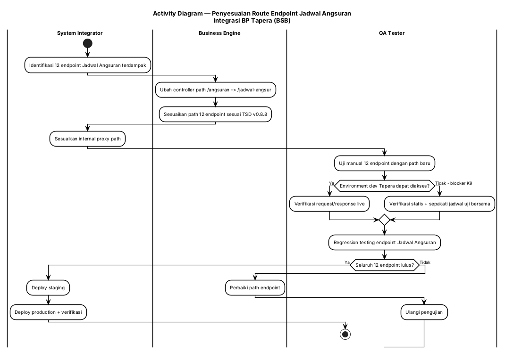

#### 3.1.4 Persyaratan Fungsional

| ID Spesifikasi | Deskripsi Spesifikasi | Aturan Bisnis/Ketergantungan Data |
|---|---|---|
| FR-1.1 | Sistem harus mengubah controller path Jadwal Angsuran dari `/angsuran` menjadi `/jadwal-angsur` | Mengacu TSD v0.8.8 §Jadwal Angsuran; [KODE] konstanta lama di `pkg/tapera/endpoint.go:53-56` |
| FR-1.2 | Sistem harus menerapkan format path baru pada **12 endpoint** Jadwal Angsuran secara serentak | Daftar endpoint: §3.1.5 Tabel A; perubahan simultan wajib karena satu unit integrasi |
| FR-1.3 | Sistem Integrator harus menyesuaikan internal proxy path sehingga request dari Web Interface diteruskan ke path baru | Ketergantungan: Business Engine & SI harus satu versi rilis |
| FR-1.4 | Sistem harus menampilkan pesan error dari API BP Tapera bila endpoint tidak ditemukan / gagal | Format pesan mengikuti response API BP Tapera (kode + pesan) |
| FR-1.5 | Sistem harus tetap dapat menampilkan "Data Jadwal tidak ditemukan" bila API Core Bank tidak mengembalikan data | Mengacu FSD Amortisasi existing UC-1/UC-2 (FR-5) |
| FR-1.6 | Pengujian regresi wajib mencakup seluruh 12 endpoint sebelum deployment production | Mitigasi risiko R10 |

#### 3.1.5 Spesifikasi Tingkat Bidang

**Tabel A — Pemetaan Path Endpoint (12 endpoint)**

| No | Nama Endpoint | Method | Path Lama (v0.8.5) | Path Baru (v0.8.6+) | Aktor Sistemik |
|---|---|---|---|---|---|
| 1 | Mutasi 75:25 | POST | `/api/mitra-penyalur/v2/angsuran/mutasi-75` | `/api/mitra-penyalur/v2/jadwal-angsur/mutasi-7525` | SI → Tapera |
| 2 | Mutasi 90:10 | POST | `/api/mitra-penyalur/v2/angsuran/mutasi-90` | `/api/mitra-penyalur/v2/jadwal-angsur/mutasi-9010` | SI → Tapera |
| 3 | Mutasi Dipercepat 75:25 | POST | `/api/mitra-penyalur/v2/angsuran/percepat/75` | `/api/mitra-penyalur/v2/jadwal-angsur/mutasi-dipercepat-7525` | SI → Tapera |
| 4 | Mutasi Dipercepat 90:10 | POST | `/api/mitra-penyalur/v2/angsuran/percepat/90` | `/api/mitra-penyalur/v2/jadwal-angsur/mutasi-dipercepat-9010` | SI → Tapera |
| 5 | Mutasi KPO | POST | `/api/mitra-penyalur/v2/angsuran/mutasi-kpo` | `/api/mitra-penyalur/v2/jadwal-angsur/mutasi-kpo` | SI → Tapera |
| 6 | List KPO | GET | `/api/mitra-penyalur/v2/angsuran/kpo` | `/api/mitra-penyalur/v2/jadwal-angsur/kpo` | SI → Tapera |
| 7 | Detail 75:25 | GET | `/api/mitra-penyalur/v2/angsuran/detail-7525` | `/api/mitra-penyalur/v2/jadwal-angsur/detail-7525` | SI → Tapera |
| 8 | Detail 90:10 | GET | `/api/mitra-penyalur/v2/angsuran/detail-9010` | `/api/mitra-penyalur/v2/jadwal-angsur/detail-9010` | SI → Tapera |
| 9 | List 75:25 | GET | `/api/mitra-penyalur/v2/angsuran/list-7525` | `/api/mitra-penyalur/v2/jadwal-angsur/list-7525` | SI → Tapera |
| 10 | List 90:10 | GET | `/api/mitra-penyalur/v2/angsuran/list-9010` | `/api/mitra-penyalur/v2/jadwal-angsur/list-9010` | SI → Tapera |
| 11 | Data Lunas 75:25 | GET | `/api/mitra-penyalur/v2/angsuran/data-lunas-7525` | `/api/mitra-penyalur/v2/jadwal-angsur/data-lunas-7525` | SI → Tapera |
| 12 | Data Lunas 90:10 | GET | `/api/mitra-penyalur/v2/angsuran/data-lunas-9010` | `/api/mitra-penyalur/v2/jadwal-angsur/data-lunas-9010` | SI → Tapera |

**Tabel B — Aturan dan Ketergantungan**

| Area | Validasi/Aturan Bisnis | Pesan Kesalahan | Ketergantungan Data | Catatan |
|---|---|---|---|---|
| Route Business Engine | Prefix controller wajib `/jadwal-angsur` | — | TSD v0.8.8 | Perubahan pada `endpoint.go` |
| Route System Integrator | Proxy path wajib mengikuti path Business Engine | — | Konfigurasi proxy SI | Wajib satu rilis |
| Penanganan error | Teruskan kode & pesan error API Tapera apa adanya | `{kode} — {message}` dari API Tapera | Response API BP Tapera | Mengacu FSD existing FR-3 |

**Tabel C — Tombol, Tautan, dan Ikon**

| Label | Event OnClick | Terlihat | Aktif vs Dinonaktifkan | Navigasi Ke | Validasi | Ketergantungan |
|---|---|---|---|---|---|---|
| "Kirim jadwal ke BP Tapera" | Submit amortisasi jadwal angsuran (menggunakan path baru) | Ya | Aktif bila semua field mandatory terisi | Tidak ada (menampilkan pop up konfirmasi) | Field mandatory | Business Engine & SI sudah memakai path v0.8.6+ |
| "Dapatkan Jadwal Angsuran" | Panggil API Core Bank Get Jadwal Angsur | Ya | Aktif | Tidak ada | — | Core Banking BSB |

---

### 3.2 Penyesuaian Panjang Maksimum Field

#### 3.2.1 Tujuan/Deskripsi

**Tujuan:** Menyelaraskan panjang maksimum 19 field pada DTO, validasi, dan tabel database dengan TSD v0.8.6 agar data yang diterima aplikasi tidak ditolak oleh API BP Tapera akibat perbedaan constraint.

**Deskripsi:** TSD v0.8.6 memperluas panjang sebagian besar field identitas/dokumen menjadi 100 karakter (`nama_pengembang` menjadi 200 karakter). Tanpa penyesuaian, aplikasi dapat menerima input yang tidak dapat disimpan/disubmit. Risiko tertinggi adalah ketidaksesuaian dengan Core Banking BSB (40–50x) — blocker K8.

#### 3.2.2 Use Case

| | |
|-|-|
| **UC-02** | **Penyesuaian Panjang Maksimum Field** |
| **Aktor Utama** | Business Engine (Golang) |
| **Pemangku Kepentingan dan Minat** | Bank Sumsel Babel (integritas data), BP Tapera (kepatuhan constraint) |
| **Pemicu** | Rilis TSD v0.8.6 — penyesuaian panjang maksimum field |
| **Pre-kondisi** | Skema tabel & DTO existing memakai panjang field versi v0.8.5 |
| **Post-kondisi** | 19 field memiliki panjang maksimum sesuai TSD v0.8.6 pada DTO, validasi, dan DB; data 100 karakter dapat disubmit |
| **Skenario Sukses Utama** | 1. Identifikasi 19 field terdampak → 2. Update constraint panjang field pada tabel database → 3. Update DTO & validasi pada Business Engine → 4. Konfirmasi constraint Core Banking BSB (K8) → 5. Update spec test terdampak → 6. Jalankan test → 7. Verifikasi submit 100 karakter ke Tapera → **TUJUAN TERCAPAI** |
| **Ekstensi** | Jika Core Banking BSB hanya mendukung 40–50 karakter (K8), maka panjang efektif input dibatasi pada nilai minimum yang disepakati BSB dan didokumentasikan sebagai deviasi terkontrol |
| **Prioritas** | Tinggi |
| **Persyaratan Khusus** | Field `nama_pengembang` memakai 200 karakter — pengecualian dari pola 100 karakter |
| **Pertanyaan Terbuka** | Batas panjang final yang disetujui BSB untuk field yang tidak didukung core banking (K8) |

##### JSON Use Case

```json
{
  "use_case": {
    "uc_id": "UC-02",
    "name": "Penyesuaian Panjang Maksimum Field",
    "primary_actor": "ACTOR-005",
    "stakeholders": ["Bank Sumsel Babel", "BP Tapera"],
    "trigger": "Rilis TSD v0.8.6 — penyesuaian panjang maksimum field",
    "preconditions": ["Skema tabel dan DTO memakai panjang field versi v0.8.5"],
    "postconditions": ["19 field sesuai TSD v0.8.6 pada DTO, validasi, dan database"],
    "main_success_scenario": [
      {"step": 1, "actor": "Sistem", "action": "Identifikasi 19 field terdampak"},
      {"step": 2, "actor": "Sistem", "action": "Update constraint panjang field pada tabel database"},
      {"step": 3, "actor": "Sistem", "action": "Update DTO dan validasi pada Business Engine"},
      {"step": 4, "actor": "Operator Cabang", "action": "Konfirmasi constraint Core Banking BSB (K8)"},
      {"step": 5, "actor": "QA Tester", "action": "Update spec test terdampak dan jalankan test"},
      {"step": 6, "actor": "Sistem", "action": "Verifikasi submit data 100 karakter ke API Tapera"}
    ],
    "extensions": [
      {"at_step": 6, "condition": "Core Banking BSB hanya mendukung 40-50 karakter", "action": "Batasi panjang efektif pada nilai minimum yang disepakati BSB, dokumentasikan sebagai deviasi terkontrol"}
    ],
    "priority": "high",
    "entities": ["Pengajuan", "SP3K", "Akad", "Pencairan", "Rumah"],
    "business_rules": ["nama_pengembang memakai 200 karakter", "Panjang field wajib konsisten antara DTO, validasi, dan DB"]
  }
}
```

#### 3.2.3 Diagram Aktivitas

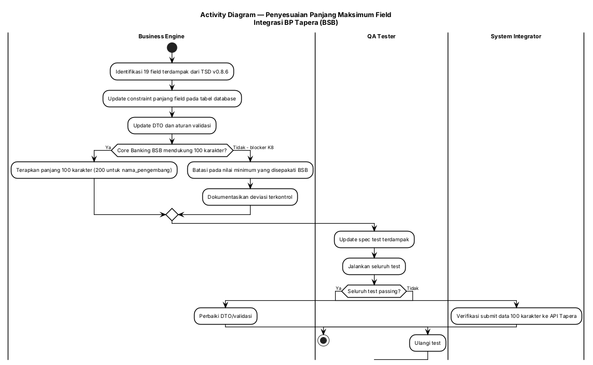

#### 3.2.4 Persyaratan Fungsional

| ID Spesifikasi | Deskripsi Spesifikasi | Aturan Bisnis/Ketergantungan Data |
|---|---|---|
| FR-2.1 | Sistem harus menerapkan panjang maksimum 100 karakter pada 18 field dan 200 karakter pada `nama_pengembang` | §3.2.5 Tabel A; [CR] TSD v0.8.6 |
| FR-2.2 | Panjang field wajib konsisten pada tiga titik: constraint tabel database, DTO, dan aturan validasi | Single source of truth; hindari validasi berbeda antar lapisan |
| FR-2.3 | Sistem harus menampilkan pesan error yang jelas bila input melampaui panjang maksimum | Format pesan mengikuti pola validasi existing; field terdampak: §3.2.5 Tabel A |
| FR-2.4 | Sistem harus menyediakan spec test yang diperbarui untuk field terdampak | Mengacu task T.1 (update spec test) CR-20260729-001 |
| FR-2.5 | Sistem harus mempertahankan kompatibilitas data existing yang panjangnya di bawah batas baru | Migrasi non-destruktif — lihat §7 |
| FR-2.6 | Bila BSB menetapkan batas lebih rendah (core banking 40–50x), sistem harus menerapkan batas efektif minimum yang disepakati | Ketergantungan: K8 (blocker) |

#### 3.2.5 Spesifikasi Tingkat Bidang

**Tabel A — Field yang Berubah Panjang (19 field)**

| No | Nama Field | Panjang Baru | Lokasi Field DB Terkait | Sumber |
|---|---|---|---|---|
| 1 | `blok_agunan` | 100 | Pengajuan/agunan | [CR] |
| 2 | `nomor_unit_agunan` | 100 | Pengajuan/agunan | [CR] |
| 3 | `nama_pemohon` | 100 | Peserta/pengajuan | [CR] |
| 4 | `email_pemohon` | 100 | Peserta/pengajuan | [CR] |
| 5 | `nama_pasangan` | 100 | Pengajuan | [CR] |
| 6 | `id_rumah` | 100 | Akad/pengajuan | [CR] |
| 7 | `nomor_spr` | 100 | Akad/pengajuan | [CR] |
| 8 | `nomor_ppjb` | 100 | SP3K/pengajuan | [CR] |
| 9 | `nomor_slf` | 100 | SP3K/Rumah | [CR] — perlu dibedakan dari `nomor_slf` Detail Rumah (v0.8.7, 50x) → [Perlu validasi] |
| 10 | `nomor_sp3k` | 100 | SP3K | [CR] |
| 11 | `nomor_bast` | 100 | Akad | [CR] |
| 12 | `nomor_imb_pbg` | 100 | SP3K | [CR] |
| 13 | `nomor_akad` | 100 | Akad | [CR] |
| 14 | `nomor_batch` | 100 | Pencairan | [CR] |
| 15 | `keterangan` | 100 | Umum | [CR] |
| 16 | `jenis_dokumen` | 100 | Dokumen | [CR] |
| 17 | `nomor_sertifikat` | 100 | Rumah/agunan | [CR] |
| 18 | `rekening_kredit_pemohon` | 100 | Akad | [CR] |
| 19 | `nama_pengembang` | **200** | Pengembang/Akad | [CR] — [KODE] field ada di `pengajuan-pembiayaan/models/residential.go:17` |

**Tabel B — Aturan dan Ketergantungan**

| Area | Validasi/Aturan Bisnis | Pesan Kesalahan | Ketergantungan Data | Catatan |
|---|---|---|---|---|
| Panjang field | Maksimum 100 karakter (kecuali `nama_pengembang` = 200) | "Panjang maksimal {n} karakter" (pola existing) | TSD v0.8.8 §kolom | Update pada tabel DB + DTO + validasi |
| Konsistensi lintas lapisan | Nilai panjang identik di ketiga lapisan | — | — | Perubahan parsial = sumber regresi |
| Data existing | Tidak ada pemotongan data otomatis | — | Database BSB | Migrasi non-destruktif (§7) |

**Tabel C — Tombol, Tautan, dan Ikon**

| Label | Event OnClick | Terlihat | Aktif vs Dinonaktifkan | Navigasi Ke | Validasi | Ketergantungan |
|---|---|---|---|---|---|---|
| (tidak ada perubahan tombol pada UC ini) | — | — | — | — | Validasi panjang field pada semua field input terkait | DTO/validasi sudah diperbarui |

---

### 3.3 Penghapusan Field yang Tidak Terpakai

#### 3.3.1 Tujuan/Deskripsi

**Tujuan:** Menghapus 5 field yang tidak lagi dipakai pada TSD v0.8.6 dari DTO, validasi, dan tabel database agar struktur data selaras dengan kontrak API Tapera dan tidak menimbulkan ambiguitas pengisian.

**Deskripsi:** Field `limit_pembiayaan` dihapus karena nilainya digenerate sistem; empat field bank/rekening dihapus karena tidak lagi menjadi bagian kontrak. `limit_pembiayaan` juga muncul sebagai field perhitungan otomatis pada FSD SP3K existing (field #10) sehingga penghapusan berdampak pada tampilan SP3K. [FSD] `20241216.TAPERA.FSD-SP3K.md` field #10.

#### 3.3.2 Use Case

| | |
|-|-|
| **UC-03** | **Penghapusan Field yang Tidak Terpakai** |
| **Aktor Utama** | Business Engine (Golang) |
| **Pemangku Kepentingan dan Minat** | Bank Sumsel Babel (kebersihan data), BP Tapera (keselarasan kontrak) |
| **Pemicu** | Rilis TSD v0.8.6 — penghapusan field yang tidak terpakai |
| **Pre-kondisi** | Field masih ada di DTO/tabel/DB pada versi v0.8.5 |
| **Post-kondisi** | 5 field tidak lagi dikirim ke API Tapera dan tidak lagi menjadi bagian DTO/tabel; aplikasi tetap berjalan tanpa error |
| **Skenario Sukses Utama** | 1. Identifikasi 5 field target → 2. Hapus field dari DTO & validasi → 3. Hapus field dari tabel database (migrasi) → 4. Sesuaikan tampilan/form yang mereferensikan field → 5. Sesuaikan spec test → 6. Jalankan regression → 7. Verifikasi submit/pencairan tetap berhasil → **TUJUAN TERCAPAI** |
| **Ekstensi** | Jika field masih dipakai pada proses internal non-Tapera, maka field dipertahankan di DB sebagai kolom legacy tanpa dikirim ke API, dan dicatat sebagai deviasi |
| **Prioritas** | Tinggi |
| **Persyaratan Khusus** | Penghapusan `limit_pembiayaan` dari form SP3K harus disertai perhitungan pengganti di sisi sistem bila nilainya masih dibutuhkan untuk keperluan internal |
| **Pertanyaan Terbuka** | Apakah `limit_pembiayaan` masih diperlukan untuk keperluan internal/reporting BSB setelah dihapus dari kontrak API? [Perlu validasi] |

##### JSON Use Case

```json
{
  "use_case": {
    "uc_id": "UC-03",
    "name": "Penghapusan Field yang Tidak Terpakai",
    "primary_actor": "ACTOR-005",
    "stakeholders": ["Bank Sumsel Babel", "BP Tapera"],
    "trigger": "Rilis TSD v0.8.6 — penghapusan field tidak terpakai",
    "preconditions": ["Field masih ada pada DTO/tabel versi v0.8.5"],
    "postconditions": ["5 field tidak lagi dikirim ke API Tapera"],
    "main_success_scenario": [
      {"step": 1, "actor": "Sistem", "action": "Identifikasi 5 field target"},
      {"step": 2, "actor": "Sistem", "action": "Hapus field dari DTO dan validasi"},
      {"step": 3, "actor": "Sistem", "action": "Hapus field dari tabel database melalui migrasi"},
      {"step": 4, "actor": "Sistem", "action": "Sesuaikan form/tampilan yang mereferensikan field"},
      {"step": 5, "actor": "QA Tester", "action": "Sesuaikan spec test dan jalankan regression"},
      {"step": 6, "actor": "Sistem", "action": "Verifikasi submit dan pencairan tetap berhasil"}
    ],
    "extensions": [
      {"at_step": 3, "condition": "Field masih dipakai proses internal non-Tapera", "action": "Pertahankan sebagai kolom legacy tanpa dikirim ke API dan catat deviasi"}
    ],
    "priority": "high",
    "entities": ["Pengajuan", "Akad", "Pencairan"],
    "business_rules": ["limit_pembiayaan digenerate sistem", "Field bank/rekening tidak lagi bagian kontrak"]
  }
}
```

#### 3.3.3 Diagram Aktivitas

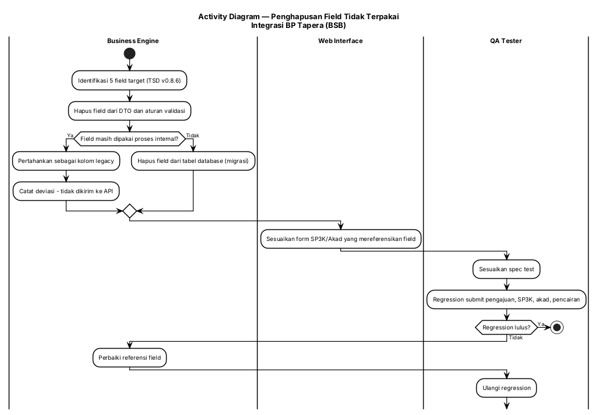

#### 3.3.4 Persyaratan Fungsional

| ID Spesifikasi | Deskripsi Spesifikasi | Aturan Bisnis/Ketergantungan Data |
|---|---|---|
| FR-3.1 | Sistem tidak boleh lagi mengirim 5 field berikut ke API BP Tapera: `limit_pembiayaan`, `kode_bank_pengembang`, `nomor_rekening_pengembang`, `kode_bank_pemohon`, `rekening_tabungan_pemohon` | §3.3.5 Tabel A; [CR] TSD v0.8.6 |
| FR-3.2 | Sistem harus menghapus field tersebut dari DTO dan aturan validasi | Hindari field wajib yang tidak lagi relevan |
| FR-3.3 | Sistem harus menjalankan migrasi database non-destruktif (backup sebelum penghapusan kolom) | §7.2 Persiapan Konversi Data |
| FR-3.4 | Sistem harus menyesuaikan form yang masih menampilkan field terdampak agar tidak menimbulkan error tampilan | Titik terdampak utama: form SP3K (field `Limit Pembiayaan`) [FSD] FSD SP3K field #10 |
| FR-3.5 | Nilai `limit_pembiayaan` — bila masih dibutuhkan internal — harus dihasilkan oleh perhitungan sistem, bukan input pengguna | [CR] "datanya akan digenerate sistem" |
| FR-3.6 | Regression wajib mencakup alur submit pengajuan, SP3K, akad, dan pencairan | Mitigasi R7 |

#### 3.3.5 Spesifikasi Tingkat Bidang

**Tabel A — Field yang Dihapus**

| No | Nama Field | Lokasi Field DB Terkait | Alasan (TSD v0.8.6) | Penanganan Internal |
|---|---|---|---|---|
| 1 | `limit_pembiayaan` | Funding/pengajuan | Digenerate sistem | [Perlu validasi] — pertahankan sebagai kolom legacy bila dibutuhkan reporting |
| 2 | `kode_bank_pengembang` | Akad/pengajuan | Tidak lagi bagian kontrak | Hapus dari DTO & DB |
| 3 | `nomor_rekening_pengembang` | Akad/pengajuan | Tidak lagi bagian kontrak | Hapus dari DTO & DB |
| 4 | `kode_bank_pemohon` | Akad/pengajuan | Tidak lagi bagian kontrak | Hapus dari DTO & DB |
| 5 | `rekening_tabungan_pemohon` | Akad/pengajuan | Tidak lagi bagian kontrak | Hapus dari DTO & DB |

**Tabel B — Aturan dan Ketergantungan**

| Area | Validasi/Aturan Bisnis | Pesan Kesalahan | Ketergantungan Data | Catatan |
|---|---|---|---|---|
| Form SP3K | Field `Limit Pembiayaan` tidak lagi ditampilkan sebagai input | — | Perhitungan sistem | [FSD] FSD SP3K existing menampilkan field #10 sebagai input + perhitungan otomatis |
| Submit ke Tapera | Payload tidak boleh memuat 5 field terhapus | Error dari Tapera bila field dikirim (tidak sesuai kontrak) | TSD v0.8.8 | — |
| Migrasi | Backup data sebelum DROP kolom | — | DBA/DevOps | §7.2 |

**Tabel C — Tombol, Tautan, dan Ikon**

| Label | Event OnClick | Terlihat | Aktif vs Dinonaktifkan | Navigasi Ke | Validasi | Ketergantungan |
|---|---|---|---|---|---|---|
| "Simpan Pengajuan SP3K" | Submit SP3K (payload tanpa field terhapus) | Ya | Aktif bila field mandatory terisi | Tidak ada (pop up konfirmasi) | Field mandatory tersisa | DTO sudah dibersihkan |

---

### 3.4 Penyesuaian Enum & Dropdown Pekerjaan Pemohon

#### 3.4.1 Tujuan/Deskripsi

**Tujuan:** Memastikan field Pekerjaan Pemohon hanya berisi 5 nilai yang divalidasi API BP Tapera (`ASN`, `TNI/POLRI`, `SWASTA`, `WIRASWASTA`, `LAINNYA`), baik pada dropdown form maupun pada validasi backend, sehingga pengajuan tidak ditolak saat submit.

**Deskripsi:** TSD v0.8.6 mengubah constraint `pekerjaan_pemohon` menjadi enumerasi 5 nilai. Aplikasi saat ini masih menyediakan daftar lebih luas. Verifikasi kode: daftar konstanta frontend `ListEmploymentSegment` memuat 10 nilai (`CPNS, ASN, TNI, POLRI, BUMN, BUMD, BUMDes, SWASTA, PEKERJA LAIN, PEKERJA MANDIRI`) dan **sudah tidak dipakai** (di-comment) — dropdown kini diambil dari API parameter segmen. [KODE] `web-service/src/pages/financing-application/constants/list-dropdown.ts:27-62`; `components/3-spk3/Form.tsx:26`; sumber dropdown: `components/1-submission/Form.tsx:76` → `v1/integration-tapera/parameter/segmen`.

Temuan tambahan: terdapat literal `KARYAWAN SWASTA` pada tampilan pengajuan prioritas. [KODE] `web-service/src/pages/priority-application/views/DetailView.tsx:82` — berpotensi tidak match enum → [Perlu validasi].

#### 3.4.2 Use Case

| | |
|-|-|
| **UC-04** | **Penyesuaian Enum & Dropdown Pekerjaan Pemohon** |
| **Aktor Utama** | Operator Cabang |
| **Pemangku Kepentingan dan Minat** | Bank Sumsel Babel (kelancaran submit), BP Tapera (kepatuhan enum) |
| **Pemicu** | Rilis TSD v0.8.6 — perubahan constraint `pekerjaan_pemohon` menjadi enumerasi |
| **Pre-kondisi** | Operator berada pada form Pengajuan Pembiayaan (step 1) atau SP3K |
| **Post-kondisi** | Dropdown hanya menampilkan 5 nilai tervalidasi; nilai yang dikirim saat submit tepat sama dengan enum API |
| **Skenario Sukses Utama** | 1. Operator membuka form pengajuan → 2. Sistem menampilkan dropdown Pekerjaan Pemohon berisi 5 nilai tervalidasi → 3. Operator memilih salah satu nilai → 4. Sistem mengirim nilai apa adanya (exact match) saat submit → 5. BP Tapera menerima pengajuan tanpa error enum → **TUJUAN TERCAPAI** |
| **Ekstensi** | Jika BP Tapera menambah nilai segmen baru di kemudian hari, maka penambahan tersebut diperlakukan sebagai CR baru; jika nilai lama masih terkirim (mis. `KARYAWAN SWASTA`), sistem harus memetakan ke `SWASTA` sebelum submit |
| **Prioritas** | Tinggi |
| **Persyaratan Khusus** | Nilai `TNI/POLRI` dikirim sebagai satu nilai gabungan (bukan `TNI` dan `POLRI` terpisah) |
| **Pertanyaan Terbuka** | K10 — hubungan field `pekerjaan_pemohon` antara form step 1 dan SP3K; K11 — perlakuan data selain 5 nilai tervalidasi |

##### JSON Use Case

```json
{
  "use_case": {
    "uc_id": "UC-04",
    "name": "Penyesuaian Enum dan Dropdown Pekerjaan Pemohon",
    "primary_actor": "ACTOR-001",
    "stakeholders": ["Bank Sumsel Babel", "BP Tapera"],
    "trigger": "Rilis TSD v0.8.6 — perubahan constraint pekerjaan_pemohon",
    "preconditions": ["Operator berada pada form pengajuan pembiayaan atau SP3K"],
    "postconditions": ["Dropdown hanya menampilkan 5 nilai tervalidasi dan nilai yang dikirim exact match"],
    "main_success_scenario": [
      {"step": 1, "actor": "Operator Cabang", "action": "Membuka form pengajuan pembiayaan"},
      {"step": 2, "actor": "Sistem", "action": "Menampilkan dropdown Pekerjaan Pemohon berisi 5 nilai tervalidasi"},
      {"step": 3, "actor": "Operator Cabang", "action": "Memilih salah satu nilai pekerjaan"},
      {"step": 4, "actor": "Sistem", "action": "Mengirim nilai pekerjaan apa adanya saat submit"},
      {"step": 5, "actor": "API BP Tapera", "action": "Menerima pengajuan tanpa error enum"}
    ],
    "extensions": [
      {"at_step": 4, "condition": "Nilai lama masih terkirim (mis. KARYAWAN SWASTA)", "action": "Petakan ke SWASTA sebelum submit"}
    ],
    "priority": "high",
    "entities": ["Pengajuan", "SP3K"],
    "business_rules": ["Hanya 5 nilai tervalidasi digunakan", "TNI/POLRI dikirim sebagai satu nilai"]
  }
}
```

#### 3.4.3 Diagram Aktivitas

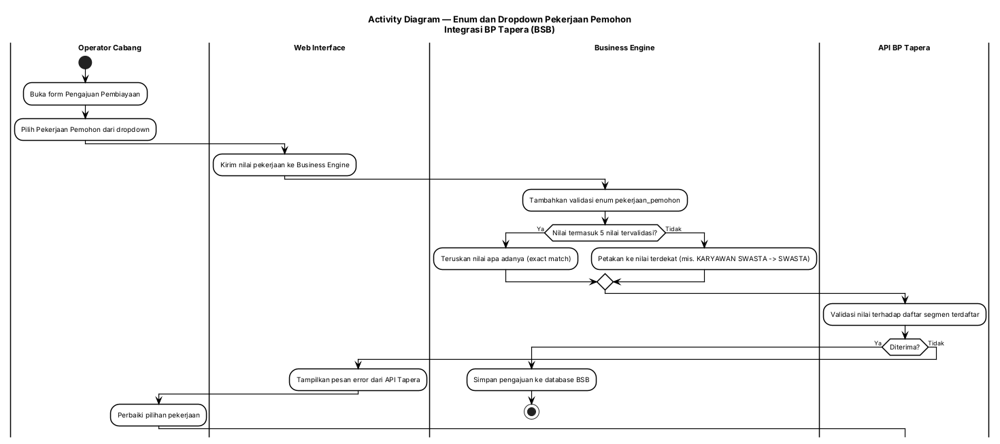

#### 3.4.4 Persyaratan Fungsional

| ID Spesifikasi | Deskripsi Spesifikasi | Aturan Bisnis/Ketergantungan Data |
|---|---|---|
| FR-4.1 | Dropdown Pekerjaan Pemohon hanya boleh menyediakan 5 nilai: `ASN`, `TNI/POLRI`, `SWASTA`, `WIRASWASTA`, `LAINNYA` | §3.4.5 Tabel A; [CR] TSD v0.8.6 |
| FR-4.2 | Sistem harus menerapkan validasi enum `pekerjaan_pemohon` di sisi backend | [CR] task A.3.1, BE-3 |
| FR-4.3 | Nilai yang dikirim saat submit harus `exact match` dengan enum API Tapera | Nilai `SWASTA`, bukan `KARYAWAN SWASTA` |
| FR-4.4 | Sistem harus memetakan nilai lama yang masih tersimpan menjadi nilai tervalidasi sebelum submit | Mitigasi R5 |
| FR-4.5 | Sistem harus menampilkan pesan error dari API Tapera bila nilai ditolak | Format mengikuti response API Tapera |
| FR-4.6 | Sumber daftar pekerjaan pada form pengajuan harus konsisten dengan parameter segmen Tapera | [KODE] sumber saat ini: `v1/integration-tapera/parameter/segmen` → Tapera `/segmen/list` |
| FR-4.7 | Perubahan daftar nilai di luar 5 nilai tervalidasi diperlakukan sebagai CR baru, bukan penambahan langsung | [CR] klasterifikasi K11 |

#### 3.4.5 Spesifikasi Tingkat Bidang

**Tabel A — Field Pekerjaan Pemohon**

| Field Label | Kontrol UI | Wajib | Dapat Diedit | Tipe Data | Set Nilai | Nilai Default | Contoh Data | Sumber Data |
|---|---|---|---|---|---|---|---|---|
| Pekerjaan Pemohon (Pengajuan Pembiayaan) | Dropdown | Ya | Ya | String (enum) | ASN; TNI/POLRI; SWASTA; WIRASWASTA; LAINNYA | — | SWASTA | API BP Tapera — List Segmen Pekerjaan (via SI `/parameter/segmen`) |
| Pekerjaan Pemohon (Pengajuan Prioritas) | Dropdown | Ya | Ya | String (enum) | ASN; TNI/POLRI; SWASTA; WIRASWASTA; LAINNYA | — | SWASTA | API BP Tapera — List Segmen Pekerjaan |
| Segmen Pekerjaan (SP3K) | Dropdown | Ya | Ya | String | ASN; TNI/POLRI; SWASTA; WIRASWASTA; LAINNYA | — | ASN | API BP Tapera — List Segmen pekerjaan |

**Tabel B — Aturan dan Ketergantungan**

| Field Label | Validasi/Aturan Bisnis | Pesan Kesalahan | Ketergantungan Data | Info/Catatan Tambahan |
|---|---|---|---|---|
| Pekerjaan Pemohon | Harus salah satu dari 5 nilai enum | Pesan error dari API Tapera | API BP Tapera — List Segmen Pekerjaan | [KODE] daftar FE lama (10 nilai) sudah tidak dipakai |
| Pekerjaan Pemohon (prioritas) | Harus salah satu dari 5 nilai enum | Pesan error dari API Tapera | API BP Tapera | [KODE] masih ada literal `KARYAWAN SWASTA` pada tampilan detail prioritas → [Perlu validasi] |
| Segmen Pekerjaan (SP3K) | Harus salah satu dari 5 nilai enum | Pesan error dari API Tapera | API BP Tapera | — |

**Tabel C — Tombol, Tautan, dan Ikon**

| Label | Event OnClick | Terlihat | Aktif vs Dinonaktifkan | Navigasi Ke | Validasi | Ketergantungan |
|---|---|---|---|---|---|---|
| "Kirim Pengajuan" | Submit pengajuan (dengan nilai enum tervalidasi) | Ya | Aktif bila semua field mandatory terisi | Tidak ada (pop up konfirmasi) | Enum pekerjaan wajib valid | Validasi backend FR-4.2 |
| "Simpan Pengajuan SP3K" | Submit SP3K | Ya | Aktif bila semua field mandatory terisi | Tidak ada (pop up konfirmasi) | Enum pekerjaan wajib valid | Validasi backend FR-4.2 |

---

### 3.5 Penyesuaian URL Environment API Tapera

#### 3.5.1 Tujuan/Deskripsi

**Tujuan:** Menyesuaikan base URL API BP Tapera pada setiap environment (development, staging, production) sesuai TSD v0.8.6 agar endpoint baru dapat diakses.

**Deskripsi:** TSD v0.8.6 menetapkan perubahan URL environment. Konfigurasi base URL saat ini dibaca dari environment variable (mis. `TAPERA_BASE_URL`), sehingga penyesuaian dilakukan pada konfigurasi, bukan pada kode. [KODE] `tapera-integration-service/src/tapera/tapera.service.ts:146`; `tapera-integration-service/src/tapera/tapera.module.ts:17`; `pengajuan-pembiayaan/config/config.go:15`.

Catatan: akses ke URL development Tapera saat ini gagal dengan pesan `You cannot consume this service` (blocker K9) sehingga verifikasi live belum dapat dilakukan. [CR] K9.

#### 3.5.2 Use Case

| | |
|-|-|
| **UC-05** | **Penyesuaian URL Environment API Tapera** |
| **Aktor Utama** | Sistem Integrasi (NestJS) |
| **Pemangku Kepentingan dan Minat** | Bank Sumsel Babel (kesiapan integrasi), BP Tapera (akses environment) |
| **Pemicu** | Rilis TSD v0.8.6 — penyesuaian URL environment |
| **Pre-kondisi** | Environment variable base URL pada sistem masih memakai nilai versi lama |
| **Post-kondisi** | Setiap environment memakai base URL yang sesuai TSD v0.8.6 dan dapat diakses |
| **Skenario Sukses Utama** | 1. Identifikasi URL target per environment dari TSD → 2. Ubah konfigurasi environment variable → 3. Deploy konfigurasi ke masing-masing environment → 4. Uji konektivitas endpoint → 5. Verifikasi request/response berhasil → **TUJUAN TERCAPAI** |
| **Ekstensi** | Jika akses development Tapera gagal (K9), maka pengujian live ditunda; koordinasi akses ke BP Tapera dan gunakan staging/production setelah akses tersedia |
| **Prioritas** | Sedang |
| **Persyaratan Khusus** | Base URL wajib berasal dari environment variable — tidak boleh di-hardcode ke dalam kode |
| **Pertanyaan Terbuka** | Apakah kredensial/service account juga berubah bersamaan dengan perubahan URL? [Perlu validasi] |

##### JSON Use Case

```json
{
  "use_case": {
    "uc_id": "UC-05",
    "name": "Penyesuaian URL Environment API Tapera",
    "primary_actor": "ACTOR-004",
    "stakeholders": ["Bank Sumsel Babel", "BP Tapera"],
    "trigger": "Rilis TSD v0.8.6 — penyesuaian URL environment",
    "preconditions": ["Environment variable base URL masih memakai nilai versi lama"],
    "postconditions": ["Setiap environment memakai base URL sesuai TSD v0.8.6"],
    "main_success_scenario": [
      {"step": 1, "actor": "Sistem", "action": "Identifikasi URL target per environment dari TSD"},
      {"step": 2, "actor": "Sistem", "action": "Ubah konfigurasi environment variable"},
      {"step": 3, "actor": "QA Tester", "action": "Uji konektivitas endpoint pada environment terkait"},
      {"step": 4, "actor": "Sistem", "action": "Verifikasi request/response berhasil"}
    ],
    "extensions": [
      {"at_step": 3, "condition": "Akses environment development Tapera gagal (K9)", "action": "Tunda pengujian live dan koordinasikan akses ke BP Tapera"}
    ],
    "priority": "medium",
    "entities": [],
    "business_rules": ["Base URL dari environment variable, tidak di-hardcode"]
  }
}
```

#### 3.5.3 Diagram Aktivitas

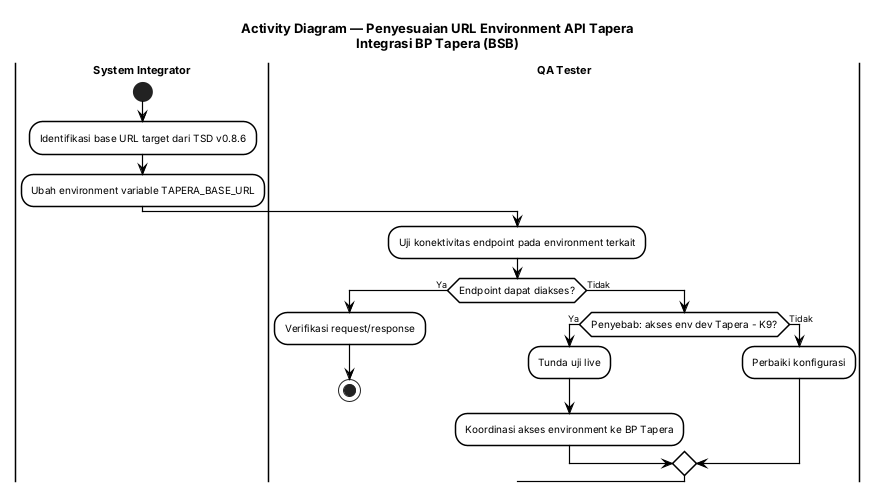

#### 3.5.4 Persyaratan Fungsional

| ID Spesifikasi | Deskripsi Spesifikasi | Aturan Bisnis/Ketergantungan Data |
|---|---|---|
| FR-5.1 | Sistem harus memakai base URL API Tapera sesuai environment: Development `https://api.dev.tapera.go.id:8443/`, Staging `https://api.qa.tapera.go.id/`, Production `https://h2h.tapera.go.id/` | §3.5.5 Tabel A; [CR] TSD v0.8.6 |
| FR-5.2 | Base URL wajib dibaca dari environment variable, bukan di-hardcode | [KODE] pola konfigurasi existing: `TAPERA_BASE_URL` |
| FR-5.3 | Sistem harus menampilkan pesan error yang informatif bila koneksi ke API Tapera gagal | Format mengikuti response API Tapera |
| FR-5.4 | Sistem harus mendukung pengujian pada environment development Tapera untuk endpoint baru | Terblokir K9 — perlu akses dari BP Tapera |

#### 3.5.5 Spesifikasi Tingkat Bidang

**Tabel A — Konfigurasi Environment**

| Environment | Base URL | Variabel Konfigurasi | Status Akses | Catatan |
|---|---|---|---|---|
| Development | `https://api.dev.tapera.go.id:8443/` | `TAPERA_BASE_URL` | **Tidak dapat diakses** — `You cannot consume this service` (K9) | Blocker → koordinasi BP Tapera |
| Staging | `https://api.qa.tapera.go.id/` | `TAPERA_BASE_URL` | [Perlu validasi] | — |
| Production | `https://h2h.tapera.go.id/` | `TAPERA_BASE_URL` | Sesuai implementasi existing | — |

**Tabel B — Aturan dan Ketergantungan**

| Area | Validasi/Aturan Bisnis | Pesan Kesalahan | Ketergantungan Data | Catatan |
|---|---|---|---|---|
| Konfigurasi base URL | Wajib dari environment variable | — | Deployment config | Tidak boleh di-hardcode |
| Akses environment | Endpoint baru wajib dapat diuji minimal di satu environment non-production | Pesan error dari API Tapera | Kredensial & akses BP Tapera | K9 |

**Tabel C — Tombol, Tautan, dan Ikon**

| Label | Event OnClick | Terlihat | Aktif vs Dinonaktifkan | Navigasi Ke | Validasi | Ketergantungan |
|---|---|---|---|---|---|---|
| (tidak ada perubahan tombol pada UC ini) | — | — | — | — | — | Konfigurasi environment |

---

### 3.6 Penyesuaian List Perumahan (Parameter Baru)

#### 3.6.1 Tujuan/Deskripsi

**Tujuan:** Menambahkan parameter request `namaPerumahan`, `limit`, dan `page` pada endpoint List Perumahan (TSD v0.8.7 §2.13.1) agar pencarian dan paginasi data perumahan dapat dilakukan.

**Deskripsi:** Data perumahan tersimpan di database lokal BSB dan **disinkronkan dari API Tapera melalui cron**, bukan diinput manual: "Pengambilan data menggunakan cron dijalankan 1 minggu sekali". [FSD] `20241216.TAPERA.FSD-Pengajuan_Pembiayaan.md` baris 261. Penambahan parameter ini memperluas kemampuan query pada lapisan SI.

#### 3.6.2 Use Case

| | |
|-|-|
| **UC-06** | **Penyesuaian List Perumahan (Parameter Baru)** |
| **Aktor Utama** | Cron Service (NestJS) / Admin Sistem |
| **Pemangku Kepentingan dan Minat** | Bank Sumsel Babel (pencarian data perumahan), BP Tapera (keselarasan API) |
| **Pemicu** | Rilis TSD v0.8.7 — penambahan parameter pada List Perumahan |
| **Pre-kondisi** | Endpoint List Perumahan existing hanya menerima parameter versi lama |
| **Post-kondisi** | Endpoint menerima dan memproses `namaPerumahan`, `limit`, `page` sesuai TSD v0.8.7 |
| **Skenario Sukses Utama** | 1. Sesuaikan DTO/parameter endpoint List Perumahan → 2. Terapkan nilai default (`limit` = 10, `page` = 1) → 3. Uji query dengan filter nama perumahan → 4. Verifikasi paginasi → 5. Jalankan regression Stok Rumah → **TUJUAN TERCAPAI** |
| **Ekstensi** | Jika parameter tidak dikirim, sistem memakai nilai default; jika namaPerumahan tidak ditemukan, sistem mengembalikan daftar kosong tanpa error |
| **Prioritas** | Sedang |
| **Persyaratan Khusus** | Parameter bersifat opsional (`O`) sesuai TSD |
| **Pertanyaan Terbuka** | Apakah Web Interface juga perlu menyediakan filter `namaPerumahan` pada halaman stok rumah? [Perlu validasi] |

##### JSON Use Case

```json
{
  "use_case": {
    "uc_id": "UC-06",
    "name": "Penyesuaian List Perumahan (Parameter Baru)",
    "primary_actor": "ACTOR-006",
    "stakeholders": ["Bank Sumsel Babel", "BP Tapera"],
    "trigger": "Rilis TSD v0.8.7 — penambahan parameter List Perumahan",
    "preconditions": ["Endpoint List Perumahan hanya menerima parameter versi lama"],
    "postconditions": ["Endpoint memproses namaPerumahan, limit, page sesuai TSD v0.8.7"],
    "main_success_scenario": [
      {"step": 1, "actor": "Sistem", "action": "Sesuaikan DTO/parameter endpoint List Perumahan"},
      {"step": 2, "actor": "Sistem", "action": "Terapkan nilai default limit 10 dan page 1"},
      {"step": 3, "actor": "QA Tester", "action": "Uji query dengan filter nama perumahan dan paginasi"},
      {"step": 4, "actor": "QA Tester", "action": "Jalankan regression Stok Rumah"}
    ],
    "extensions": [
      {"at_step": 3, "condition": "Parameter tidak dikirim", "action": "Gunakan nilai default"},
      {"at_step": 3, "condition": "namaPerumahan tidak ditemukan", "action": "Kembalikan daftar kosong tanpa error"}
    ],
    "priority": "medium",
    "entities": ["Perumahan", "Rumah"],
    "business_rules": ["Parameter bersifat opsional", "Data perumahan bersumber dari sinkronisasi cron dari API Tapera"]
  }
}
```

#### 3.6.3 Diagram Aktivitas

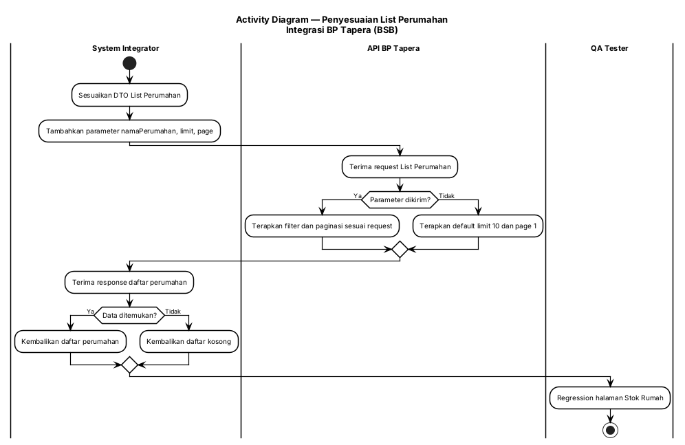

#### 3.6.4 Persyaratan Fungsional

| ID Spesifikasi | Deskripsi Spesifikasi | Aturan Bisnis/Ketergantungan Data |
|---|---|---|
| FR-6.1 | Endpoint List Perumahan harus menerima parameter `namaPerumahan` (opsional, 100 karakter, string) | §3.6.5 Tabel A; [CR] TSD v0.8.7 §2.13.1 |
| FR-6.2 | Endpoint harus menerima parameter `limit` (opsional, integer, default 10) dan `page` (opsional, integer, default 1) | [CR] TSD v0.8.7 §2.13.1 |
| FR-6.3 | Parameter harus diteruskan melalui System Integrator tanpa mengubah semantiknya | Ketergantungan: SI ↔ API Tapera |
| FR-6.4 | Sistem harus mengembalikan daftar kosong (bukan error) bila hasil filter tidak ada | Perilaku konsisten untuk UI |
| FR-6.5 | Sistem harus menampilkan pesan error dari API Tapera bila request gagal | Format mengikuti response API Tapera |
| FR-6.6 | Data perumahan yang ditampilkan berasal dari database lokal hasil sinkronisasi cron | [FSD] sinkronisasi mingguan via cron |

#### 3.6.5 Spesifikasi Tingkat Bidang

**Tabel A — Parameter Request List Perumahan**

| Parameter | Tipe | Wajib | Panjang | Default | Deskripsi | Sumber |
|---|---|---|---|---|---|---|
| `namaPerumahan` | String | O (opsional) | 100 | — | Filter nama perumahan | [CR] TSD v0.8.7 §2.13.1 |
| `limit` | Integer | O (opsional) | 3n | 10 | Jumlah data per halaman | [CR] TSD v0.8.7 §2.13.1 |
| `page` | Integer | O (opsional) | 3n | 1 | Nomor halaman | [CR] TSD v0.8.7 §2.13.1 |

> **Catatan.** Nama perumahan pada form pengajuan saat ini diambil dari **API internal sistem** (dropdown Lokasi Perumahan), bukan langsung dari API Tapera. [FSD] `20241216.TAPERA.FSD-Pengajuan_Pembiayaan.md` baris 261, 371, 647, 762.

**Tabel B — Aturan dan Ketergantungan**

| Area | Validasi/Aturan Bisnis | Pesan Kesalahan | Ketergantungan Data | Catatan |
|---|---|---|---|---|
| Filter nama perumahan | Opsional; pencocokan berdasarkan nama | — | Data perumahan lokal | Hasil sinkronisasi cron |
| Paginasi | Default limit 10, page 1 | — | — | Nilai non-numerik → validasi parameter |
| Sumber data | Data perumahan dari database lokal | — | Cron Service ↔ API Tapera | Sinkronisasi mingguan |

**Tabel C — Tombol, Tautan, dan Ikon**

| Label | Event OnClick | Terlihat | Aktif vs Dinonaktifkan | Navigasi Ke | Validasi | Ketergantungan |
|---|---|---|---|---|---|---|
| (tidak ada perubahan tombol pada UC ini) | — | — | — | — | — | — |

---

### 3.7 Penyesuaian List Rumah (Field Baru + Koreksi Typo)

#### 3.7.1 Tujuan/Deskripsi

**Tujuan:** Menambahkan field `blok`, `nomor_rumah`, `tipe_bangunan` pada response List Rumah serta mengoreksi typo `luas_bangunan` (TSD v0.8.7 §2.13.2), agar data unit rumah tampil lengkap dan sesuai kontrak.

**Deskripsi:** List Rumah menjadi sumber data untuk pemilihan agunan pada SP3K (Blok Agunan, Nomor Rumah, ID Rumah). [FSD] `20241216.TAPERA.FSD-SP3K.md` baris 169–171. Tanpa field baru, identifikasi unit rumah tidak lengkap.

#### 3.7.2 Use Case

| | |
|-|-|
| **UC-07** | **Penyesuaian List Rumah (Field Baru + Koreksi Typo)** |
| **Aktor Utama** | Cron Service (NestJS) |
| **Pemangku Kepentingan dan Minat** | Bank Sumsel Babel (kelengkapan data agunan), BP Tapera (keselarasan response) |
| **Pemicu** | Rilis TSD v0.8.7 — penyesuaian Stok Rumah (struct Go) |
| **Pre-kondisi** | Response List Rumah belum memuat `blok`, `nomor_rumah`, `tipe_bangunan`; typo `luas_bangunan` belum dikoreksi |
| **Post-kondisi** | Response List Rumah memuat seluruh field sesuai TSD v0.8.7; field terpakai di SP3K terisi |
| **Skenario Sukses Utama** | 1. Update response List Rumah (tambah `blok`, `nomor_rumah`, `tipe_bangunan`) → 2. Koreksi typo `luas_bangunan` → 3. Sesuaikan routing endpoint Stok Rumah → 4. Uji response manual → 5. Verifikasi data agunan tampil pada SP3K → 6. Regression halaman parameter house → **TUJUAN TERCAPAI** |
| **Ekstensi** | Jika field baru kosong pada data lama, maka tampilan menampilkan nilai kosong tanpa melakukan perhitungan; data terisi setelah sinkronisasi berikutnya |
| **Prioritas** | Tinggi |
| **Persyaratan Khusus** | Perubahan response tidak boleh mengubah format field existing yang sudah dikonsumsi sistem |
| **Pertanyaan Terbuka** | Apakah typo `luas_bangunan` pada implementasi lama berada di sisi struktur Go, nama kolom DB, atau keduanya? [Perlu validasi] |

##### JSON Use Case

```json
{
  "use_case": {
    "uc_id": "UC-07",
    "name": "Penyesuaian List Rumah (Field Baru dan Koreksi Typo)",
    "primary_actor": "ACTOR-006",
    "stakeholders": ["Bank Sumsel Babel", "BP Tapera"],
    "trigger": "Rilis TSD v0.8.7 — penyesuaian Stok Rumah",
    "preconditions": ["Response List Rumah belum memuat blok, nomor_rumah, tipe_bangunan"],
    "postconditions": ["Response List Rumah sesuai TSD v0.8.7"],
    "main_success_scenario": [
      {"step": 1, "actor": "Sistem", "action": "Update response List Rumah dengan field baru"},
      {"step": 2, "actor": "Sistem", "action": "Koreksi typo luas_bangunan"},
      {"step": 3, "actor": "Sistem", "action": "Sesuaikan routing endpoint Stok Rumah"},
      {"step": 4, "actor": "QA Tester", "action": "Uji manual response endpoint"},
      {"step": 5, "actor": "QA Tester", "action": "Verifikasi data agunan tampil pada SP3K dan regression halaman parameter house"}
    ],
    "extensions": [
      {"at_step": 4, "condition": "Field baru kosong pada data lama", "action": "Tampilkan nilai kosong tanpa perhitungan, terisi setelah sinkronisasi berikutnya"}
    ],
    "priority": "high",
    "entities": ["Rumah", "SP3K", "Pengajuan"],
    "business_rules": ["Format field existing tidak berubah", "Data dari sinkronisasi cron"]
  }
}
```

#### 3.7.3 Diagram Aktivitas

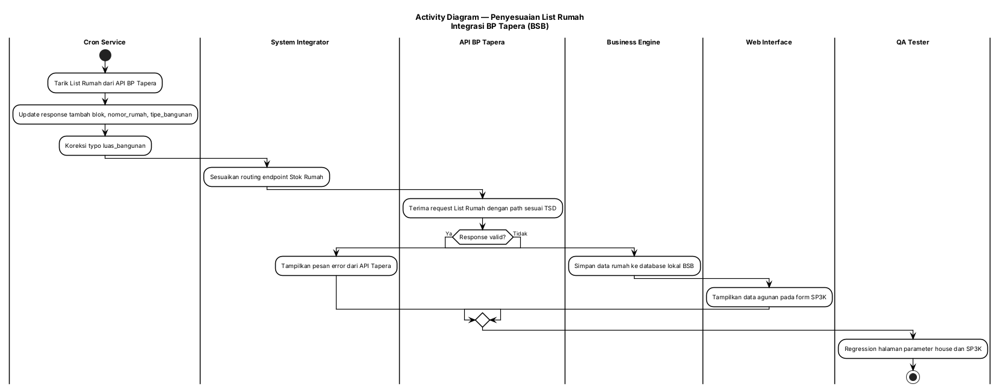

#### 3.7.4 Persyaratan Fungsional

| ID Spesifikasi | Deskripsi Spesifikasi | Aturan Bisnis/Ketergantungan Data |
|---|---|---|
| FR-7.1 | Response List Rumah harus memuat field `blok` (M, 10x, string) | §3.7.5 Tabel A; [CR] TSD v0.8.7 §2.13.2 |
| FR-7.2 | Response List Rumah harus memuat field `nomor_rumah` (M, 10x, string) | [CR] TSD v0.8.7 §2.13.2 |
| FR-7.3 | Response List Rumah harus memuat field `tipe_bangunan` (M, 10x, string) | [CR] TSD v0.8.7 §2.13.2 |
| FR-7.4 | Field `luas_bangunan` harus bertipe integer (koreksi typo) | [CR] TSD v0.8.7 §2.13.2 |
| FR-7.5 | Routing endpoint Stok Rumah harus disesuaikan dengan path TSD | [CR] task B.2.2 |
| FR-7.6 | Data agunan pada SP3K (Blok Agunan, Nomor Rumah, ID Rumah) harus tetap terisi dari database internal hasil cron | [FSD] FSD SP3K baris 169–171 |
| FR-7.7 | Regression wajib mencakup halaman parameter house dan form SP3K | [CR] task T.6 |

#### 3.7.5 Spesifikasi Tingkat Bidang

**Tabel A — Field Response List Rumah**

| No | Nama Field | Perubahan | Wajib | Panjang | Tipe | Contoh Data | Sumber Data |
|---|---|---|---|---|---|---|---|
| 1 | `luas_bangunan` | Koreksi typo; tipe integer | — | — | Integer | 36 | API BP Tapera (via cron) |
| 2 | `blok` | **BARU** | M | 10 | String | A | API BP Tapera (via cron) |
| 3 | `nomor_rumah` | **BARU** | M | 10 | String | 100 | API BP Tapera (via cron) |
| 4 | `tipe_bangunan` | **BARU** | M | 10 | String | 36 | API BP Tapera (via cron) |

> **Catatan implementasi.** Model `House` pada Web Interface saat ini **belum** memuat `tipe_bangunan` (maupun `nomor_slf`/`tanggal_slf`); field yang ada antara lain `blok`, `nomor_rumah`, `luas_bangunan`, `luas_tanah`, `id_rumah`, `id_lokasi`. [KODE] `web-service/src/pages/parameters/models/house.ts`.

**Tabel B — Aturan dan Ketergantungan**

| Area | Validasi/Aturan Bisnis | Pesan Kesalahan | Ketergantungan Data | Catatan |
|---|---|---|---|---|
| Field baru List Rumah | Wajib ada pada response; nilai kosong ditampilkan apa adanya | — | API BP Tapera → DB lokal | Data terisi setelah sinkronisasi |
| `luas_bangunan` | Bertipe integer | — | API BP Tapera | [KODE] FE sudah memakai `luas_bangunan` (`components/3-sp3k/Form.tsx:334`) |
| Routing Stok Rumah | Path endpoint sesuai TSD | Pesan error dari API Tapera | System Integrator | [CR] task B.2.2 |

**Tabel C — Tombol, Tautan, dan Ikon**

| Label | Event OnClick | Terlihat | Aktif vs Dinonaktifkan | Navigasi Ke | Validasi | Ketergantungan |
|---|---|---|---|---|---|---|
| (tidak ada perubahan tombol pada UC ini) | — | — | — | — | — | — |

---

### 3.8 Penyesuaian Detail Rumah (`tipe_bangunan`, `nomor_slf`, `tanggal_slf`)

#### 3.8.1 Tujuan/Deskripsi

**Tujuan:** Menambahkan field `tipe_bangunan`, `nomor_slf` (TSD v0.8.7) dan `tanggal_slf` (TSD v0.8.8) pada response Detail Rumah sehingga data SLF unit rumah tersedia lengkap di BSB.

**Deskripsi:** `tanggal_slf` bersumber dari **Sikumbang API** melalui BP Tapera. Data ini melengkapi dokumen kelayakan bangunan yang sudah ada (`nomor_slf`, `nomor_imb_pbg`). Detail Rumah dipakai SP3K untuk mengisi Blok/No. Rumah/ID Rumah. [FSD] FSD SP3K baris 169–171.

#### 3.8.2 Use Case

| | |
|-|-|
| **UC-08** | **Penyesuaian Detail Rumah** |
| **Aktor Utama** | Cron Service (NestJS) |
| **Pemangku Kepentingan dan Minat** | Bank Sumsel Babel (kelengkapan legalitas), BP Tapera (keselarasan response), Sikumbang (sumber `tanggal_slf`) |
| **Pemicu** | Rilis TSD v0.8.7 dan v0.8.8 — penambahan field pada Detail Rumah |
| **Pre-kondisi** | Response Detail Rumah belum memuat `tipe_bangunan`, `nomor_slf`, `tanggal_slf` |
| **Post-kondisi** | Response Detail Rumah memuat tiga field baru; data SLF dapat dikonsumsi modul SP3K/akad |
| **Skenario Sukses Utama** | 1. Update response Detail Rumah (tambah `tipe_bangunan`, `nomor_slf`) → 2. Tambah `tanggal_slf` (format YYYY-MM-DD) → 3. Uji manual response endpoint → 4. Verifikasi tampilan data SLF → 5. Regression SP3K/akad → **TUJUAN TERCAPAI** |
| **Ekstensi** | Karena `nomor_slf` dan `tanggal_slf` bersifat opsional, bila nilainya tidak tersedia maka field ditampilkan kosong tanpa memblokir proses |
| **Prioritas** | Tinggi |
| **Persyaratan Khusus** | Format `tanggal_slf` wajib `YYYY-MM-DD` |
| **Pertanyaan Terbuka** | Kesesuaian panjang `nomor_slf`: 50x (TSD v0.8.7 Detail Rumah) vs 100x (TSD v0.8.6 field umum) → [Perlu validasi] |

##### JSON Use Case

```json
{
  "use_case": {
    "uc_id": "UC-08",
    "name": "Penyesuaian Detail Rumah",
    "primary_actor": "ACTOR-006",
    "stakeholders": ["Bank Sumsel Babel", "BP Tapera", "Sikumbang"],
    "trigger": "Rilis TSD v0.8.7 dan v0.8.8",
    "preconditions": ["Response Detail Rumah belum memuat tipe_bangunan, nomor_slf, tanggal_slf"],
    "postconditions": ["Response Detail Rumah memuat tiga field baru"],
    "main_success_scenario": [
      {"step": 1, "actor": "Sistem", "action": "Update response Detail Rumah dengan tipe_bangunan dan nomor_slf"},
      {"step": 2, "actor": "Sistem", "action": "Tambah field tanggal_slf format YYYY-MM-DD"},
      {"step": 3, "actor": "QA Tester", "action": "Uji manual response endpoint Detail Rumah"},
      {"step": 4, "actor": "QA Tester", "action": "Verifikasi tampilan data SLF dan regression SP3K/akad"}
    ],
    "extensions": [
      {"at_step": 3, "condition": "nomor_slf atau tanggal_slf tidak tersedia", "action": "Tampilkan kosong tanpa memblokir proses"}
    ],
    "priority": "high",
    "entities": ["Rumah", "SP3K", "Akad"],
    "business_rules": ["tanggal_slf format YYYY-MM-DD", "nomor_slf dan tanggal_slf bersifat opsional"]
  }
}
```

#### 3.8.3 Diagram Aktivitas

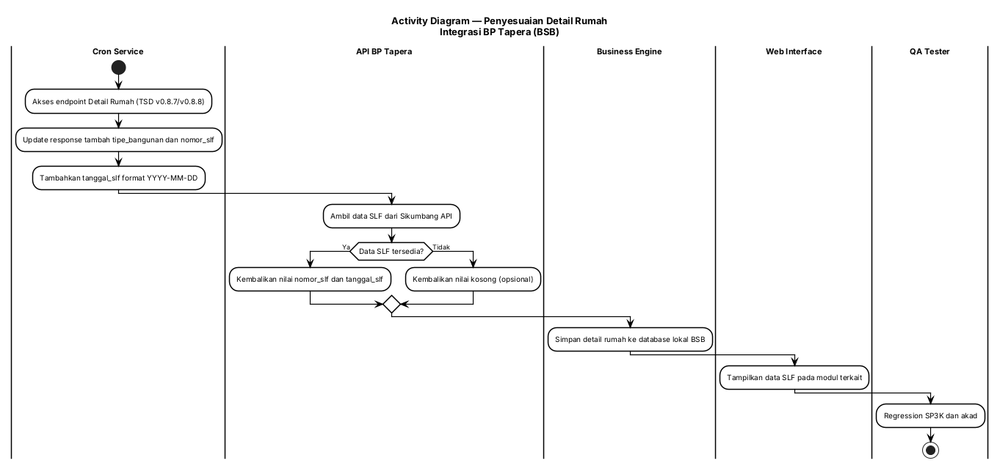

#### 3.8.4 Persyaratan Fungsional

| ID Spesifikasi | Deskripsi Spesifikasi | Aturan Bisnis/Ketergantungan Data |
|---|---|---|
| FR-8.1 | Response Detail Rumah harus memuat `tipe_bangunan` (M, 10x, string) | §3.8.5 Tabel A; [CR] TSD v0.8.7 §2.13.3 |
| FR-8.2 | Response Detail Rumah harus memuat `nomor_slf` (O, 50x, string) | [CR] TSD v0.8.7 §2.13.3 |
| FR-8.3 | Response Detail Rumah harus memuat `tanggal_slf` (O, 10x, string, `YYYY-MM-DD`) dari Sikumbang API | [CR] TSD v0.8.8 |
| FR-8.4 | Field opsional yang kosong tidak boleh memblokir proses pengajuan/SP3K | Perilaku konsisten untuk UI dan submit |
| FR-8.5 | Sistem harus menyimpan field baru pada database lokal agar dapat dikonsumsi modul lain | Data source: sinkronisasi cron |
| FR-8.6 | Regression wajib mencakup modul SP3K dan akad | [CR] task T.6 |

#### 3.8.5 Spesifikasi Tingkat Bidang

**Tabel A — Field Response Detail Rumah**

| No | Nama Field | Perubahan | Wajib | Panjang | Tipe | Format | Contoh Data | Sumber Data |
|---|---|---|---|---|---|---|---|---|
| 1 | `tipe_bangunan` | **BARU** (v0.8.7) | M | 10 | String | — | 36 | API BP Tapera — Detail Rumah |
| 2 | `nomor_slf` | **BARU** (v0.8.7) | O | 50 | String | — | SLF-00123 | API BP Tapera — Detail Rumah |
| 3 | `tanggal_slf` | **BARU** (v0.8.8) | O | 10 | String | `YYYY-MM-DD` | 2026-05-14 | Sikumbang API (via BP Tapera) |

**Tabel B — Aturan dan Ketergantungan**

| Area | Validasi/Aturan Bisnis | Pesan Kesalahan | Ketergantungan Data | Catatan |
|---|---|---|---|---|
| `tipe_bangunan` | Wajib ada pada response | — | API BP Tapera | Konsisten dengan List Rumah |
| `nomor_slf` | Opsional | — | API BP Tapera | Opsi kosong diperbolehkan |
| `tanggal_slf` | Opsional; format tanggal ISO | — | Sikumbang API via Tapera | Validasi format bila diisi |
| Penyimpanan lokal | Field baru disimpan ke DB lokal | — | DB BSB | Diperlukan modul lain |

**Tabel C — Tombol, Tautan, dan Ikon**

| Label | Event OnClick | Terlihat | Aktif vs Dinonaktifkan | Navigasi Ke | Validasi | Ketergantungan |
|---|---|---|---|---|---|---|
| (tidak ada perubahan tombol pada UC ini) | — | — | — | — | — | — |

---

### 3.9 Penyesuaian Model & Tampilan House pada Frontend

#### 3.9.1 Tujuan/Deskripsi

**Tujuan:** Menambahkan field `tipe_bangunan`, `nomor_slf`, dan `tanggal_slf` pada model `House` di frontend serta menyesuaikan halaman yang menampilkan data rumah, sehingga data baru dapat ditampilkan kepada operator.

**Deskripsi:** Model `House` pada Web Interface saat ini memuat `blok`, `nomor_rumah`, `luas_bangunan`, `luas_tanah`, `id_rumah`, `id_lokasi`, `jenis_perumahan`, `harga`, dll — **tanpa** `tipe_bangunan`/`nomor_slf`/`tanggal_slf`. [KODE] `web-service/src/pages/parameters/models/house.ts`.

#### 3.9.2 Use Case

| | |
|-|-|
| **UC-09** | **Penyesuaian Model & Tampilan House pada Frontend** |
| **Aktor Utama** | Operator Cabang |
| **Pemangku Kepentingan dan Minat** | Bank Sumsel Babel (transparansi data unit), BP Tapera (keselarasan data) |
| **Pemicu** | Penyelesaian UC-07 & UC-08 (field baru pada response List/Detail Rumah) |
| **Pre-kondisi** | Backend/SI sudah mengembalikan field `tipe_bangunan`, `nomor_slf`, `tanggal_slf` |
| **Post-kondisi** | Model `House` memuat field baru; halaman yang menampilkan data rumah menampilkannya tanpa error tipe |
| **Skenario Sukses Utama** | 1. Tambah field pada model `House` → 2. Sesuaikan tampilan halaman yang menggunakan data `House` → 3. Jalankan test compile TypeScript → 4. Uji tampilan halaman parameter house → 5. Verifikasi tidak ada type error → **TUJUAN TERCAPAI** |
| **Ekstensi** | Jika field kosong, tampilan menampilkan nilai kosong/dash tanpa error |
| **Prioritas** | Sedang |
| **Persyaratan Khusus** | `nomor_slf` dan `tanggal_slf` bersifat opsional (`?`) pada model |
| **Pertanyaan Terbuka** | Halaman mana saja yang perlu menampilkan `tanggal_slf` (parameter house saja, atau juga detail pengajuan/SP3K)? [Perlu validasi] |

##### JSON Use Case

```json
{
  "use_case": {
    "uc_id": "UC-09",
    "name": "Penyesuaian Model dan Tampilan House pada Frontend",
    "primary_actor": "ACTOR-001",
    "stakeholders": ["Bank Sumsel Babel", "BP Tapera"],
    "trigger": "Penyelesaian field baru pada response List/Detail Rumah",
    "preconditions": ["Backend/SI mengembalikan tipe_bangunan, nomor_slf, tanggal_slf"],
    "postconditions": ["Model House memuat field baru dan halaman terkait menampilkannya"],
    "main_success_scenario": [
      {"step": 1, "actor": "Sistem", "action": "Tambah field tipe_bangunan, nomor_slf, tanggal_slf pada model House"},
      {"step": 2, "actor": "Sistem", "action": "Sesuaikan tampilan halaman yang menggunakan data House"},
      {"step": 3, "actor": "QA Tester", "action": "Jalankan test compile TypeScript"},
      {"step": 4, "actor": "QA Tester", "action": "Uji tampilan halaman parameter house"}
    ],
    "extensions": [
      {"at_step": 4, "condition": "Field kosong", "action": "Tampilkan nilai kosong/dash tanpa error"}
    ],
    "priority": "medium",
    "entities": ["Rumah"],
    "business_rules": ["nomor_slf dan tanggal_slf bersifat opsional"]
  }
}
```

#### 3.9.3 Diagram Aktivitas

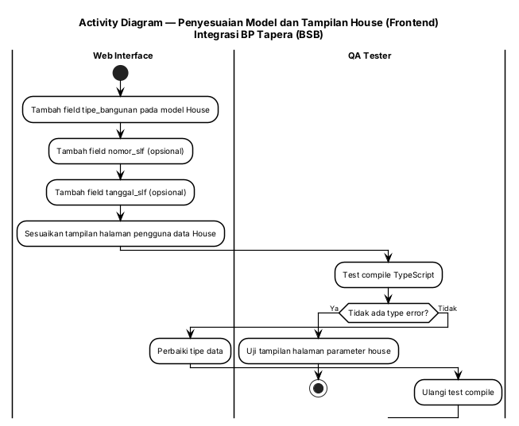

#### 3.9.4 Persyaratan Fungsional

| ID Spesifikasi | Deskripsi Spesifikasi | Aturan Bisnis/Ketergantungan Data |
|---|---|---|
| FR-9.1 | Model `House` pada frontend harus memuat `tipe_bangunan` bertipe string | [KODE] model saat ini belum memuatnya — `models/house.ts` |
| FR-9.2 | Model `House` harus memuat `nomor_slf?: string` (opsional) | [CR] task F.2 |
| FR-9.3 | Model `House` harus memuat `tanggal_slf?: string` (opsional) | [CR] task F.3 |
| FR-9.4 | Halaman yang menggunakan data `House` harus disesuaikan agar tidak menimbulkan error tampilan | [CR] task F.4 |
| FR-9.5 | Test compile TypeScript wajib lulus tanpa type error | [CR] task T.5 |

#### 3.9.5 Spesifikasi Tingkat Bidang

**Tabel A — Field Model House (Frontend)**

| Field | Tipe | Wajib | Status | Contoh Data | Sumber Data |
|---|---|---|---|---|---|
| `blok` | string | Ya | Sudah ada | A | API internal (cron) |
| `nomor_rumah` | string | Ya | Sudah ada | 100 | API internal (cron) |
| `luas_bangunan` | number | Ya | Sudah ada (dikoreksi pada UC-07) | 36 | API internal (cron) |
| `luas_tanah` | number | Ya | Sudah ada | 100 | API internal (cron) |
| `id_rumah` | string | Ya | Sudah ada | ID981726312 | API internal (cron) |
| `tipe_bangunan` | string | Ya | **BARU** | 36 | API internal (cron) |
| `nomor_slf` | string | Tidak | **BARU (opsional)** | SLF-00123 | API internal (cron) |
| `tanggal_slf` | string | Tidak | **BARU (opsional)** | 2026-05-14 | API internal (cron) |

**Tabel B — Aturan dan Ketergantungan**

| Field | Validasi/Aturan Bisnis | Pesan Kesalahan | Ketergantungan Data | Info/Catatan |
|---|---|---|---|---|
| `tipe_bangunan` | Ditampilkan apa adanya | — | Response List/Detail Rumah (UC-07/UC-08) | — |
| `nomor_slf` | Opsional; tampil kosong bila tidak ada | — | Response Detail Rumah | — |
| `tanggal_slf` | Opsional; format tampilan mengikuti locale sistem | — | Response Detail Rumah (Sikumbang) | — |

**Tabel C — Tombol, Tautan, dan Ikon**

| Label | Event OnClick | Terlihat | Aktif vs Dinonaktifkan | Navigasi Ke | Validasi | Ketergantungan |
|---|---|---|---|---|---|---|
| (tidak ada perubahan tombol pada UC ini) | — | — | — | — | — | — |

---

### 3.10 Penyesuaian Field Eligibility Verification (`lat_pic`/`long_pic`)

#### 3.10.1 Tujuan/Deskripsi

**Tujuan:** Menambahkan field `lat_pic` dan `long_pic` pada model verifikasi kelayakan di frontend, sehingga koordinat lokasi pihak PIC dapat dikirim dan tersimpan bersama bukti kelayakan.

**Deskripsi:** Modul verifikasi kelayakan di frontend saat ini memakai field `lat` dan `long` (koordinat pengunggah). [KODE] `web-service/src/pages/financing-application/schema/eligibility-verification.ts` — `CreateEligibilityVerificationSchema` memuat `lat` dan `long`. Penambahan `lat_pic`/`long_pic` merupakan item D.2 pada CR-20260729-001. Perbedaan semantik antara `lat`/`long` (pengunggah) dan `lat_pic`/`long_pic` (PIC) perlu dikonfirmasi → [Perlu validasi].

#### 3.10.2 Use Case

| | |
|-|-|
| **UC-10** | **Penyesuaian Field Eligibility Verification** |
| **Aktor Utama** | Operator Cabang |
| **Pemangku Kepentingan dan Minat** | Bank Sumsel Babel (ketertelusuran lokasi verifikasi), BP Tapera (kelengkapan bukti) |
| **Pemicu** | Item D.2 CR-20260729-001 — penyesuaian field eligibility verification |
| **Pre-kondisi** | Operator berada pada form Verifikasi Kelayakan |
| **Post-kondisi** | Model verifikasi kelayakan frontend memuat `lat_pic`/`long_pic`; data terkirim ke backend |
| **Skenario Sukses Utama** | 1. Cek model eligibility verification frontend → 2. Tambah field `lat_pic`/`long_pic` → 3. Tambahkan kontrol pengambilan koordinat (bila belum ada) → 4. Uji pengisian form verifikasi kelayakan → 5. Verifikasi data terkirim & tersimpan → **TUJUAN TERCAPAI** |
| **Ekstensi** | Jika koordinat tidak dapat diambil (izin lokasi ditolak), sistem harus tetap mengizinkan submit dengan nilai kosong atau memblokir sesuai kebijakan yang ditetapkan Klien |
| **Prioritas** | Sedang |
| **Persyaratan Khusus** | Wajib/tidaknya `lat_pic`/`long_pic` belum ditetapkan dalam CR — perlu keputusan Klien |
| **Pertanyaan Terbuka** | Apakah `lat_pic`/`long_pic` wajib? Bagaimana hubungannya dengan `lat`/`long` yang sudah ada? [Perlu validasi] |

##### JSON Use Case

```json
{
  "use_case": {
    "uc_id": "UC-10",
    "name": "Penyesuaian Field Eligibility Verification",
    "primary_actor": "ACTOR-001",
    "stakeholders": ["Bank Sumsel Babel", "BP Tapera"],
    "trigger": "Item D.2 CR-20260729-001",
    "preconditions": ["Operator berada pada form Verifikasi Kelayakan"],
    "postconditions": ["Model verifikasi kelayakan memuat lat_pic dan long_pic"],
    "main_success_scenario": [
      {"step": 1, "actor": "Sistem", "action": "Cek model eligibility verification frontend"},
      {"step": 2, "actor": "Sistem", "action": "Tambah field lat_pic dan long_pic"},
      {"step": 3, "actor": "Operator Cabang", "action": "Isi form verifikasi kelayakan termasuk koordinat PIC"},
      {"step": 4, "actor": "Sistem", "action": "Kirim dan simpan data verifikasi kelayakan"}
    ],
    "extensions": [
      {"at_step": 3, "condition": "Izin lokasi ditolak", "action": "Izinkan submit dengan nilai kosong atau blokir sesuai kebijakan Klien"}
    ],
    "priority": "medium",
    "entities": ["Pengajuan", "Rumah"],
    "business_rules": ["Semantik lat_pic/long_pic berbeda dari lat/long pengunggah"]
  }
}
```

#### 3.10.3 Diagram Aktivitas

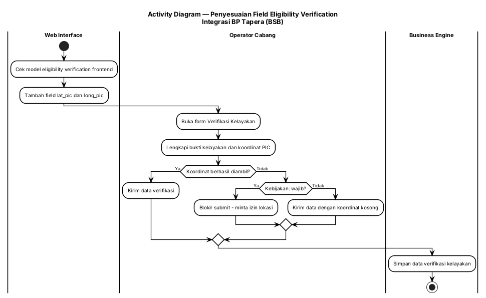

#### 3.10.4 Persyaratan Fungsional

| ID Spesifikasi | Deskripsi Spesifikasi | Aturan Bisnis/Ketergantungan Data |
|---|---|---|
| FR-10.1 | Model verifikasi kelayakan frontend harus memuat field `lat_pic` dan `long_pic` | [CR] task F.5; [KODE] model saat ini hanya memuat `lat`/`long` |
| FR-10.2 | Sistem harus mengirim `lat_pic`/`long_pic` bersama payload verifikasi kelayakan | Terkoordinasi dengan skema backend |
| FR-10.3 | Sistem harus menangani kondisi koordinat tidak tersedia sesuai kebijakan yang ditetapkan Klien | Ketergantungan: keputusan wajib/tidak wajib → [Perlu validasi] |
| FR-10.4 | Perubahan tidak boleh mengganggu alur verifikasi kelayakan existing (bukti foto, SLF, QR code) | [KODE] `CreateEligibilityVerificationSchema` existing |

#### 3.10.5 Spesifikasi Tingkat Bidang

**Tabel A — Field Verifikasi Kelayakan**

| Field | Kontrol UI | Wajib | Dapat Diedit | Tipe Data | Contoh Data | Sumber Data | Status |
|---|---|---|---|---|---|---|---|
| `lat` (koordinat pengunggah) | Hidden/Auto-capture | Ya | Tidak | Number | -3.1234 | GPS perangkat | Sudah ada |
| `long` (koordinat pengunggah) | Hidden/Auto-capture | Ya | Tidak | Number | 104.5678 | GPS perangkat | Sudah ada |
| `lat_pic` | Hidden/Auto-capture | [Perlu validasi] | Tidak | Number | -3.1234 | GPS perangkat PIC | **BARU** |
| `long_pic` | Hidden/Auto-capture | [Perlu validasi] | Tidak | Number | 104.5678 | GPS perangkat PIC | **BARU** |
| `document_slf` | Upload | Tidak | Ya | File | slf.pdf | User entry | Sudah ada |
| `qrcode` | Upload | Tidak | Ya | File | qr.png | User entry | Sudah ada |

**Tabel B — Aturan dan Ketergantungan**

| Field | Validasi/Aturan Bisnis | Pesan Kesalahan | Ketergantungan Data | Info/Catatan |
|---|---|---|---|---|
| `lat_pic`/`long_pic` | Nilai koordinat valid; wajib/tidak wajib menunggu keputusan Klien | "Masukkan Latitude/Longitude PIC" bila wajib | GPS perangkat | [Perlu validasi] |
| Bukti kelayakan | Minimal satu bukti kelayakan terunggah | "Silakan unggah bukti kelayakan" | Penyimpanan berkas (upload service) | [Perlu validasi] — layanan upload tidak di-clone |

**Tabel C — Tombol, Tautan, dan Ikon**

| Label | Event OnClick | Terlihat | Aktif vs Dinonaktifkan | Navigasi Ke | Validasi | Ketergantungan |
|---|---|---|---|---|---|---|
| "Isi Formulir" (verifikasi kelayakan) | Buka form verifikasi kelayakan | Ya | Aktif bila tahap sebelumnya selesai | Form verifikasi kelayakan | **Validasi mandatory field (lihat UC-11)** | Tahap sebelumnya sudah selesai |
| "Kirim" / "Simpan" | Submit verifikasi kelayakan | Ya | Aktif bila bukti & field wajib terisi | Tidak ada (pop up konfirmasi) | Bukti kelayakan, koordinat | UC-08 (data SLF rumah) |

---

### 3.11 Validasi Mandatory Field pada Aksi "Isi Formulir"

#### 3.11.1 Tujuan/Deskripsi

**Tujuan:** Menutup celah validasi pada alur Inbox Pengajuan, yaitu operator dapat menekan **"Isi Formulir"** dan masuk ke tahap berikutnya tanpa field mandatory (Gender, Pekerjaan Pemohon, Pendapatan Pemohon, dan field wajib lain) terverifikasi ulang terlebih dahulu.

**Deskripsi:** Temuan Klien: "pengajuan yang melalui inbox pengajuan (aplikasi tapera), data pendapatan dan gender bisa dilewati". Resolusi: "Perlu improve UI atau menambahkan proses validasi ketika tombol 'Isi Formulir' diklik".

**Kondisi aktual (terverifikasi dari kode):**

| # | Temuan | Bukti |
|---|---|---|
| 1 | Tombol/tautan **"Isi Formulir"** pada stepper langsung menavigasi ke form tanpa cek kelengkapan field | [KODE] `web-service/src/pages/financing-application/components/stepper.tsx:141` dan `:151` → `handleDetailClick()` menavigasi ke route berikutnya tanpa validasi |
| 2 | Tombol **"Isi Formulir"** pada daftar Verifikasi Kelayakan juga langsung menavigasi | [KODE] `views/create/4-eligibility-verification/List.tsx:268` |
| 3 | **NIK tidak dapat diubah** pada form pengajuan (`applicant_nik` read-only), sedangkan **`gender` dan `applicant_income` adalah field aktif** yang dapat dilewati | [KODE] `components/1-submission/Form.tsx:392` (occupation), `:418` (income), `:520` (gender) |
| 4 | Skema validasi `submissionSchema` **sudah menetapkan** `gender` dan `applicant_income` sebagai field wajib dengan pesan error | [KODE] `schema/submission.ts` — `gender: z.string().min(1)`, `applicant_income: z.number().min(1)` |
| 5 | Validasi skema hanya berjalan pada saat **submit form**, bukan pada saat aksi "Isi Formulir" diklik — inilah celah yang dilaporkan | [KODE] gabungan temuan 1–4 |

> **Interpretasi teknis (asumsi yang perlu dikonfirmasi).** Karena `gender`/`applicant_income` sudah wajib pada skema submit, celah yang dilaporkan Klien paling mungkin terjadi pada **pengajuan yang berasal dari Inbox/Sikasep**, yaitu data yang dibuat di luar sistem BSB Tapera lalu ditarik/dibuka operator melalui aksi "Isi Formulir" — sehingga field tersebut mungkin belum terisi pada record sumber dan tidak divalidasi sebelum form dibuka. Perlu konfirmasi alur & bukti tangkapan layar dari Klien. → [Perlu validasi]

#### 3.11.2 Use Case

| | |
|-|-|
| **UC-11** | **Validasi Mandatory Field pada Aksi "Isi Formulir"** |
| **Aktor Utama** | Operator Cabang |
| **Pemangku Kepentingan dan Minat** | Bank Sumsel Babel (kualitas data pengajuan, kepatuhan validasi BP Tapera) |
| **Pemicu** | Operator menekan tombol/tautan "Isi Formulir" pada inbox/stepper/daftar tahap |
| **Pre-kondisi** | Operator berada pada halaman Inbox Pengajuan / daftar tahap pengajuan |
| **Post-kondisi** | Form hanya terbuka bila seluruh field mandatory sudah terisi; bila belum, sistem menampilkan pesan validasi dan tidak berpindah halaman |
| **Skenario Sukses Utama** | 1. Operator menekan "Isi Formulir" → 2. Sistem mengecek kelengkapan field mandatory (Gender, Pekerjaan Pemohon, Pendapatan Pemohon, dan field wajib lain) → 3. Jika lengkap, sistem membuka form tahap berikutnya → 4. Operator mengisi/melengkapi form → 5. Submit dan sistem memvalidasi ulang di sisi backend → 6. Data tersimpan bila valid → **TUJUAN TERCAPAI** |
| **Ekstensi** | Jika ada field mandatory yang kosong, sistem menampilkan pesan error yang jelas per field, menyorot field bermasalah, dan tidak menavigasi; jika validasi backend terlewati (mis. request langsung ke API), backend tetap menolak dengan pesan validasi |
| **Prioritas** | Tinggi (P2 pada urutan eksekusi) |
| **Persyaratan Khusus** | Perbaikan harus diterapkan pada **dua lapisan** (frontend + backend) agar tidak dapat dilewati; terkait task D.3 CR-20260729-001 (validasi form pengajuan & dropdown pekerjaan) dan sebaiknya digabung pengerjaannya |
| **Pertanyaan Terbuka** | K6 — estimasi mandays & analisis risiko CR ini belum lengkap; apakah celah juga terjadi pada jalur Sikasep/mobile dan tahap lain (SP3K, akad)? [Perlu validasi] |

##### JSON Use Case

```json
{
  "use_case": {
    "uc_id": "UC-11",
    "name": "Validasi Mandatory Field pada Aksi Isi Formulir",
    "primary_actor": "ACTOR-001",
    "stakeholders": ["Bank Sumsel Babel"],
    "trigger": "Operator menekan tombol atau tautan Isi Formulir",
    "preconditions": ["Operator berada pada halaman Inbox Pengajuan atau daftar tahap pengajuan"],
    "postconditions": ["Form hanya terbuka bila seluruh field mandatory sudah terisi"],
    "main_success_scenario": [
      {"step": 1, "actor": "Operator Cabang", "action": "Menekan tombol Isi Formulir"},
      {"step": 2, "actor": "Sistem", "action": "Cek kelengkapan field mandatory (Gender, Pekerjaan Pemohon, Pendapatan, dll)"},
      {"step": 3, "actor": "Sistem", "action": "Membuka form tahap berikutnya bila lengkap"},
      {"step": 4, "actor": "Operator Cabang", "action": "Mengisi atau melengkapi form"},
      {"step": 5, "actor": "Sistem", "action": "Memvalidasi ulang di sisi backend"},
      {"step": 6, "actor": "Business Engine", "action": "Menyimpan data bila valid"}
    ],
    "extensions": [
      {"at_step": 2, "condition": "Field mandatory kosong", "action": "Tampilkan pesan error per field, sorot field bermasalah, jangan navigasi"},
      {"at_step": 5, "condition": "Request langsung ke API melewati frontend", "action": "Backend menolak dengan pesan validasi"}
    ],
    "priority": "high",
    "entities": ["Pengajuan", "Peserta"],
    "business_rules": ["Validasi wajib ada di frontend dan backend", "Terkait validasi dropdown pekerjaan (UC-04)"]
  }
}
```

#### 3.11.3 Diagram Aktivitas

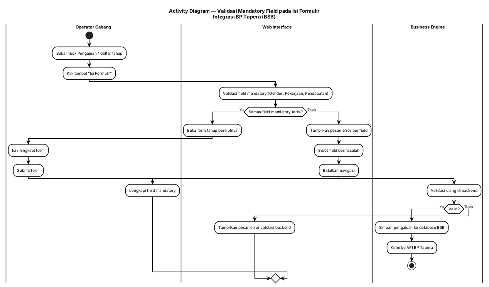

#### 3.11.4 Persyaratan Fungsional

| ID Spesifikasi | Deskripsi Spesifikasi | Aturan Bisnis/Ketergantungan Data |
|---|---|---|
| FR-11.1 | Aksi "Isi Formulir" harus memicu pengecekan kelengkapan field mandatory sebelum navigasi | [KODE] `stepper.tsx` & `views/create/4-eligibility-verification/List.tsx` saat ini langsung navigasi |
| FR-11.2 | Field mandatory minimum yang diverifikasi: Gender, Pekerjaan Pemohon, Penghasilan Pemohon, dan seluruh field wajib lain pada skema tahap terkait | [KODE] `schema/submission.ts`; [CR] CR-20260908-001 |
| FR-11.3 | Sistem harus menampilkan pesan error yang jelas dan spesifik per field, serta menyorot field bermasalah | [CR] resolusi "improve UI atau menambahkan proses validasi" |
| FR-11.4 | Sistem tidak boleh berpindah halaman bila validasi gagal | Perilaku wajib |
| FR-11.5 | Validasi wajib diterapkan juga di sisi backend agar tidak dapat dilewati melalui request langsung | [CR] task V-2 |
| FR-11.6 | Pesan validasi harus konsisten antara frontend dan backend | Hindari pesan berbeda untuk kondisi sama |
| FR-11.7 | Perbaikan harus mencakup seluruh titik masuk "Isi Formulir" pada alur pengajuan, bukan hanya satu layar | [KODE] minimal 2 titik teridentifikasi; verifikasi menyeluruh → [Perlu validasi] |
| FR-11.8 | Perbaikan harus diuji dengan regression pada form pengajuan & inbox | [CR] task V-3 |

#### 3.11.5 Spesifikasi Tingkat Bidang

**Tabel A — Titik Masuk & Field Terverifikasi**

| Titik Masuk | Lokasi | Perilaku Sekarang | Perilaku Target | Field Diverifikasi |
|---|---|---|---|---|
| Tautan "Isi Formulir" pada stepper | `components/stepper.tsx:141, :151` | Navigasi langsung | Validasi dulu, lalu navigasi | Field mandatory tahap berikutnya |
| Tombol "Isi Formulir" pada daftar Verifikasi Kelayakan | `views/create/4-eligibility-verification/List.tsx:268` | Navigasi langsung | Validasi dulu, lalu navigasi | Field mandatory verifikasi kelayakan |
| Field Gender | `components/1-submission/Form.tsx:520` | Dapat dilewati | Wajib terisi sebelum lanjut | `gender` |
| Field Pekerjaan Pemohon | `components/1-submission/Form.tsx:392` | Dapat dilewati | Wajib terisi sebelum lanjut (lihat UC-04) | `applicant_occupation` |
| Field Penghasilan Pemohon | `components/1-submission/Form.tsx:418` | Dapat dilewati | Wajib terisi sebelum lanjut | `applicant_income` |
| Field NIK Pemohon | `components/1-submission/Form.tsx` | Read-only (tidak dapat diubah) | Tetap read-only | `applicant_nik` |

**Tabel B — Aturan dan Ketergantungan**

| Field | Validasi/Aturan Bisnis | Pesan Kesalahan | Ketergantungan Data | Info/Catatan |
|---|---|---|---|---|
| Gender | Wajib (min 1 nilai) | "Masukkan Jenis Kelamin" | Skema form | [KODE] pesan sudah ada di `submissionSchema` |
| Penghasilan Pemohon | Wajib (min 1) | "Masukkan Penghasilan Pemohon" | Skema form | [KODE] pesan sudah ada |
| Pekerjaan Pemohon | Wajib (min 1) | "Masukkan Pekerjaan Pemohon" | API Tapera List Segmen Pekerjaan | Terkait UC-04 |
| NIK Pemohon | 16 digit; tidak dapat diubah setelah cek prioritas | "NIK harus 16 digit" | API BP Tapera (cek prioritas) | [FSD] FSD Pengajuan FR-2 |
| Validasi backend | Menolak payload tidak lengkap | Pesan validasi backend | — | Mencegah bypass |

**Tabel C — Tombol, Tautan, dan Ikon**

| Label | Event OnClick | Terlihat | Aktif vs Dinonaktifkan | Navigasi Ke | Validasi | Ketergantungan |
|---|---|---|---|---|---|---|
| "Isi Formulir" (stepper) | Validasi lalu navigasi ke form tahap berikutnya | Ya | Aktif (perilaku validasi berubah) | Form tahap berikutnya | Field mandatory tahap berikutnya | Selesainya tahap sebelumnya |
| "Isi Formulir" (daftar verifikasi kelayakan) | Validasi lalu navigasi ke form verifikasi | Ya | Aktif | Form verifikasi kelayakan | Field mandatory verifikasi | UC-10 |
| "Kirim Pengajuan" | Submit pengajuan ke API BP Tapera | Ya | Aktif bila semua field mandatory terisi | Tidak ada (pop up konfirmasi) | Seluruh field mandatory | Validasi backend FR-11.5 |

---

### 3.12 Penyesuaian Tenor Maksimal s.d. 480 Bulan

#### 3.12.1 Tujuan/Deskripsi

**Tujuan:** Memperluas batas tenor maksimal pembiayaan dari 20 tahun (240 bulan) menjadi **40 tahun (480 bulan)** pada modul pengajuan, SP3K, akad, dan amortisasi jadwal angsuran, sesuai kebijakan KPR Sejahtera FLPP (Kepmen PKP 1721/1722 Tahun 2026).

**Deskripsi:** Saat ini validasi tenor maksimal pada modul SP3K masih membedakan program: **360 bulan untuk TAPERA dan 240 bulan untuk program lainnya**. [KODE] `web-service/src/pages/financing-application/views/create/3-sp3k-approval/Sp3kFormView.tsx:53` dan `views/edit/3-sp3k-approval/Sp3kUpdateView.tsx:51` — pesan: `Tenor maksimal adalah ${programType === "TAPERA" ? 360 : 240} bulan`. FSD existing juga mencatat sumber Tenor/Bunga dari API Core Bank Get Jadwal Angsur dengan contoh 120 bulan. [FSD] `20241216.TAPERA.FSD-Amortisasi_Jadwal_Angsuran.md` field #1, #2.

**Ketergantungan kritis:** apakah Core Banking BSB mendukung tenor 480 bulan — blocker K1, wajib terjawab sebelum implementasi.

#### 3.12.2 Use Case

| | |
|-|-|
| **UC-12** | **Penyesuaian Tenor Maksimal s.d. 480 Bulan** |
| **Aktor Utama** | Operator Cabang |
| **Pemangku Kepentingan dan Minat** | Bank Sumsel Babel (kepatuhan Kepmen PKP 1721/1722), BP Tapera |
| **Pemicu** | Kebijakan KPR Sejahtera FLPP — tenor s.d. 40 tahun (Kepmen PKP 1721/1722 Tahun 2026) |
| **Pre-kondisi** | Sistem masih memvalidasi tenor maksimal 240 bulan (non-TAPERA) / 360 bulan (TAPERA); Core Banking BSB mendukung tenor panjang |
| **Post-kondisi** | Tenor s.d. 480 bulan dapat diinput, divalidasi konsisten, diproses tanpa error pada pengajuan → SP3K → akad → jadwal angsuran |
| **Skenario Sukses Utama** | 1. Konfirmasi dukungan Core Banking (K1) → 2. Update validasi rentang tenor di backend (batas maksimum 480) → 3. Update validasi & pesan error di frontend (portal konvensional dan syariah) → 4. Update constraint kolom tenor di database → 5. Simulasi jadwal angsuran dengan tenor 40 tahun → 6. Verifikasi jadwal 480 baris dari Core Bank → 7. Test case & regression → 8. Deploy staging → production → **TUJUAN TERCAPAI** |
| **Ekstensi** | Jika Core Banking BSB belum mendukung tenor 480 bulan (K1 belum terjawab/negatif), maka implementasi ditunda dan pengajuan tenor >240 bulan ditolak dengan pesan informatif; jadwal angsuran 40 tahun tidak dapat dihasilkan |
| **Prioritas** | Tinggi (P1 pada urutan eksekusi) |
| **Persyaratan Khusus** | Perubahan harus konsisten di seluruh alur (pengajuan → SP3K → akad → amortisasi) agar tidak ada tahap yang menolak tenor; berlaku untuk portal konvensional **dan** syariah |
| **Pertanyaan Terbuka** | K1 — dukungan Core Banking BSB; K4 — perlakuan pengajuan existing dengan parameter lama |

##### JSON Use Case

```json
{
  "use_case": {
    "uc_id": "UC-12",
    "name": "Penyesuaian Tenor Maksimal sampai 480 Bulan",
    "primary_actor": "ACTOR-001",
    "stakeholders": ["Bank Sumsel Babel", "BP Tapera"],
    "trigger": "Kebijakan KPR Sejahtera FLPP tenor sampai 40 tahun",
    "preconditions": ["Sistem memvalidasi tenor maksimal 240/360 bulan", "Core Banking BSB mendukung tenor panjang"],
    "postconditions": ["Tenor sampai 480 bulan dapat diproses pada seluruh tahap"],
    "main_success_scenario": [
      {"step": 1, "actor": "Operator Cabang", "action": "Konfirmasi dukungan Core Banking BSB (K1)"},
      {"step": 2, "actor": "Sistem", "action": "Update validasi rentang tenor di backend menjadi maksimum 480"},
      {"step": 3, "actor": "Sistem", "action": "Update validasi dan pesan error di frontend kedua portal"},
      {"step": 4, "actor": "Sistem", "action": "Update constraint kolom tenor pada database"},
      {"step": 5, "actor": "API Core Banking BSB", "action": "Menghasilkan jadwal angsuran tenor 40 tahun"},
      {"step": 6, "actor": "QA Tester", "action": "Susun test case dan jalankan regression"},
      {"step": 7, "actor": "Sistem", "action": "Deploy staging lalu production"}
    ],
    "extensions": [
      {"at_step": 5, "condition": "Core Banking belum mendukung tenor 480 bulan (K1)", "action": "Tunda implementasi dan tolak tenor lebih besar dengan pesan informatif"}
    ],
    "priority": "high",
    "entities": ["Pengajuan", "SP3K", "Akad", "Angsuran"],
    "business_rules": ["Tenor maksimum 480 bulan", "Konsisten di seluruh tahap", "Berlaku portal konvensional dan syariah"]
  }
}
```

#### 3.12.3 Diagram Aktivitas

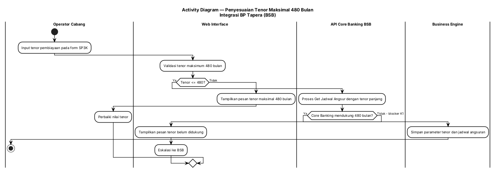

#### 3.12.4 Persyaratan Fungsional

| ID Spesifikasi | Deskripsi Spesifikasi | Aturan Bisnis/Ketergantungan Data |
|---|---|---|
| FR-12.1 | Sistem harus menerima dan memvalidasi tenor sampai dengan 480 bulan (40 tahun) pada modul pengajuan dan amortisasi | [CR] CR-20260908-002 task A.1, B.1 |
| FR-12.2 | Batas maksimum tenor harus seragam di seluruh titik validasi (pengajuan → SP3K → akad → jadwal angsuran) | [KODE] saat ini 240/360 bulan di `Sp3kFormView.tsx:53`, `Sp3kUpdateView.tsx:51` |
| FR-12.3 | Pesan error tenor harus menyebutkan batas baru (480 bulan) | Ganti pesan `Tenor maksimal adalah 240 bulan` |
| FR-12.4 | Perubahan harus diterapkan pada portal konvensional **dan** syariah | [CR] task B.1 |
| FR-12.5 | Constraint kolom tenor pada database harus diverifikasi dan disesuaikan | [CR] task A.4 |
| FR-12.6 | Sistem harus menangani kondisi Core Banking belum mendukung tenor panjang dengan pesan yang informatif (bukan error teknis) | Ketergantungan K1 |
| FR-12.7 | Pengujian harus mencakup boundary value tenor (10/15/20/40 tahun) | [CR] task D.1 |
| FR-12.8 | Pengajuan existing dengan parameter lama harus tetap dapat diproses | [CR] task D.2; K4 → [Perlu validasi] |

#### 3.12.5 Spesifikasi Tingkat Bidang

**Tabel A — Field Tenor**

| Field | Kontrol UI | Wajib | Dapat Diedit | Tipe Data | Nilai Sekarang | Nilai Baru | Contoh Data | Sumber Data |
|---|---|---|---|---|---|---|---|---|
| Tenor Pembiayaan (SP3K) | Textbox | Ya | Ya | Integer | maks 360 (TAPERA) / 240 (lain) | **maks 480** | 480 | User Input |
| Tenor (Amortisasi Jadwal Angsuran) | Textbox | Ya | Ya | Integer | mengikuti API Core Bank (contoh 120) | **maks 480** | 480 | API Core Bank Get Jadwal Angsur |
| `financing_tenure` (skema backend) | — | Ya | Ya | Integer | validasi 240/360 | **maks 480** | 480 | User Input |

**Tabel B — Aturan dan Ketergantungan**

| Field | Validasi/Aturan Bisnis | Pesan Kesalahan | Ketergantungan Data | Info/Catatan |
|---|---|---|---|---|
| Tenor | Nilai > 0 dan ≤ 480 | "Tenor maksimal adalah 480 bulan" | API Core Bank Get Jadwal Angsur | [KODE] pesan lama: "Tenor maksimal adalah 240 bulan" |
| Tenor (boundary) | Uji 10/15/20/40 tahun | — | — | [CR] task D.1 |
| Tenor existing | Tidak dilakukan perubahan otomatis | — | DB BSB | K4 → [Perlu validasi] |

**Tabel C — Tombol, Tautan, dan Ikon**

| Label | Event OnClick | Terlihat | Aktif vs Dinonaktifkan | Navigasi Ke | Validasi | Ketergantungan |
|---|---|---|---|---|---|---|
| "Simpan Pengajuan SP3K" | Submit SP3K dengan tenor baru | Ya | Aktif bila semua field mandatory terisi | Tidak ada (pop up konfirmasi) | Tenor ≤ 480 | Core Banking mendukung (K1) |
| "Dapatkan Jadwal Angsuran" | Panggil API Core Bank dengan tenor panjang | Ya | Aktif | Tidak ada | — | Core Banking (K1) |
| "Kirim jadwal ke BP Tapera" | Submit amortisasi ke BP Tapera | Ya | Aktif bila field mandatory terisi | Tidak ada (pop up konfirmasi) | Tenor ≤ 480 | UC-01 (route baru) |

---

### 3.13 Penyesuaian Suku Bunga Tetap 6,00%/5,00% & Pemetaan Jenis Rumah

#### 3.13.1 Tujuan/Deskripsi

**Tujuan:** Menerapkan suku bunga tetap baru — **6,00% p.a. untuk Rumah Tapak** dan **5,00% p.a. untuk Rumah Susun** — serta menambahkan logika pemetaan jenis rumah → suku bunga yang konsisten di seluruh alur.

**Deskripsi:** Sistem saat ini memakai suku bunga tunggal 5% yang di-set dari environment/konfigurasi. [KODE] `components/3-sp3k/Form.tsx:296` → `setValue("interest_rate", 5)`; FSD existing: "Suku bunga otomatis di isi 5% berdasarkan environment yang sudah di setting". [FSD] FSD SP3K existing field #12. Kebijakan baru menuntut bunga berbeda per jenis rumah, sehingga perlu logika pemetaan terpusat (bukan nilai tunggal). Jenis Perumahan pada SP3K sudah memiliki pilihan **Tapak / Rusun**. [FSD] FSD SP3K existing field #27.

#### 3.13.2 Use Case

| | |
|-|-|
| **UC-13** | **Penyesuaian Suku Bunga Tetap & Pemetaan Jenis Rumah** |
| **Aktor Utama** | Business Engine (Golang) / Admin Sistem |
| **Pemangku Kepentingan dan Minat** | Bank Sumsel Babel (kepatuhan kebijakan FLPP), BP Tapera |
| **Pemicu** | Kebijakan baru suku bunga tetap KPR Sejahtera FLPP (Kepmen PKP 1721/1722 Tahun 2026) |
| **Pre-kondisi** | Sistem memakai suku bunga tunggal (5%) dari konfigurasi; jenis rumah sudah dapat dipilih (Tapak/Rusun) |
| **Post-kondisi** | Suku bunga ditentukan otomatis berdasarkan jenis rumah (6,00% tapak / 5,00% susun), konsisten dari pengajuan sampai jadwal angsuran |
| **Skenario Sukses Utama** | 1. Konfirmasi cakupan produk dari BSB (K3) → 2. Tambahkan logika pemetaan jenis rumah → suku bunga → 3. Update nilai dan validasi suku bunga di backend → 4. Update nilai default & tampilan bunga di frontend → 5. Update parameter produk (nilai suku bunga baru) → 6. Uji seluruh alur (pengajuan → SP3K → akad → jadwal angsuran) → 7. Test case khusus pemetaan bunga → **TUJUAN TERCAPAI** |
| **Ekstensi** | Jika suku bunga baru hanya berlaku untuk produk KPR Sejahtera FLPP dan tidak menggantikan parameter existing (K3), maka sistem harus mendukung versioning produk/pengajuan sehingga pengajuan lama tetap memakai parameter lamanya |
| **Prioritas** | Tinggi (P1) |
| **Persyaratan Khusus** | Logika pemetaan harus terpusat agar tidak terjadi penerapan bunga yang salah per jenis rumah |
| **Pertanyaan Terbuka** | K3 — cakupan produk (hanya FLPP atau menggantikan existing); K4 — perlakuan pengajuan existing; K5 — apakah DP 1%/premi/pelunasan dipercepat perlu fitur tampilan |

##### JSON Use Case

```json
{
  "use_case": {
    "uc_id": "UC-13",
    "name": "Penyesuaian Suku Bunga Tetap dan Pemetaan Jenis Rumah",
    "primary_actor": "ACTOR-005",
    "stakeholders": ["Bank Sumsel Babel", "BP Tapera"],
    "trigger": "Kebijakan baru suku bunga tetap KPR Sejahtera FLPP",
    "preconditions": ["Sistem memakai suku bunga tunggal dari konfigurasi", "Jenis rumah dapat dipilih (Tapak/Rusun)"],
    "postconditions": ["Suku bunga ditentukan otomatis berdasarkan jenis rumah secara konsisten"],
    "main_success_scenario": [
      {"step": 1, "actor": "Admin Sistem", "action": "Konfirmasi cakupan produk suku bunga baru ke BSB (K3)"},
      {"step": 2, "actor": "Sistem", "action": "Tambahkan logika pemetaan jenis rumah ke suku bunga"},
      {"step": 3, "actor": "Sistem", "action": "Update nilai dan validasi suku bunga di backend"},
      {"step": 4, "actor": "Sistem", "action": "Update nilai default dan tampilan bunga di frontend"},
      {"step": 5, "actor": "Sistem", "action": "Update parameter produk dengan nilai suku bunga baru"},
      {"step": 6, "actor": "QA Tester", "action": "Uji seluruh alur dan test case khusus pemetaan bunga"}
    ],
    "extensions": [
      {"at_step": 5, "condition": "Suku bunga baru hanya untuk produk FLPP", "action": "Dukung versioning produk/pengajuan agar pengajuan lama memakai parameter lama"}
    ],
    "priority": "high",
    "entities": ["Pengajuan", "SP3K", "Angsuran", "Referensi"],
    "business_rules": ["Rumah Tapak 6,00%", "Rumah Susun 5,00%", "Logika pemetaan terpusat"]
  }
}
```

#### 3.13.3 Diagram Aktivitas

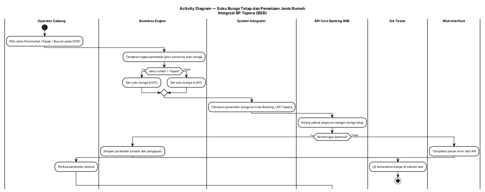

#### 3.13.4 Persyaratan Fungsional

| ID Spesifikasi | Deskripsi Spesifikasi | Aturan Bisnis/Ketergantungan Data |
|---|---|---|
| FR-13.1 | Sistem harus menerapkan suku bunga tetap **6,00% p.a.** untuk Rumah Tapak | [CR] CR-20260908-002 §1 |
| FR-13.2 | Sistem harus menerapkan suku bunga tetap **5,00% p.a.** untuk Rumah Susun | [CR] CR-20260908-002 §1; [KODE] nilai lama 5% tunggal di `3-sp3k/Form.tsx:296` |
| FR-13.3 | Sistem harus menentukan suku bunga secara otomatis berdasarkan jenis rumah (logika pemetaan terpusat) | [CR] task A.3 |
| FR-13.4 | Nilai dan validasi suku bunga harus konsisten di seluruh titik validasi backend | [CR] task A.2 |
| FR-13.5 | Constraint kolom terkait bunga dan data parameter produk harus diverifikasi & di-update | [CR] task A.4 |
| FR-13.6 | Sistem harus menampilkan nilai default dan tampilan suku bunga sesuai jenis program/rumah di frontend | [CR] task B.2 |
| FR-13.7 | Sistem harus mendukung perlakuan berbeda untuk pengajuan existing sesuai keputusan BSB (K3/K4) | Ketergantungan keputusan Klien |
| FR-13.8 | Sistem harus menyediakan test case khusus pemetaan bunga (6% vs 5%) | Mitigasi risiko "salah terapkan suku bunga per jenis rumah" |

#### 3.13.5 Spesifikasi Tingkat Bidang

**Tabel A — Field Suku Bunga**

| Field | Kontrol UI | Wajib | Dapat Diedit | Tipe Data | Set Nilai (Baru) | Nilai Default | Contoh Data | Sumber Data |
|---|---|---|---|---|---|---|---|---|
| Jenis Perumahan (SP3K) | Dropdown | Ya | Ya | String | Tapak; Rusun | Tapak | Tapak | [FSD] FSD SP3K existing field #27 |
| Suku Bunga (SP3K) | Textbox | Ya | Ya | Decimal (%) | — | Menyesuaikan jenis rumah | 6,00 | Sistem (pemetaan jenis rumah) |
| Bunga (Amortisasi Jadwal Angsuran) | Textbox | Ya | Ya | Decimal (%) | — | Menyesuaikan jenis rumah | 5,00 | API Core Bank Get Jadwal Angsur |
| `interest_rate` (skema backend) | — | Ya | Ya | Number | — | Menyesuaikan jenis rumah | 6 | User Input / Sistem |

> **Catatan.** FSD existing mencatat Suku Bunga sebagai `Integer` dengan contoh `5 %` dan sumber "Sistem berdasarkan pengaturan env". [FSD] FSD SP3K existing field #12. Perubahan dari nilai env tunggal → pemetaan jenis rumah mengubah sifat field ini. Nilai desimal (6,00 / 5,00) vs integer (6 / 5) pada penyimpanan perlu dikonfirmasi → [Perlu validasi].

**Tabel B — Aturan dan Ketergantungan**

| Field | Validasi/Aturan Bisnis | Pesan Kesalahan | Ketergantungan Data | Info/Catatan |
|---|---|---|---|---|
| Jenis rumah → bunga | Tapak = 6,00%; Susun = 5,00% | — | Jenis Perumahan (SP3K) | Logika pemetaan terpusat |
| Suku bunga | Wajib terisi, dihitung sistem | "Suku bunga wajib terisi" (pola existing) | Parameter produk | [KODE] sebelumnya hardcode 5 |
| Konsistensi alur | Bunga identik pada pengajuan, SP3K, akad, jadwal angsuran | — | — | Uji khusus |
| Pengajuan existing | Menunggu keputusan K3/K4 | — | DB BSB | [Perlu validasi] |
| Produk | Kode produk per skema bunga (mis. KPRKNS6 / KPRSYS6) perlu terdaftar di parameter produk | Error dari API Tapera bila kode tidak dikenal | API BP Tapera `/parameter/produk` | Lihat Lampiran B (matriks validasi) |

**Tabel C — Tombol, Tautan, dan Ikon**

| Label | Event OnClick | Terlihat | Aktif vs Dinonaktifkan | Navigasi Ke | Validasi | Ketergantungan |
|---|---|---|---|---|---|---|
| "Simpan Pengajuan SP3K" | Submit SP3K dengan bunga hasil pemetaan | Ya | Aktif bila semua field mandatory terisi | Tidak ada (pop up konfirmasi) | Jenis rumah & bunga terisi | Parameter produk terdaftar |
| "Simpan Perubahan" (ubah SP3K) | Submit perubahan SP3K | Ya | Aktif bila semua field mandatory terisi | Tidak ada (pop up konfirmasi) | — | UC-13 FR-13.4 |

---

### 3.14 Tampilan Simulasi & Jadwal Angsuran Tenor Panjang

#### 3.14.1 Tujuan/Deskripsi

**Tujuan:** Memastikan tampilan simulasi dan tabel jadwal angsuran tetap terbaca dan tidak merusak layout ketika jumlah baris mencapai 480 (tenor 40 tahun), serta hasil simulasi sesuai tabel resmi Klien.

**Deskripsi:** Form amortisasi jadwal angsuran existing menampilkan tabel jadwal (No Urut, Tanggal Bayar, Jumlah Angsuran, Jumlah Pokok, Jumlah Bunga, Sisa Pokok, Keterangan). [FSD] `20241216.TAPERA.FSD-Amortisasi_Jadwal_Angsuran.md` field #4–#10. Dengan tenor s.d. 480 bulan, jumlah baris meningkat dari contoh existing (120) menjadi 480 sehingga perlu mekanisme paginasi/scroll dan uji silang terhadap tabel resmi Klien (5 zona × 4 tenor).

#### 3.14.2 Use Case

| | |
|-|-|
| **UC-14** | **Tampilan Simulasi & Jadwal Angsuran Tenor Panjang** |
| **Aktor Utama** | Operator Cabang |
| **Pemangku Kepentingan dan Minat** | Bank Sumsel Babel (keterbacaan & akurasi data), BP Tapera (kesesuaian perhitungan) |
| **Pemicu** | Penyesuaian tenor s.d. 480 bulan (UC-12) |
| **Pre-kondisi** | Jadwal angsuran berhasil diambil dari Core Bank untuk tenor panjang |
| **Post-kondisi** | Tabel jadwal angsuran 480 baris tampil terbaca; hasil simulasi sesuai tabel resmi Klien |
| **Skenario Sukses Utama** | 1. Operator menekan "Dapatkan Jadwal Angsuran" → 2. Sistem menampilkan tabel jadwal tenor panjang → 3. Sistem menerapkan paginasi/scroll agar layout tidak rusak → 4. Operator memverifikasi nilai → 5. QA melakukan uji silang simulasi vs tabel resmi (5 zona × 4 tenor) → 6. Regression modul pengajuan, amortisasi, stok rumah → **TUJUAN TERCAPAI** |
| **Ekstensi** | Jika hasil simulasi tidak sesuai tabel resmi (perbedaan pembulatan/metode), maka perbedaan didokumentasikan dan dieskalasi ke BSB/Core Banking sebelum UAT |
| **Prioritas** | Sedang (bagian dari P1) |
| **Persyaratan Khusus** | Perbedaan metode perhitungan/pembulatan antara sistem dan tabel resmi wajib diselesaikan sebelum UAT |
| **Pertanyaan Terbuka** | R6 — sumber perbedaan simulasi (pembulatan vs metode amortisasi) → [Perlu validasi] |

##### JSON Use Case

```json
{
  "use_case": {
    "uc_id": "UC-14",
    "name": "Tampilan Simulasi dan Jadwal Angsuran Tenor Panjang",
    "primary_actor": "ACTOR-001",
    "stakeholders": ["Bank Sumsel Babel", "BP Tapera"],
    "trigger": "Penyesuaian tenor sampai 480 bulan",
    "preconditions": ["Jadwal angsuran berhasil diambil dari Core Bank untuk tenor panjang"],
    "postconditions": ["Tabel jadwal 480 baris tampil terbaca dan sesuai tabel resmi"],
    "main_success_scenario": [
      {"step": 1, "actor": "Operator Cabang", "action": "Menekan tombol Dapatkan Jadwal Angsuran"},
      {"step": 2, "actor": "Sistem", "action": "Menampilkan tabel jadwal tenor panjang"},
      {"step": 3, "actor": "Sistem", "action": "Menerapkan paginasi atau scroll agar layout tetap terbaca"},
      {"step": 4, "actor": "QA Tester", "action": "Uji silang simulasi terhadap tabel resmi 5 zona x 4 tenor"},
      {"step": 5, "actor": "QA Tester", "action": "Regression modul pengajuan, amortisasi, stok rumah"}
    ],
    "extensions": [
      {"at_step": 4, "condition": "Hasil simulasi berbeda dari tabel resmi", "action": "Dokumentasikan perbedaan dan eskalasi ke BSB/Core Banking sebelum UAT"}
    ],
    "priority": "medium",
    "entities": ["Angsuran", "Pengajuan"],
    "business_rules": ["Layout harus tetap terbaca pada 480 baris", "Hasil simulasi harus sesuai tabel resmi Klien"]
  }
}
```

#### 3.14.3 Diagram Aktivitas

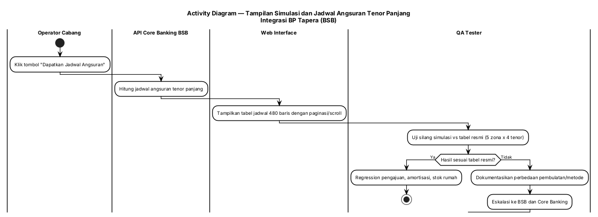

#### 3.14.4 Persyaratan Fungsional

| ID Spesifikasi | Deskripsi Spesifikasi | Aturan Bisnis/Ketergantungan Data |
|---|---|---|
| FR-14.1 | Tabel jadwal angsuran harus tetap terbaca untuk tenor s.d. 480 baris (paginasi/scroll bila perlu) | [CR] task B.3 |
| FR-14.2 | Sistem harus menampilkan informasi respons API Core Bank termasuk pesan & kode error bila gagal | [FSD] FSD Amortisasi FR-5 |
| FR-14.3 | Sistem harus menampilkan "Data Jadwal tidak ditemukan" bila jadwal tidak tersedia | [FSD] FSD Amortisasi business rules field #11 |
| FR-14.4 | Sistem harus menyediakan test case pengajuan dengan tenor 10/15/20/40 tahun dan bunga 6%/5% | [CR] task D.1 |
| FR-14.5 | Regression harus mencakup modul pengajuan, amortisasi, dan stok rumah | [CR] task D.2 |
| FR-14.6 | Uji silang hasil simulasi terhadap tabel resmi Klien (5 zona × 4 tenor) wajib dilakukan sebelum UAT | [CR] task D.3; mitigasi R6 |
| FR-14.7 | Pengajuan existing dengan parameter lama (bunga/tenor) harus tetap berjalan | [CR] task D.2; K4 → [Perlu validasi] |

#### 3.14.5 Spesifikasi Tingkat Bidang

**Tabel A — Kolom Tabel Jadwal Angsuran**

| No | Field Label | Kontrol UI | Wajib | Dapat Diedit | Tipe Data | Contoh Data (tenor pendek) | Contoh Data (tenor panjang) | Sumber Data |
|---|---|---|---|---|---|---|---|---|
| 4 | No Urut | Kolom Tabel | Ya | Tidak | Integer | 1 | 480 | API Core Bank Get Jadwal Angsur |
| 5 | Tanggal Bayar | Kolom Tabel | Ya | Tidak | Date | 03/01/2025 | 03/01/2066 | API Core Bank Get Jadwal Angsur |
| 6 | Jumlah Angsuran | Kolom Tabel | Ya | Tidak | Integer | Rp 5.000.000 | [Perlu validasi] | API Core Bank Get Jadwal Angsur |
| 7 | Jumlah Pokok | Kolom Tabel | Ya | Tidak | Integer | Rp 4.000.000 | [Perlu validasi] | API Core Bank Get Jadwal Angsur |
| 8 | Jumlah Bunga | Kolom Tabel | Ya | Tidak | Decimal (%) | 0,3% | 6,00% / 5,00% sesuai jenis rumah | API Core Bank Get Jadwal Angsur |
| 9 | Sisa Pokok | Kolom Tabel | Ya | Tidak | Integer | Rp 157.000.000 | [Perlu validasi] | API Core Bank Get Jadwal Angsur |
| 10 | Keterangan | Kolom Tabel | Ya | Tidak | String | Angsuran ke 1 | Angsuran ke 480 | API Core Bank Get Jadwal Angsur |

> **Catatan.** Kolom #4–#10 mengacu FSD Amortisasi existing. [#4–#10 field] Ditambahkan kebutuhan **paginasi/scroll** dan **uji silang** akibat perubahan tenor.

**Tabel B — Aturan dan Ketergantungan**

| Area | Validasi/Aturan Bisnis | Pesan Kesalahan | Ketergantungan Data | Info/Catatan |
|---|---|---|---|---|
| Tampilan tabel | Tetap terbaca pada 480 baris; layout tidak rusak | — | — | Gunakan paginasi/virtual scroll |
| Ketersediaan jadwal | Bila API Core Bank tidak mengembalikan data | "Data Jadwal tidak ditemukan" | API Core Bank Get Jadwal Angsur | [FSD] |
| Akurasi simulasi | Harus sesuai tabel resmi Klien (5 zona × 4 tenor) | — | Tabel simulasi resmi Klien | Selisih pembulatan dieskalasi |
| Regresi | Modul pengajuan, amortisasi, stok rumah | — | DB BSB | Pengajuan existing tetap berjalan |

**Tabel C — Tombol, Tautan, dan Ikon**

| Label | Event OnClick | Terlihat | Aktif vs Dinonaktifkan | Navigasi Ke | Validasi | Ketergantungan |
|---|---|---|---|---|---|---|
| "Dapatkan Jadwal Angsuran" | Panggil API Core Bank Get Jadwal Angsur | Ya | Aktif | Tidak ada | — | Core Banking (K1) |
| "Kirim jadwal ke BP Tapera" | Submit amortisasi ke BP Tapera | Ya | Aktif bila semua field mandatory terisi | Tidak ada (pop up konfirmasi) | Field mandatory | UC-01 (route baru) |
| "Ubah Jadwal" | Buka form perubahan jadwal angsuran | Ya | Aktif | Form perubahan amortisasi | — | [FSD] FSD Amortisasi UC-2 |

---
## 4. Konfigurasi Sistem

Perubahan pada FSD ini memerlukan penyesuaian konfigurasi berikut. Semua nilai harus dikelola melalui environment variable / parameter — **tidak di-hardcode**.

### 4.1 Konfigurasi Environment

| # | Parameter | Environment | Nilai Target | Tujuan | Ketergantungan |
|---|---|---|---|---|---|
| 1 | `TAPERA_BASE_URL` | Development | `https://api.dev.tapera.go.id:8443/` | Akses endpoint Tapera versi terbaru | K9 — saat ini belum dapat diakses |
| 2 | `TAPERA_BASE_URL` | Staging | `https://api.qa.tapera.go.id/` | Pengujian pra-production | [Perlu validasi] |
| 3 | `TAPERA_BASE_URL` | Production | `https://h2h.tapera.go.id/` | Kanal H2H produksi | — |
| 4 | `CORE_BANKING_BASE_URL` | Semua | (sesuai environment BSB) | Sumber Get Jadwal Angsur, CIF, PK | K1 — dukungan tenor 480 |
| 5 | `CRON_BASE_URL` | Semua | (sesuai environment BSB) | Trigger sinkronisasi Stok Rumah | — |

### 4.2 Parameter Aplikasi

| # | Parameter | Nilai Sekarang | Nilai Target | Tujuan | Sumber |
|---|---|---|---|---|---|
| 1 | Tenor maksimum | 240 bulan (non-TAPERA) / 360 bulan (TAPERA) | **480 bulan** | Kepatuhan Kepmen PKP 1721/1722 | [KODE] `Sp3kFormView.tsx:53`, `Sp3kUpdateView.tsx:51` |
| 2 | Suku bunga tetap | 5% (tunggal, dari konfigurasi) | **6,00% (Tapak) / 5,00% (Susun)** | Kepatuhan Kepmen PKP 1721/1722 | [KODE] `3-sp3k/Form.tsx:296` |
| 3 | Enum `pekerjaan_pemohon` | daftar luas (10 nilai, tidak dipakai) / dari API segmen | **5 nilai tervalidasi** | Kepatuhan enum TSD v0.8.6 | [KODE] `constants/list-dropdown.ts:27` |
| 4 | Parameter produk | (existing) | Termasuk kode produk per skema bunga | Kemunculan produk baru di dropdown | Lampiran B (matriks validasi: `KPRKNS6`, `KPRSYS6`) |

### 4.3 Alternatif & Catatan Konfigurasi

| Topik | Alternatif | Rekomendasi |
|---|---|---|
| Penanganan batas panjang field vs Core Banking (40–50x) | (a) Terapkan 100 karakter penuh & minta BSB menyesuaikan core banking; (b) Batasi pada nilai minimum yang didukung core banking | **Tergantung keputusan BSB** — butuh konfirmasi tertulis (K8). Opsi (a) sesuai TSD; opsi (b) menghindari risiko penolakan data saat submit |
| Penanganan pengajuan existing (parameter lama) | (a) Migrasi otomatis ke parameter baru; (b) Versioning produk/pengajuan (parameter lama tetap berlaku) | **Opsi (b)** — lebih aman untuk audit & regresi; butuh keputusan BSB (K3, K4) |
| Sumber kebenaran daftar pekerjaan | (a) Hardcode 5 nilai di frontend; (b) Ambil dari API Tapera List Segmen Pekerjaan | **Opsi (b)** — sesuai kondisi implementasi saat ini [KODE], menghindari drift bila Tapera menambah nilai |
| Nilai suku bunga | (a) Integer (6 / 5); (b) Desimal dua angka (6,00 / 5,00) | **Menunggu keputusan** — TSD/Kepmen menyebut 6,00% & 5,00%; penyimpanan existing integer → [Perlu validasi] |

---

## 5. Persyaratan Pelaporan

### 5.1 Jenis Laporan yang Dihasilkan

| ID Laporan | Nama Laporan | Frekuensi | Tenggat Waktu | Sumber Data | Audiens | Dampak Perubahan |
|---|---|---|---|---|---|---|
| LR-1 | Laporan Outstanding | Bulanan | Sesuai jadwal existing | Tabel Outstanding | Divisi Bisnis BSB | Dampak perubahan tenor (s.d. 480) & suku bunga [Perlu validasi] |
| LR-2 | Laporan Realisasi Kredit Peserta | Bulanan | Sesuai jadwal existing | Tabel Pengajuan/Pencairan | Divisi Bisnis BSB | Dampak penghapusan `limit_pembiayaan` [Perlu validasi] |
| LR-3 | Laporan Pengajuan | Sesuai kebutuhan | — | Tabel Pengajuan | Operator/Supervisor | Dampak panjang field & enum pekerjaan |
| LR-4 | Laporan Pencairan (batch/efek) | Per batch | Sesuai jadwal existing | Tabel Pencairan/TagihanFLPP | Pusat | Dampak panjang field `nomor_batch`, penghapusan field bank/rekening |
| LR-5 | Riwayat/log perubahan pengajuan (application history) | Real-time (detail) | — | Riwayat pengajuan | Operator | Tidak berubah |

> **[Perlu validasi].** Dampak perubahan terhadap definisi & layout laporan **belum diverifikasi** terhadap implementasi aktual modul laporan (FSD Laporan Outstanding existing masih mengacu parameter lama). Verifikasi kode modul laporan berada di luar verifikasi yang sudah dilakukan pada dokumen ini.

### 5.2 Format Laporan

Mengikuti format FSD existing untuk masing-masing laporan (header: identitas BSB/periode; body: kolom sesuai definisi; footer: total & halaman). **Tidak ada perubahan format yang ditetapkan dalam ketiga CR** — perubahan hanya berupa nilai parameter (tenor/bunga) dan penghapusan field yang tidak terpakai.

| Aspek | Ketentuan |
|---|---|
| Format berkas | Mengikuti implementasi existing (ekspor layar/Excel/PDF sesuai modul) → [Perlu validasi] |
| Mekanisme ekstraksi | Pull dari database internal BSB |
| Hak akses | Sesuai role existing (Operator/Supervisor/Admin) — otorisasi via OPA tidak dapat diverifikasi (repo tidak di-clone) → [Perlu validasi] |
| Frekuensi | Bulanan (LR-1, LR-2); per batch (LR-4); ad-hoc (LR-3) |

---

## 6. Persyaratan Integrasi

### 6.1 Sistem Eksternal

| # | Sistem Eksternal | Jenis Interface | Data yang Ditukar | Protokol | Bukti |
|---|---|---|---|---|---|
| INT-1 | API BP Tapera (Mitra Penyalur) | REST API | Pengajuan, follow up, SP3K, verifikasi kelayakan, akad, jadwal angsuran (12 endpoint), stok rumah, parameter, pencairan | HTTPS + token | [KODE] `pkg/tapera/endpoint.go`; TSD v0.8.8 |
| INT-2 | Core Banking BSB (C-Hub) | REST API | Get Jadwal Angsur, CIF, PK, debitur FLPP | HTTPS | [KODE] `tapera-integration-service/src/core-banking/**` |
| INT-3 | Sikumbang API (via BP Tapera) | REST API (perantara) | `tanggal_slf` pada Detail Rumah | HTTPS | [CR] TSD v0.8.8 |
| INT-4 | Penyimpanan berkas (upload service) | Internal service | Bukti kelayakan, dokumen SLF, QR code | Internal | [Perlu validasi] — repo tidak di-clone |
| INT-5 | Cron Service | Internal service | Sinkronisasi Stok Rumah & parameter | Internal | [KODE] repo `cron-service` |

### 6.2 Endpoint Terdampak

| # | Metode | Endpoint | Perubahan | Sumber |
|---|---|---|---|---|
| EP-1 | POST/GET | `/api/mitra-penyalur/v2/jadwal-angsur/*` (12 endpoint) | Prefix path berubah dari `/angsuran/` | [CR] TSD v0.8.6; §3.1.5 |
| EP-2 | GET | `/api/mitra-penyalur/v2/stok-rumah/perumahan` | Tambah param `namaPerumahan`, `limit`, `page` | [CR] TSD v0.8.7 §2.13.1 |
| EP-3 | GET | `/api/mitra-penyalur/v2/stok-rumah/rumah` | Tambah field `blok`, `nomor_rumah`, `tipe_bangunan`; koreksi `luas_bangunan` | [CR] TSD v0.8.7 §2.13.2 |
| EP-4 | GET | `/api/mitra-penyalur/v2/stok-rumah/rumah/detail` | Tambah field `tipe_bangunan`, `nomor_slf`, `tanggal_slf` | [CR] TSD v0.8.7/v0.8.8 §2.13.3 |
| EP-5 | GET | `/api/mitra-penyalur/v2/parameter/produk` | Nilai suku bunga & kode produk baru | Lampiran B (matriks validasi) |
| EP-6 | GET | `/api/mitra-penyalur/v2/parameter/segmen` | Enum pekerjaan 5 nilai | [CR] TSD v0.8.6 |
| EP-7 | POST | `/api/mitra-penyalur/v2/pembiayaan/submission` | Panjang field, enum, penghapusan field | [CR] TSD v0.8.6 |
| EP-8 | GET | `/api/mitra-penyalur/v2/pembiayaan/inbox` | Titik masuk alur Inbox (validasi form) | [FSD] FSD Inbox Pengajuan FR-1 |

> **Catatan.** Nama modul pada System Integrator berbeda dari path API Tapera: SI mengekspos `residential`, `residential/house`, dan `installments` (bukan `stok-rumah`/`jadwal-angsur`). [KODE] `tapera-integration-service/src/residential/residential.controller.ts:28,51`; `src/installments/installments.controller.ts:19,23,32,41,50`. Pemetaan path internal BSB ↔ path Tapera perlu diperiksa saat implementasi → [Perlu validasi].

### 6.3 Penanganan Pengecualian/Pelaporan Kesalahan

| ID | Kesalahan | Penyebab | Strategi Solusi |
|---|---|---|---|
| EX-1 | Endpoint Jadwal Angsuran tidak ditemukan (404) | Path belum diselaraskan ke `/jadwal-angsur/` | Terapkan UC-01; uji 12 endpoint |
| EX-2 | Data ditolak API Tapera karena panjang field | Panjang field tidak sesuai TSD / melebihi kapasitas core banking | Terapkan UC-02; konfirmasi K8 |
| EX-3 | Penolakan enum `pekerjaan_pemohon` | Nilai tidak termasuk 5 nilai tervalidasi | Terapkan UC-04; pemetaan nilai |
| EX-4 | Koneksi ke API BP Tapera gagal | Endpoint/infra tidak tersedia | Tampilkan kode & pesan error API Tapera; retry sesuai pola existing |
| EX-5 | Koneksi ke API Core Bank gagal | Core Banking tidak merespons | Tampilkan pesan & kode error Core Bank [FSD] |
| EX-6 | Jadwal angsuran tidak ditemukan | Data jadwal belum tersedia di Core Bank | Tampilkan "Data Jadwal tidak ditemukan" [FSD] |
| EX-7 | Tenor melebihi batas yang didukung Core Banking | K1 belum terselesaikan | Tolak dengan pesan informatif; eskalasi ke BSB |
| EX-8 | Validasi form dilanggar melalui request langsung | Validasi hanya di frontend | Terapkan validasi backend (UC-11 FR-11.5) |
| EX-9 | Akses environment development Tapera ditolak | `You cannot consume this service` (K9) | Koordinasi akses ke BP Tapera |
| EX-10 | Data perumahan/rumah tidak tampil atau kedaluwarsa | Sinkronisasi cron belum berjalan | Verifikasi job cron & trigger manual sesuai prosedur operasional |

**Kode error validasi API Tapera yang relevan** (dari matriks validasi Klien):

| Service | Kode Error | Pesan |
|---|---|---|
| Follow Up | `FUP0000311` | Laporan penghasilan melebihi batas (1.000.000) untuk individu belum menikah di kode kabupaten/kota 31.74 |
| Follow Up | `FUP0000310` | Laporan penghasilan melebihi batas (2.000.000) untuk pasangan menikah di kode kabupaten/kota 31.74 |
| SP3K | `SPK0000017` | Harga rumah 200.000.000 melebihi batas max 185.000.000 |
| SP3K | `SPK0000031` | Luas bangunan 1.000 melebihi batas max 40 |
| SP3K | `SPK0000032` | Luas tanah 1.000 melebihi batas max 50 |

Sumber: [`resources/Checklist Kesiapan Bank(Matrix Validasi Baru).csv`](../../../decisions/CR/resources/Checklist%20Kesiapan%20Bank(Matrix%20Validasi%20Baru).csv). Matriks tersebut juga memuat **kode produk** untuk penginputan pada service Pengajuan Pembiayaan / Perubahan Pengajuan Pembiayaan / Tapera Mobile (contoh: syariah `KPRSYS6`, konvensional `KPRKNS6` untuk Kode Produk Rusun 6% Development).

---

## 7. Persyaratan Migrasi/Konversi Data

### 7.1 Strategi Konversi Data

| # | Objek Migrasi | Strategi | Alasan |
|---|---|---|---|
| MIG-1 | Constraint panjang field (19 field) | **Alter tipe kolom** (non-destruktif — memperluas panjang tidak menghapus data) | Perluasan panjang tidak memotong data existing |
| MIG-2 | Penghapusan 5 field | **Non-destruktif**: field di-*rename*/*deprecate* terlebih dahulu, penghapusan fisik setelah periode observasi | Menjaga kemampuan rollback & audit |
| MIG-3 | Constraint kolom tenor (maks 480) | **Alter constraint** — verifikasi tipe & batas kolom | Menampung nilai tenor lebih panjang |
| MIG-4 | Nilai parameter suku bunga | **Update data parameter produk** + versioning bila K3/K4 menetapkan pembedaan produk lama/baru | Menghindari perubahan retroaktif pada pengajuan existing |
| MIG-5 | Field baru Stok Rumah (`blok`, `nomor_rumah`, `tipe_bangunan`, `tipe_bangunan`, `nomor_slf`, `tanggal_slf`) | **Tambah kolom** + isi ulang melalui sinkronisasi cron berikutnya | Data bersumber dari API Tapera, bukan input manual |
| MIG-6 | Enum `pekerjaan_pemohon` | **Pemetaan nilai lama → 5 nilai tervalidasi** (mis. `KARYAWAN SWASTA` → `SWASTA`) untuk data/record lama | Menghindari penolakan saat submit/pengiriman ulang |

**Jadwal konversi:** dilaksanakan bersamaan dengan deployment pekerjaan CR, setelah seluruh blocker (Lampiran B) terklarifikasi. **Rencana uji data:** verifikasi jumlah baris sebelum/sesudah, uji sampling record dengan panjang mendekati batas, dan uji submit data hasil migrasi ke API Tapera.

### 7.2 Persiapan Konversi Data

| # | Prasyarat | Detail |
|---|---|---|
| P-1 | Backup basis data penuh | Sebelum menjalankan DDL perubahan constraint/penghapusan kolom |
| P-2 | Rencana rollback | Skrip rollback untuk setiap perubahan DDL; uji rollback di staging |
| P-3 | Jendela pemeliharaan | Perubahan DDL dijadwalkan pada jendela non-operasional |
| P-4 | Konfirmasi BSB atas batas panjang field | Keputusan K8 menentukan panjang final sebelum DDL dijalankan |
| P-5 | Konfirmasi BSB atas perlakuan data existing | Keputusan K3/K4 menentukan strategi versioning parameter |
| P-6 | Sinkronisasi data Stok Rumah | Jalankan job cron setelah field/kolom baru ditambahkan |

### 7.3 Spesifikasi Konversi Data

| Sumber | Elemen Data Sumber | Target | Elemen Data Target | Aturan Konversi | Catatan |
|---|---|---|---|---|---|
| DB BSB (kolom lama) | 19 field (panjang lama) | DB BSB (kolom baru) | 19 field (100x / 200x) | Perluasan tipe kolom; tidak ada transformasi nilai | MIG-1 |
| DB BSB | `limit_pembiayaan` | — | (deprecated) | Deprecate → observasi → hapus | MIG-2; nilai internal digenerate sistem |
| DB BSB | 4 field bank/rekening | — | (dihapus) | Hapus dari DTO/payload; kolom disesuaikan | MIG-2 |
| DB BSB | Kolom tenor | Kolom tenor | Batas ≤ 480 | Verifikasi tipe & constraint | MIG-3 |
| Parameter produk | Suku bunga (5%) | Parameter produk | Suku bunga baru (6,00%/5,00%) | Update nilai; versioning bila diputuskan | MIG-4 |
| API BP Tapera (via cron) | Field baru List/Detail Rumah | DB BSB | Kolom baru Stok Rumah | Tambah kolom; isi dari sinkronisasi | MIG-5 |
| DB BSB | Nilai `pekerjaan_pemohon` lama | DB BSB | 5 nilai tervalidasi | Pemetaan nilai (mis. `KARYAWAN SWASTA` → `SWASTA`) | MIG-6; perlu daftar pemetaan lengkap → [Perlu validasi] |

---

## 8. Referensi

### 8.1 Dokumen Sumber Resmi

| # | Dokumen | Versi/Tanggal | Peran |
|---|---|---|---|
| R-1 | TSD Mitra Penyalur BP TAPERA | v0.8.8, 23 Juni 2026 | Sumber teknis primer K1 (delta v0.8.6–v0.8.8) |
| R-2 | Rapat Koordinasi Kesiapan Sistem IT Bank Penyalur FLPP | 4 September 2026 | Sumber kebijakan K3 (FLPP) |
| R-3 | Kepmen PKP No. 1721/KPTS/M/2026 | 6 Agustus 2026 | Kriteria Rumah Susun dalam Fasilitasi Pemerintah Pusat |
| R-4 | Kepmen PKP No. 1722/KPTS/M/2026 | 6 Agustus 2026 | Kriteria Rumah Umum Tapak dalam Fasilitasi Pemerintah Pusat |
| R-5 | Matriks Validasi Baru (Checklist Kesiapan Bank) | — | Kode error & batas validasi baru; kode produk |
| R-6 | Temuan Klien via WhatsApp (screenshot) | 8 September 2026 | Sumber K2 (validasi gender & pendapatan) |
| R-7 | TSD Mitra Penyalur BP TAPERA | v0.8.5, 10 Desember 2025 | Versi acuan implementasi saat ini |

### 8.2 Dokumen Proyek

| # | Dokumen | Lokasi |
|---|---|---|
| P-1 | CR Consolidated v2.1 | `decisions/CR/CR-CONSOLIDATED-v2-TSD-v086-v088.md` |
| P-2 | CR-20260729-001 | `decisions/CR/CR-20260729-001-penawaran-delta-tsd-v086-v088.md` |
| P-3 | CR-20260908-001 | `decisions/CR/CR-20260908-001-penyesuaian-validasi-gender-dan-pendapatan-applicant.md` |
| P-4 | CR-20260908-002 | `decisions/CR/CR-20260908-002-penyesuaian-tenor-dan-suku-bunga-flpp.md` |
| P-5 | Surat Penawaran Klien No. 31/BD-TLab/SPH/IX/2026 | `decisions/surat-penawaran-change-request-consolidated.md` |
| P-6 | Decision Log | `decisions/decision-log.md` |
| P-7 | Change Log/CR Register | `decisions/CHANGELOG.md` |
| P-8 | Peta Proyek Taiga | `taiga/taiga-project-map.md` |
| P-9 | Risk Register | `risks/risk-register.md` |
| P-10 | Requirement Backlog | `requirements/requirement-backlog.md` |
| P-11 | ERD v1.2 | `architecture/erd-v1.2.md` |

### 8.3 FSD Existing (Basis/Delta)

| # | Dokumen | Nomor |
|---|---|---|
| F-1 | FSD Pengajuan Pembiayaan | 20241001.TAPERA.FSD-02.1.2 |
| F-2 | FSD SP3K | 20241001.TAPERA.FSD-04.1.2 |
| F-3 | FSD Amortisasi Jadwal Angsuran | 20241001.TAPERA.FSD-14.1.0 |
| F-4 | FSD Inbox Pengajuan | 20241009.TAPERA.FSD-* |
| F-5 | FSD Pengelolaan Pengembang | 20241009.TAPERA.FSD-* |
| F-6 | FSD Verifikasi Kelayakan | 20241216.TAPERA.FSD-* |
| F-7 | FSD Akad | 20241216.TAPERA.FSD-* |
| F-8 | FSD Laporan Outstanding | 20241216.TAPERA.FSD-* |

### 8.4 Source Code (Basis Verifikasi)

| # | Repo | Lokasi | Peran |
|---|---|---|---|
| S-1 | `web-service` | `source-code/project-bsb-tapera/code-repo/web-service` | Frontend React JS |
| S-2 | `pengajuan-pembiayaan` | `source-code/project-bsb-tapera/code-repo/pengajuan-pembiayaan` | Business Engine (Golang) |
| S-3 | `tapera-integration-service` | `source-code/project-bsb-tapera/code-repo/tapera-integration-service` | System Integrator (NestJS) |
| S-4 | `cron-service` | `source-code/project-bsb-tapera/code-repo/cron-service` | Sinkronisasi data |
| S-5 | Dokumentasi teknis | `source-code/project-bsb-tapera/source-code-documentation` | Dokumentasi arsitektur & service |

---

## Lampiran A — Matriks Ketertelusuran (CR → UC → FR → Kode Task)

### A.1 K1 — CR-20260729-001 (Delta TSD v0.8.6–v0.8.8)

| Item CR | UC FSD | FR | Kode Task (CR) | Peran | MD |
|---|---|---|---|---|---|
| A. Route alignment 12 endpoint | UC-01 | FR-1.1 – FR-1.6 | A.4.1–A.4.3, BE-5, SI-1 | BE, SI, QA | — |
| B.1 Panjang field | UC-02 | FR-2.1 – FR-2.6 | A.1.1, BE-1 | BE, DBA/DevOps | — |
| B.2 Penghapusan field | UC-03 | FR-3.1 – FR-3.6 | A.2.1, BE-2 | BE, FE | — |
| B.3 Enum pekerjaan | UC-04 | FR-4.1 – FR-4.7 | A.3.1, T.1, T.2, BE-3, FE-3 | BE, FE, QA | — |
| B.4 URL environment | UC-05 | FR-5.1 – FR-5.4 | BE-4 | DevOps, SI | — |
| C.1 List Perumahan | UC-06 | FR-6.1 – FR-6.6 | BE-6, SI-2 | BE, SI | — |
| C.1 List Rumah | UC-07 | FR-7.1 – FR-7.7 | B.2.1, B.2.2, BE-7 | BE, SI, FE, QA | — |
| C.2/C.3 Detail Rumah | UC-08 | FR-8.1 – FR-8.6 | B.3.1, C.1.1, BE-8 | BE, SI, QA | — |
| D.1 Model House FE | UC-09 | FR-9.1 – FR-9.5 | F.1–F.4, FE-1, FE-2 | FE, QA | — |
| D.2 Eligibility field | UC-10 | FR-10.1 – FR-10.4 | F.5 | FE, QA | — |
| Testing | UC-01..UC-10 | — | T.1–T.6 | QA | — |
| **Subtotal CR-20260729-001** | | | | | **42 MD** |

### A.2 K2 — CR-20260908-001 (Validasi Gender & Pendapatan)

| Item CR | UC FSD | FR | Kode Task (CR) | Peran | MD |
|---|---|---|---|---|---|
| Validasi mandatory "Isi Formulir" | UC-11 | FR-11.1 – FR-11.8 | V-1 (FE 1,0), V-2 (BE 0,5), V-3 (QA 0,5), V-4 (PM 0,5) | FE, BE, QA, PM | 2,5 |
| **Subtotal CR-20260908-001** | | | | | **2,5 MD** |

### A.3 K3 — CR-20260908-002 (Tenor & Suku Bunga FLPP)

| Item CR | UC FSD | FR | Kode Task (CR) | Peran | MD |
|---|---|---|---|---|---|
| A.1 Validasi tenor 480 | UC-12 | FR-12.1 – FR-12.8 | A.1 | BE | 0,5 |
| A.2 Parameter & validasi bunga | UC-13 | FR-13.1 – FR-13.8 | A.2 | BE | 1,0 |
| A.3 Pemetaan jenis rumah → bunga | UC-13 | FR-13.3 | A.3 | BE | 1,0 |
| A.4 Constraint database | UC-02, UC-13 | FR-2.2, FR-13.5 | A.4 | BE, DevOps | 0,5 |
| A.5 Testing backend | UC-12, UC-13 | FR-12.7, FR-13.8 | A.5 | BE | 1,5 |
| B.1 Field input tenor | UC-12 | FR-12.1, FR-12.3, FR-12.4 | B.1 | FE | 0,75 |
| B.2 Field bunga | UC-13 | FR-13.6 | B.2 | FE | 0,5 |
| B.3 Tampilan simulasi/jadwal panjang | UC-14 | FR-14.1 | B.3 | FE | 0,75 |
| B.4 Testing frontend | UC-12, UC-14 | FR-12.4, FR-14.1 | B.4 | FE | 0,5 |
| C.1 Verifikasi proxy Get Jadwal Angsur | UC-12, UC-14 | FR-12.2, FR-14.2 | C.1 | SI | 0,5 |
| C.2 Verifikasi TSD terbaru | UC-12, UC-13 | — | C.2 | SI | 0,5 |
| D.1 Test case baru | UC-12, UC-14 | FR-12.7, FR-14.4 | D.1 | QA | 1,0 |
| D.2 Regression | UC-12, UC-13, UC-14 | FR-12.8, FR-14.5, FR-14.7 | D.2 | QA | 2,0 |
| D.3 Uji silang simulasi | UC-14 | FR-14.6 | D.3 | QA | 0,5 |
| E.1–E.3 DevOps | Semua K3 | — | E.1–E.3 | DevOps | 1,5 |
| F.1–F.3 PM | Semua K3 | — | F.1–F.3 | PM | 3,0 |
| **Subtotal CR-20260908-002** | | | | | **16,0 MD** |

### A.4 Epic Taiga

| Epic (Taiga id 126) | UC FSD | Story Point |
|---|---|---|
| CR-20260729-001 (Delta TSD) | UC-01 – UC-10 | 43,5 (= 42 + buffer 1,5) |
| CR-20260908-001 (Validasi Form) | UC-11 | 2,5 |
| CR-20260908-002 (FLPP Tenor & Bunga) | UC-12 – UC-14 | 16 |
| **Total** | 14 UC | **62 SP = 62 MD** |

> Sumber: [`taiga/taiga-project-map.md`](../../../taiga/taiga-project-map.md). Selisih 1,5 MD antara CR Consolidated v2.1 (60,5 MD) dan surat penawaran (62 MD) dibukukan sebagai task `BUF-1..3` ber-tanda `[Perlu validasi]`.

---

## Lampiran B — Daftar Klarifikasi Data (Blocker)

Seluruh item berikut **wajib terjawab** sebelum implementasi. Sumber: CR Consolidated v2.1 §7.

| # | CR / UC | Klarifikasi | Deadline | Pemilik | Status |
|---|---|---|---|---|---|
| K1 | CR-20260908-002 / UC-12, UC-14 | Apakah Core Banking BSB mendukung tenor 480 bulan & bunga baru? | H3 (14 Sep 2026) | BSB (Core Banking) | **Terbuka** |
| K2 | CR-20260908-002 / UC-12, UC-13 | Apakah BP Tapera merilis TSD baru terkait Kepmen 1721/1722? | Sebelum implementasi | BP Tapera (via Ibnu/Annas) | **Terbuka** |
| K3 | CR-20260908-002 / UC-13 | Suku bunga baru berlaku untuk produk FLPP saja atau menggantikan existing? | H3 (14 Sep 2026) | BSB (Divisi Bisnis) | **Terbuka** |
| K4 | CR-20260908-002 / UC-12, UC-13, UC-14 | Perlakuan pengajuan existing dengan parameter lama? | H3 (14 Sep 2026) | BSB | **Terbuka** |
| K5 | CR-20260908-002 | Apakah DP 1%, premi asuransi, pelunasan dipercepat perlu fitur tampilan? | H3 (14 Sep 2026) | BSB | **Terbuka** |
| K6 | CR-20260908-001 / UC-11 | Estimasi mandays & analisis risiko belum ada (draft 2,5 MD) | Sebelum penawaran | TLab (PM + Dev) | **Terbuka** |
| K7 | CR-20260729-001 | Approval BSB atas penawaran delta TSD | Sebelum eksekusi P3 | BSB | **Terbuka** |
| K8 | CR-20260729-001 / UC-02 | Perbedaan panjang field Core Banking BSB (40–50x) vs TSD (100x) | Sebelum implementasi | BSB (Core Banking) | **Terbuka** |
| K9 | CR-20260729-001 / UC-01, UC-05 | URL environment development Tapera tidak dapat diakses (`You cannot consume this service`) | Sebelum implementasi | BP Tapera | **Terbuka** |
| K10 | CR-20260729-001 / UC-04 | Data `pekerjaan_pemohon` — hubungan field di form step 1 dan SP3K | Sebelum implementasi | BSB / BP Tapera | **Terbuka** |
| K11 | CR-20260729-001 / UC-04 | Data `pekerjaan_pemohon` selain 5 nilai tervalidasi | Sebelum implementasi | BP Tapera | **Terbuka** |

### B.1 Klarifikasi Tambahan dari Verifikasi Dokumen Ini

| # | UC | Pertanyaan | Status |
|---|---|---|---|
| V-1 | UC-02, UC-08 | Panjang `nomor_slf`: 50x (TSD v0.8.7 §2.13.3) vs 100x (TSD v0.8.6 field umum)? Field mana yang dimaksud pada masing-masing konteks? | **Terbuka** |
| V-2 | UC-04 | Perlakuan nilai `KARYAWAN SWASTA` yang masih muncul pada tampilan pengajuan prioritas (`priority-application/views/DetailView.tsx:82`) — apakah perlu pemetaan ke `SWASTA`? | **Terbuka** |
| V-3 | UC-10 | Apakah `lat_pic`/`long_pic` wajib? Bagaimana hubungannya dengan `lat`/`long` yang sudah ada pada skema verifikasi kelayakan? | **Terbuka** |
| V-4 | UC-11 | Titik masuk "Isi Formulir" mana saja yang harus divalidasi (stepper, daftar verifikasi kelayakan, dan/atau lainnya)? | **Terbuka** |
| V-5 | UC-11 | Konfirmasi alur pasti celah validasi: apakah terjadi pada pengajuan yang masuk via Inbox/Sikasep? | **Terbuka** |
| V-6 | UC-13 | Penyimpanan suku bunga: nilai desimal (6,00/5,00) atau integer (6/5)? | **Terbuka** |
| V-7 | §5 | Dampak perubahan terhadap definisi & layout laporan (LR-1, LR-2, LR-4)? | **Terbuka** |
| V-8 | §6.2 | Pemetaan nama modul System Integrator (`residential`, `installments`) ↔ path API Tapera (`stok-rumah`, `jadwal-angsur`) | **Terbuka** |
| V-9 | §2.1.1 | Konfigurasi otentikasi/otorisasi (OPA) & routing gateway (Traefik) yang terdampak | **Terbuka** — repo tidak di-clone |
| V-10 | §7.3 | Daftar pemetaan lengkap nilai `pekerjaan_pemohon` lama → 5 nilai tervalidasi | **Terbuka** |

---

## Lampiran C — Estimasi Effort & Urutan Eksekusi

### C.1 Effort per CR

| CR | Effort (MD) | Status | Sumber |
|---|---|---|---|
| CR-20260729-001 | 42 | Pending (menunggu approval BSB) | CR-20260729-001 §Ruang Lingkup |
| CR-20260908-001 | 2,5 | Draft — menunggu validasi tim dev | CR-20260908-001 / CR Consolidated v2.1 §4.1 |
| CR-20260908-002 | 16,0 | Draft — menunggu validasi tim dev | CR-20260908-002 §7 |
| **Total item-level** | **60,5** | | CR Consolidated v2.1 §9.1 |
| **Total surat penawaran** | **62** | PM 16 / DevOps 8 / SE 22 / Tester 16 | Surat No. 31/BD-TLab/SPH/IX/2026 |

> **Selisih 1,5 MD** antara 60,5 dan 62 dibukukan sebagai task buffer (`BUF-1..3`) pada Peta Taiga dengan tanda `[Perlu validasi]`. Estimasi CR-20260908-001 & CR-20260908-002 **masih draft** — wajib divalidasi tim development.

> **Mandays ≠ Timeline.** Mandays dipakai untuk penentuan harga (akumulatif, tidak terpengaruh paralelisme). Timeline adalah durasi kalender untuk delivery (dipengaruhi paralelisme). Keduanya tidak boleh dicampur.

### C.2 Effort per Peran

| Peran | Delta TSD | Validasi Form | FLPP | Total (item-level) |
|---|---|---|---|---|
| Project Manager | 12 | 0,5 | 3,0 | 15,5 |
| DevOps | 6 | — | 1,5 | 7,5 |
| Backend Developer | 9 | 0,5 | 4,5 | 14,0 |
| Integrasi SI | 1 | — | 1,0 | 2,0 |
| Tester | 12 | 0,5 | 3,5 | 16,0 |
| Frontend Developer | 2 | 1,0 | 2,5 | 5,5 |
| **Total** | **42** | **2,5** | **16,0** | **60,5** |

### C.3 Timeline Delivery (dipengaruhi paralelisme)

| Workstream | Mandays | Peran Paralel | Estimasi Timeline |
|---|---|---|---|
| CR-20260729-001 (Delta TSD) | 42 | PM, DevOps, Backend, Tester | **10 hari kerja** |
| CR-20260908-001 (Validasi Form) | 2,5 | FE, BE, QA, PM | **2–3 hari kerja** |
| CR-20260908-002 (FLPP) | 16,0 | BE, FE, QA, DevOps, PM | **12 hari kerja** (target 25 Sep 2026) |

### C.4 Urutan Eksekusi (Prioritas)

| Prioritas | Workstream | Alasan |
|---|---|---|
| **P1** | CR-20260908-002 (FLPP tenor/bunga) → UC-12, UC-13, UC-14 | Deadline klien 25 Sep 2026; regulasi wajib (Kepmen 1721/1722) |
| **P2** | CR-20260908-001 (validasi form) → UC-11 | Kecil & cepat; menyentuh form pengajuan yang sama dengan UC-04 (dropdown pekerjaan) — sebaiknya digabung pengerjaannya |
| **P3** | CR-20260729-001 (delta TSD) → UC-01 – UC-10 | Menunggu approval BSB (K7); effort besar (42 MD); dijadwalkan setelah P1 |

### C.5 Dependensi Teknis Antar-CR

| # | Dari | Ke | Jenis | Detail | Implikasi FSD |
|---|---|---|---|---|---|
| D1 | CR-20260908-001 (UC-11) | CR-20260729-001 D.3 (UC-04) | Modul sama | Keduanya menyentuh form pengajuan & validasi mandatory field | **Gabungkan pengerjaan** FR-4.2 & FR-11.2 agar konsisten |
| D2 | CR-20260908-002 (UC-12, UC-13, UC-14) | CR-20260729-001 A (UC-01) | Modul sama | Keduanya menyentuh modul Amortisasi/Jadwal Angsuran: perubahan route (UC-01) + perubahan tenor/bunga (UC-12/UC-13) | **Uji bersama** FR-1.x, FR-12.x, FR-13.x agar tidak saling menimpa |

---

## Lampiran D — Catatan Verifikasi & Batas Dokumen

### D.1 Metode Verifikasi

| Kategori | Sumber | Keterangan |
|---|---|---|
| `[CR]` | Dokumen CR aktif + Consolidated v2.1 + TSD v0.8.8 + surat penawaran | Angka, item pekerjaan, estimasi, dan lingkup mengikuti dokumen ini apa adanya |
| `[FSD]` | FSD existing (`requirements/fsd/2024*.md`) | Perilaku existing yang menjadi basis delta |
| `[KODE]` | `source-code/project-bsb-tapera/code-repo/` (4 repo bisnis) | Diverifikasi langsung ke kode pada 13 Oktober 2026 |
| `[Perlu validasi]` | — | Belum dapat diverifikasi dari dokumen/kode yang tersedia |

### D.2 Klaim yang Sudah Diverifikasi ke Kode

| # | Klaim | Bukti Kode |
|---|---|---|
| 1 | Konstanta endpoint Jadwal Angsuran masih memakai prefix lama `/angsuran/` | `pengajuan-pembiayaan/pkg/tapera/endpoint.go:53-56` |
| 2 | Validasi tenor SP3K masih 360 (TAPERA) / 240 (lainnya) | `web-service/.../views/create/3-sp3k-approval/Sp3kFormView.tsx:53`; `views/edit/3-sp3k-approval/Sp3kUpdateView.tsx:51` |
| 3 | Suku bunga di-set tunggal 5% | `web-service/.../components/3-sp3k/Form.tsx:296` |
| 4 | Skema pengajuan sudah menetapkan `gender` & `applicant_income` wajib | `web-service/.../schema/submission.ts` |
| 5 | Aksi "Isi Formulir" pada stepper langsung navigasi tanpa validasi | `web-service/.../components/stepper.tsx:141, :151` → `handleDetailClick()` |
| 6 | Tombol "Isi Formulir" pada daftar Verifikasi Kelayakan langsung navigasi | `web-service/.../views/create/4-eligibility-verification/List.tsx:268` |
| 7 | Field `gender`, `applicant_occupation`, `applicant_income` adalah field aktif | `web-service/.../components/1-submission/Form.tsx:520, :392, :418` |
| 8 | Daftar pekerjaan frontend (10 nilai) sudah tidak dipakai; sumber dari API parameter segmen | `web-service/.../constants/list-dropdown.ts:27-62`; `components/1-submission/Form.tsx:76`; `components/3-spk3/Form.tsx:26` |
| 9 | Model `House` frontend belum memuat `tipe_bangunan`/`nomor_slf`/`tanggal_slf` | `web-service/src/pages/parameters/models/house.ts` |
| 10 | Skema verifikasi kelayakan memuat `lat`/`long` (belum `lat_pic`/`long_pic`) | `web-service/.../schema/eligibility-verification.ts` |
| 11 | Base URL API Tapera dibaca dari environment variable `TAPERA_BASE_URL` | `tapera-integration-service/src/tapera/tapera.service.ts:146`; `src/tapera/tapera.module.ts:17`; `pengajuan-pembiayaan/config/config.go:15` |
| 12 | System Integrator mengekspos modul `residential` (List Perumahan/List Rumah/Detail) & `installments` | `tapera-integration-service/src/residential/residential.controller.ts:28,51`; `src/installments/installments.controller.ts:19` |
| 13 | Field `nama_pengembang` ada pada model residential | `pengajuan-pembiayaan/models/residential.go:17` |
| 14 | Literal `KARYAWAN SWASTA` masih muncul pada halaman pengajuan prioritas | `web-service/src/pages/priority-application/views/DetailView.tsx:82` |

### D.3 Batas Verifikasi (yang Tidak Dapat Diverifikasi)

| # | Area | Alasan | Tindak Lanjut |
|---|---|---|---|
| 1 | Otentikasi & otorisasi (OPA), routing gateway (Traefik) | `user-service`, `upload-service`, `opa-*`, `traefik_rules` **tidak di-clone** (by design) | Minta repo/log ke tim bila perlu |
| 2 | Skema & migrasi database aktual | Repo kode tidak memuat migrasi/skema DB lengkap | Verifikasi ke DBA/DevOps BSB atau tim dev |
| 3 | Konfigurasi & kapabilitas Core Banking BSB | Sistem eksternal | Menunggu jawaban K1, K8 |
| 4 | Akses environment Tapera (dev/staging) | K9 — akses ditolak | Koordinasi ke BP Tapera |
| 5 | Hasil pengujian aktual (test case, UAT) | Belum dilaksanakan untuk 3 CR ini | Akan dihasilkan pada fase pengujian (CR-20260729-001 task T.1–T.6) |
| 6 | Modul di luar 4 repo bisnis-proses (laporan, efek, dsb.) | Di luar scope kloning | Verifikasi terpisah |

### D.4 Cara Membaca Dokumen Ini

1. **FSD delta.** Hanya bagian yang tercantum di §3 yang berubah. Seluruh perilaku lain mengikuti FSD existing (F-1 s.d. F-8).
2. **Satu UC = satu unit deliverable.** Nomor UC pada §3.0 memetakan langsung ke Kode Task pada CR dan ke Epic/User Story pada Taiga (Lampiran A).
3. **Blocker harus ditutup lebih dulu.** Implementasi item yang bergantung pada K1–K11 tidak boleh dimulai sebelum klarifikasi terjawab (Lampiran B).
4. **Tanda `[Perlu validasi]` wajib ditutup** sebelum dokumen dinyatakan siap untuk BAST atau diserahkan ke Klien sebagai dokumen final yang ditandatangani.

---

## Kolom Pengesahan

Dokumen ini milik PT Teknologi Kode Indonesia (TLab) dan dilarang diperbanyak atau dilampirkan dalam bentuk apa pun seluruh atau sebagian untuk kepentingan di luar tanpa izin tertulis dari Perusahaan.

Dikeluarkan di : Yogyakarta
Pada Tanggal : 13 Oktober 2026

| Disusun Oleh | Direview Oleh | Disetujui Oleh |
|---|---|---|
| **Yudha Pratama**<br>Project Manager | **Eka Annas Solichin**<br>Technical Project Coordinator | **Noverdian**<br>IT Manager Bank Sumsel Babel |

---

*Dokumen FSD FINAL v1.0 — FSD delta berbasis CR Consolidated v2.1 (3 CR aktif). Estimasi CR-20260908-001 (2,5 MD) & CR-20260908-002 (16 MD) menunggu validasi tim development. Mandays (60,5/62 MD) untuk harga; timeline per workstream untuk delivery. Seluruh item `[Perlu validasi]` wajib ditutup sebelum penandatanganan.*
